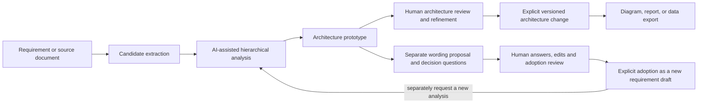
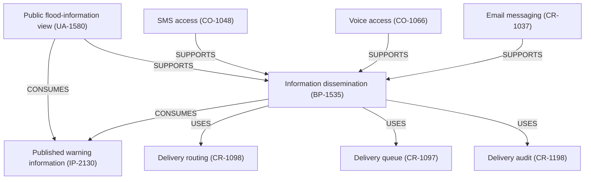
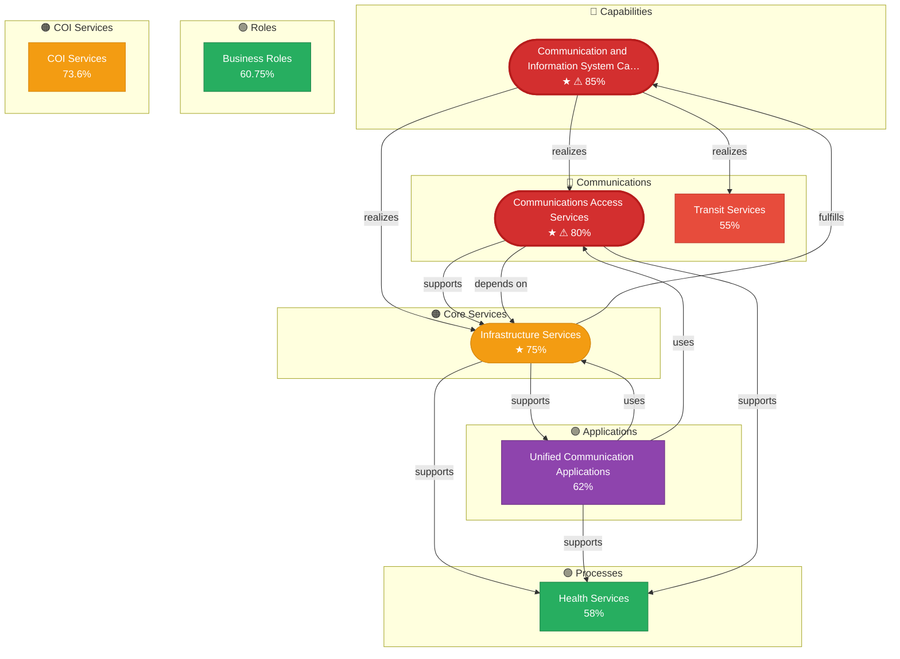
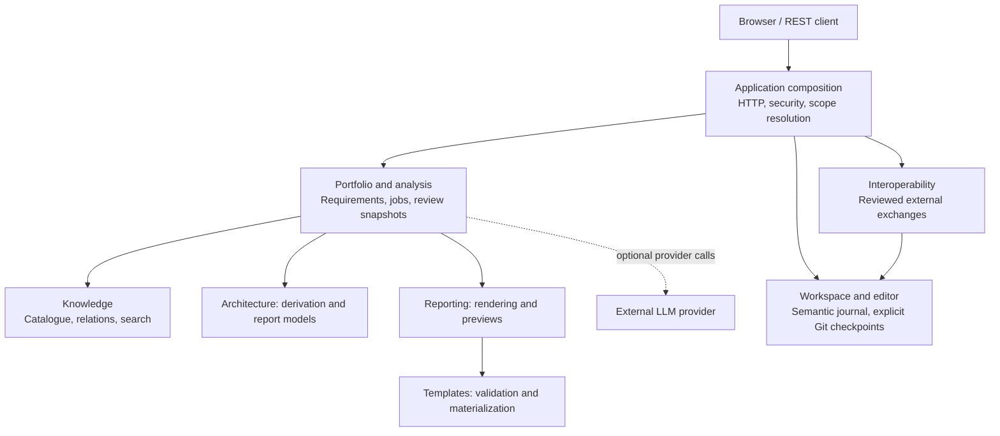

# Taxonomy Architecture Analyzer

[](https://github.com/carstenartur/Taxonomy/actions/workflows/ci-cd.yml)
[](https://carstenartur.github.io/Taxonomy/coverage/)
[](https://carstenartur.github.io/Taxonomy/tests/surefire-report.html)
[](LICENSE)
[](https://github.com/carstenartur/Taxonomy/dependency-graph/sbom)
[](https://zenodo.org/badge/latestdoi/1172765819)
[](https://github.com/carstenartur/Taxonomy/releases/latest)

**Turn requirements and source documents into reviewable architecture proposals for planning and procurement, with AI assistance and human control.**

Taxonomy Architecture Analyzer uses hierarchical AI-assisted analysis to turn requirements, regulations, and source documents into plausible cross-layer architecture prototypes. It traverses the architecture catalogue, scores relevant paths, proposes elements and relations, and produces inspectable views and exportable models.

The primary goal is to shorten the path from an unstructured need to a useful first architecture model by automating much of the initial catalogue analysis and model construction. The result is deliberately a prototype rather than an authoritative decision: scores, rationales, source mappings, proposals, and accepted changes remain reviewable, attributable, comparable, refinable, versioned, and reversible.

By externalizing taxonomy paths, scores, relations, provenance, and history, the workbench also reduces the amount of architecture context users must reconstruct and keep in mind at once.

Taxonomy is intended for planning and procurement in federal, state and local
public administration and in larger enterprises worldwide. It helps make needs,
components, relationships and responsibilities explicit so that participants can
review a shared model and retain the reasons for changes.

## Why use Taxonomy?

Taxonomy connects architecture prototyping with **requirement clarification**:
inspect a proposed architecture, work through evidence-linked decision questions,
review a separate wording proposal, and explicitly adopt a new requirement draft.
A separately requested analysis can then use that draft and its inherited decisions.
The original text and earlier analysis remain available; generated wording is not
silently treated as an approved requirement or an accepted architecture change.

The value is the connected workflow, not a claim that AI, Git, or diagrams are
exclusive to this product:

- **Clarify the need:** bottom-up formulations and cross-taxonomy review connect
  wording and decision questions to the selected architecture evidence.
- **Retain the reasons:** saved proposals and historical exports retain the source,
  snapshot and decisions used at that time instead of reinterpreting them against
  today's catalogue.
- **Control the work:** choose taxonomy roots and full or taxonomies-only analysis;
  distinguish completed, excluded and unresolved work, and reuse validated answers
  when resuming a compatible run.

Start with the browser workflows in the [English user guide](docs/en/USER_GUIDE.md)
or [German user guide](docs/de/USER_GUIDE.md). The [reformulation contract](docs/features/requirement-reformulation.md)
and [verification boundaries](docs/testing/requirement-reformulation.md) describe
what is implemented and what has not been established by live-model evaluation.

## Planning and procurement

Procurement brings together people who understand different parts of a need.
Taxonomy aims to make their assumptions, dependencies and open questions visible
before those details become difficult or expensive to change.

| Planning question | How the workbench helps |
|---|---|
| What do we need, and what remains unclear? | Retains requirements and source evidence, proposes clarification questions and keeps adopted wording as a separate version |
| Which parts must work together? | Makes proposed components and relationships inspectable in a shared architecture model |
| Which roles and responsibilities need agreement? | Places business roles, processes and recorded ownership alongside the affected elements for human review |
| Why was the plan changed? | Keeps reviewed proposals, decisions, model history and contextual exports available for later work |

The intended scope includes goods, services and organizational changes, such as
vehicle procurement, building operations or shared services. These are possible
application domains, not claims of completed field trials. The current analysis
uses the C3 catalogue and its capabilities, roles, processes, information,
applications and services; each new domain needs suitable concepts and reviewed
mappings. Existing IT-oriented examples demonstrate particular workflows rather
than defining the project's audience.

The expected benefits are less duplicated clarification, earlier discovery of
gaps, better coordination and more understandable decisions. Effects on costs,
processing time and public accountability still need evaluation in actual use.
External-system connections can add current-state data; development and initial
evaluation can also use entered requirements and public or authored examples.

See the concepts guide in [English](docs/en/CONCEPTS.md#planning-procurement-and-architecture)
or [German](docs/de/CONCEPTS.md#planung-beschaffung-und-architektur) for the
relationship between requirements, projects and enduring architecture models.

## What the application provides

| Capability | Description |
|---|---|
| Rapid architecture prototyping | Derives candidate cross-layer architecture elements, relations, and views from requirements and source documents |
| Hierarchical analysis trace | Preserves assessed roots, intermediate nodes, leaves, paths and rationales; unvisited or unselected nodes are not negative findings |
| Selectable analysis and recovery | Select roots and FULL/TAXONOMIES_ONLY mode; retain scope, completed work and validated answers during compatible continuation |
| Architecture views | Builds cross-layer views from selected elements and typed relations |
| Traceable source import | Extracts bounded candidates from PDF and DOCX sources and links accepted requirements to source versions and fragments |
| Requirement reformulation | Produces a saved wording proposal with traceable decision questions, explicit draft adoption and historical JSON/Markdown/HTML/DOCX exports; see the [workflow](docs/features/requirement-reformulation.md) and [verification boundaries](docs/testing/requirement-reformulation.md) |
| Versioned architecture DSL | Keeps explicit DSL checkpoints in JGit and durable semantic editor revisions in a separate operation journal; supports branches, diffs, merges, reverts, and selective transfer |
| Search | Provides full-text search and optional local ONNX vector search through Hibernate Search and Lucene |
| Multi-user workspaces | Separates personal workspaces from the shared architecture repository |
| Export | Produces machine-readable architecture outputs and configurable decision reports (Word/HTML/JSON), including selected taxonomies, compact profiles and readable landscape trees; see the illustrated guide ([English](docs/en/USER_GUIDE.md#configurable-decision-report), [Deutsch](docs/de/USER_GUIDE.md#configurable-decision-report)) and [scope and format contracts](docs/testing/contextual-exports.md) |
| Pluggable AI | Supports configured generative providers and optional local ONNX embeddings for search/scoring; local embeddings are not a generative relationship or reformulation model |

## Typical workflow



AI-generated scores, relations, and architecture prototypes are proposals, not authoritative decisions. Users remain responsible for reviewing rationales, source mappings, and model content before accepting them.

Adoption does not automatically run another analysis or modify the architecture.
Completing the planned work does not prove semantic completeness. Technical tests
and retained evidence do not establish superior results against another product.
Local ONNX cannot complete generative relationship assessment or wording synthesis.

Portable backup/history/restore work is still being integrated; it is not a released
end-to-end backup or round-trip contribution workflow merely because supporting
capture adapters exist. Check the exact deployed version and documented support
boundary before relying on it.

## Requirement-based architecture example

The **Flood information and subscriptions** scenario starts with a public view of
published warnings and observations, area subscriptions, SMS/phone/email delivery,
account management and visible data freshness. Its explicitly added test assumption
requires durable delivery work, idempotent retries, protection and an audit trail.

The following focus view selects actual directed relationships from the
[captured architecture snapshot](taxonomy-tooling/src/test/resources/scenario-documents/complete-flood-v1/architecture.json.gz).
Functional labels are shortened for readability; catalogue IDs, relation types and
directions are retained. It is an editorial view of saved output, not a new analysis
or the complete graph.



The saved evidence separates the public-reading, subscriber-delivery and
reliable-delivery contributions of `BP-1535`. The application reads existing warning
information; the delivery process uses routing, queueing and audit services, while
the selected channels support delivery. Queue durability and idempotency are
explicit requirements in the evidence, not properties proved by the queue's name.

The captured result, dated **19 October 2026**, has **50 displayed nodes and 36
relationships** and remains **PARTIAL**. One unresolved question asks whether the
incoming F5 observation batch is already a Recognized Environmental Picture or its
product identity is unspecified. Optional choices and open dependencies remain
inspectable in the full evidence.

**Evidence boundary:** the application pipeline produced the saved snapshot using
authored model HTTP responses. These are not responses captured from a live model.
The [run receipt](taxonomy-tooling/src/test/resources/scenario-documents/complete-flood-v1/run.json.gz)
records the source revision and mock boundary. This example demonstrates retained
functional architecture and traceability, not a new CI pass, live-model quality or
an approved physical implementation.

Follow the worked example in [English](docs/en/EXAMPLES.md#1-requirement--architecture)
or [German](docs/de/EXAMPLES.md#1-anforderung--architektur). The
[scenario guide](docs/testing/scenario-acceptance.md) explains reproduction and
acceptance; the [independent reference](docs/qa/scenario-reference-review.md)
explains required functions, permitted additions and open decisions.

<details>
<summary>Earlier hospital exporter fixture</summary>

### Architecture Impact Showcase

This deterministic hospital fixture supplies hand-authored scores and catalogue
seed relations to the architecture-view and Mermaid export pipeline. It makes no
LLM call and exercises the earlier score/propagation path. The current default
analysis builds its view from requirement-scoped relationship evidence instead.
The existing drift test continues to compare the block below with exporter output;
it does not measure model quality or the newer analysis path.



> **Legend:** ★ = direct match · ⚠ = impact hotspot (≥ 80%) · rounded nodes = anchors/hotspots · percentages = relevance score · arrow labels = relation type

</details>

## Quick start

### Requirements

- Java 25
- Docker for integration and browser verification profiles
- Git

Use the checked-in Maven Wrapper. A separately installed Maven version is neither required nor recommended.

```bash
git clone https://github.com/carstenartur/Taxonomy.git
cd Taxonomy
./mvnw -pl taxonomy-app -am package -DskipTests
java -Dloader.path=taxonomy-app/target/features -jar taxonomy-app/target/taxonomy-app-*.jar --taxonomy.plugins.directory=taxonomy-app/target/plugins
```

Open `http://localhost:8080`. Run these commands from the repository root; the
feature and plugin directories contain the artifacts staged by Maven.

On a new local database, the application creates the `admin` account with a **random one-time bootstrap password** in a uniquely named owner-only temporary file. The startup log contains only the file path. Read the file once, sign in, and replace the password immediately; the application removes the file after the committed administrator password change. No reusable password is published in this repository.

To provide the initial password explicitly for local development:

```bash
export TAXONOMY_ADMIN_PASSWORD='use-a-unique-local-development-secret'
./mvnw -pl taxonomy-app -am package -DskipTests
java -Dloader.path=taxonomy-app/target/features -jar taxonomy-app/target/taxonomy-app-*.jar --taxonomy.plugins.directory=taxonomy-app/target/plugins
```

To browse without loading or downloading the embedding model:

```bash
export TAXONOMY_EMBEDDING_ENABLED=false
./mvnw -pl taxonomy-app -am package -DskipTests
java -Dloader.path=taxonomy-app/target/features -jar taxonomy-app/target/taxonomy-app-*.jar --taxonomy.plugins.directory=taxonomy-app/target/plugins
```

The local command starts plain HTTP on port 8080. Do not expose that port directly to the internet.

## Production deployment

The supported production example places Caddy in front of the application, enables automatic HTTPS, keeps application port 8080 inside the Docker network, and stores application state in named volumes.

```bash
cp .env.example .env
# Configure DOMAIN, TAXONOMY_ADMIN_PASSWORD, and optional provider settings.
docker compose -f docker-compose.prod.yml up -d --build
```

In local-user mode, production startup rejects missing, placeholder, or short administrator passwords. Keycloak mode has separate identity-provider configuration requirements. Review the complete deployment and security documentation before exposing an instance outside a trusted development machine.

- [Deployment guide](docs/en/DEPLOYMENT_GUIDE.md)
- [Deployment checklist](docs/en/DEPLOYMENT_CHECKLIST.md)
- [Container image](docs/en/CONTAINER_IMAGE.md)
- [Security](docs/en/SECURITY.md)
- [Configuration reference](docs/en/CONFIGURATION_REFERENCE.md)

## Build and verification

Fast default verification:

```bash
./mvnw verify
```

Canonical Maven CI profile, including integration, browser, quality, coverage, and local ONNX suites:

```bash
./mvnw -B verify -Pci -DrunOnnxTests=true
```

Full reproduction of every required CI check with only Java and Maven installed
is not yet achieved. The remaining runtime and lifecycle gaps are documented in
[Maven Verification Authority](docs/dev/MAVEN_VERIFICATION.md#remaining-gaps-in-the-javamaven-only-provisioning-requirement).

Focused profiles include:

```bash
./mvnw test -Parchitecture-tests -Dsurefire.failIfNoSpecifiedTests=false
./mvnw verify -Pdocument-import-tests -Dsurefire.failIfNoSpecifiedTests=false
./mvnw verify -Parchimate-import-tests -Dsurefire.failIfNoSpecifiedTests=false
./mvnw verify -Pdatabase-postgres
./mvnw verify -Ponnx
./mvnw verify -Pui-tests
```

Without Docker, use the same Spring Boot/HSQLDB scenarios and GUI checks with
matching local Chrome and ChromeDriver binaries:

```bash
CHROME_BIN=/absolute/path/chrome CHROMEDRIVER=/absolute/path/chromedriver ./mvnw verify -Ptest-local
```

See [Docker-free tests and GUI preview](docs/testing/docker-free-tests.md) for
focused runs, screenshots and the coverage retained in the existing CI profiles.

The whole-repository module-extraction gate is owned by `taxonomy-build`, which
is ordered after the application, aggregate coverage, and tooling modules. It
runs in ordinary full-reactor verification and in the root-level
`architecture-tests` profile. Focused selections that
end at `taxonomy-app`, including the Keycloak-only lane, do not run this
whole-reactor inventory; the full reactor remains its enforcement boundary.

The build generates:

- JUnit and Failsafe reports
- aggregate JaCoCo coverage
- browser and accessibility evidence
- CycloneDX SBOM files
- dependency-alignment and supply-chain policy reports

## Architecture

Taxonomy is a **modular monolith built as one executable Spring Boot application**.
The Maven reactor contains twenty child modules: six framework-free foundations, a plugin runtime, an external plugin,
eight runtime feature libraries, the application composition root, and three build/tooling modules.

### How the application fits together

This is **Taxonomy's own application architecture**, not an architecture model
produced by the workbench. Arrows describe logical collaboration, not a complete
Maven dependency graph. The diagram shows the default local execution mode.
The same application image also supports optional Artemis-based analysis with
separate coordinator and worker processes; Maven modules are not separate services.



The [architecture guide](docs/en/ARCHITECTURE.md) ([Deutsch](docs/de/ARCHITECTURE.md))
separates feature-module dependencies, the requirement workflow, and persistence
responsibilities. It distinguishes immutable analysis snapshots, editable workspace
revisions, the durable semantic journal, and explicit Git checkpoints.

For distributed execution, see [analysis execution](docs/en/ARCHITECTURE.md#analysis-execution-and-deployment)
and the [Artemis operator guide](docs/en/OPERATIONS_GUIDE.md#external-artemis-analysis-operations).
The database retains durable operation state; the external broker delivers tasks
to workers, which can be assigned selected taxonomy roots. This does not make
every web session or background job safe for multiple web replicas.

The [plugin guide](docs/dev/07-extension-points.md) describes built-in and external
capabilities, the shared catalog and startup versus dynamic lifecycle rules.

### Module inventory

| Module | Responsibility |
|---|---|
| `taxonomy-domain` | Framework-free shared architecture and analysis types |
| `taxonomy-dsl` | Framework-free DSL syntax, parsing, mapping, semantic diff, and model processing |
| `taxonomy-export` | Framework-free export contracts, codecs, and neutral rendering |
| `taxonomy-extension-api` | Framework-free extension interfaces and metadata |
| `taxonomy-extension-runtime` | Atomic plugin catalog, artifact validation and private classloader |
| `taxonomy-mermaid-plugin` | Independently built external Mermaid adapter |
| `taxonomy-reporting-api` | Framework-free complete snapshot-bound report models |
| `taxonomy-templates-api` | Framework-free generic template management and contribution ports |
| `taxonomy-workspace` | Repository/workspace identity, versioning, editor operation journal, undo/redo, Git checkpoints, and JGit storage |
| `taxonomy-knowledge` | Catalogue and seeds, relations and hypotheses, search, indexes, and local embeddings |
| `taxonomy-templates` | Versioned document templates, OOXML validation, materialization, WebDAV, and template administration |
| `taxonomy-interop` | External-tool connectors, reviewed exchange, identity mappings, and synchronization checkpoints |
| `taxonomy-architecture` | Architecture derivation, scoring, gaps, patterns, recommendations, diagrams, and reports |
| `taxonomy-reporting` | Report renderers, layouts, template contributions, preview and health |
| `taxonomy-analysis` | Requirement/LLM analysis, provider gateways, prompts and policies, parsing, and analysis sessions |
| `taxonomy-portfolio` | Projects, versioned requirements, analysis jobs/results, reviews, recovery, and workbench snapshots |
| `taxonomy-app` | The only executable application: Spring wiring, cross-context HTTP/UI composition, security/observability, deployment configuration, and database migrations |
| `taxonomy-tooling` | Build and release tooling; not a runtime feature library |
| `taxonomy-coverage` | Reactor-wide coverage aggregation |
| `taxonomy-build` | Authoritative quality gates, whole-reactor checks, and browser verification |

Feature libraries do not depend back on `taxonomy-app`; the runtime module dependency
graph is acyclic. The supporting preferences and provenance contexts deliberately remain
in the application for now. This split does not introduce microservices or claim that every
internal package cycle has been removed.

Owned unit tests move with each feature library. Cross-context application, database,
security, and recovery tests remain with the application. Maven/architecture checks enforce
module ownership and dependency direction; packaging checks verify the feature libraries,
unique runtime classes/resources, and application-owned migrations in the executable JAR.

See the [module boundaries](docs/en/MODULE_BOUNDARIES.md)
([Deutsch](docs/de/MODULE_BOUNDARIES.md)) and the
[#628 completion scope](docs/dev/MODULE_EXTRACTION_COMPLETION.md) for the detailed ownership
and verification contracts.

Important implementation choices:

- Java 25 and Spring Boot
- Hibernate ORM and Hibernate Search
- Lucene full-text and vector indexes
- JGit-backed architecture history
- database-backed logical Git repositories through `jgit-storage-hibernate`
- DJL and ONNX Runtime for optional local embeddings
- Thymeleaf-based web UI
- Testcontainers for reproducible external-system integration tests
- Playwright for cross-browser and accessibility verification

See [Architecture](docs/en/ARCHITECTURE.md) for component boundaries and [Repository topology](docs/en/REPOSITORY_TOPOLOGY.md) for workspace and shared-repository behavior.

## Architecture history and collaboration

Accepted semantic editor operations are durable revisions with their own audit
and undo/redo history. They are **not one Git commit per operation**. A Git commit
is an explicit, stable checkpoint; an immutable analysis/workbench snapshot is a
separate result selected for review or snapshot-bound export.

Architecture content is stored as a purpose-built textual DSL rather than as opaque serialized UI state. This enables:

- human-readable review
- semantic and textual comparison
- named variants
- shared and personal workspaces
- merge and conflict detection
- revert and restoration
- selective transfer of individual changes
- traceability from source material to accepted architecture content

External canonical repositories can be integrated through JGit transport. Synchronization uses commit ancestry and three-way merge semantics; rejected pushes and merge conflicts are reported instead of being presented as success.

See [Git integration](docs/en/GIT_INTEGRATION.md) and [Workspace and versioning guide](docs/en/WORKSPACE_VERSIONING.md).

## Document import and provenance

PDF and DOCX processing is bounded by upload size, PDF page count, expanded archive size, extracted text length, and candidate count. ZIP-bomb checks are performed before Apache POI expands DOCX content.

Document registration and candidate confirmation are transactional. A failed operation does not leave a partially created provenance graph, and repeating the same candidate confirmation is idempotent.

## AI and local operation

For the actual grouping criteria, score calculations, limitations and rationale for each of the eight sub-taxonomies, see [Grouping and scoring](docs/en/TAXONOMY_SCORING.md) ([Deutsch](docs/de/TAXONOMY_SCORING.md)). It separates implemented arithmetic, remaining navigation/provenance restrictions, and relevance from necessity.

Generative analysis can use a configured hosted provider or a self-hosted model
server through `CUSTOM_OPENAI`. The model server is a separate service; Taxonomy
does not bundle a generative LLM in its application image. Provider configuration
is optional for catalogue browsing, DSL editing, version navigation, deterministic
validation, and many search and export functions.

A smaller generative model can support development of workflows, review controls,
persistence, exports and failure handling even when its architecture proposals
need substantial correction. Choose a development model that supports the
required response contract and representative input sizes. Evaluate architectural
completeness and usefulness separately, including comparisons with more capable
models when available. Neither a high-end GPU nor a particular provider is a
general prerequisite for contributing to these application features.

For self-hosted generative analysis, start a compatible model server and configure
`LLM_PROVIDER=CUSTOM_OPENAI`, `CUSTOM_LLM_URL` and `CUSTOM_LLM_MODEL`.
See [AI providers and development evaluation](docs/en/AI_PROVIDERS.md#development-and-result-quality)
([Deutsch](docs/de/AI_PROVIDERS.md#entwicklung-und-ergebnisqualität)) and the
[custom model-server guide](docs/dev/custom-llm.md) for the protocol, context
limits, network configuration and authentication.

Local ONNX embeddings are a separate capability for similarity scoring and
semantic search. They do not generate relation assessments or requirement wording.
To use local embedding-based scoring on its own:

```bash
export LLM_PROVIDER=LOCAL_ONNX
export TAXONOMY_EMBEDDING_ENABLED=true
export TAXONOMY_EMBEDDING_MODEL_PROFILE=MULTILINGUAL_MINILM_L12
export TAXONOMY_EMBEDDING_MODEL_DIR=/absolute/path/to/multilingual-minilm
export TAXONOMY_EMBEDDING_ALLOW_DOWNLOAD=false
```

The default local model supports German and English retrieval. Provision its
pinned files with `.github/scripts/download-embedding-model.sh`; inference can
then run offline. Existing BGE installations must explicitly select
`TAXONOMY_EMBEDDING_MODEL_PROFILE=BGE_SMALL_EN`. See
[model provisioning and migration](docs/testing/multilingual-model-provisioning.md).

When using a generative LLM together with local semantic search, keep its
`LLM_PROVIDER` selection and enable the embedding settings separately. Functional
tests with prepared responses establish software behavior; they do not establish
live-model quality. See the [evaluation plan](docs/research/evaluation.md).

For deployment provenance and model-policy details, see:

- [AI transparency](docs/en/AI_TRANSPARENCY.md)
- [Digital sovereignty](docs/en/DIGITAL_SOVEREIGNTY.md)
- [Data protection](docs/en/DATA_PROTECTION.md)

## Security model

The application supports local form login and a Keycloak/OIDC profile. Authorization distinguishes read-only users, architects, and administrators. State-changing architecture, provenance, workspace, prompt, and administrative operations are protected independently of UI visibility.

Production deployments should:

- use HTTPS through a trusted reverse proxy;
- use a unique administrator credential or Keycloak;
- keep secrets in deployment secret storage rather than source files;
- disable public Swagger access unless explicitly required;
- restrict database, index, backup, and Git-storage access;
- monitor authentication, authorization, and audit events;
- review generated SBOM and vulnerability-assessment evidence.

Report security issues according to [SECURITY.md](SECURITY.md).

## Accessibility

The UI is tested across roles, browsers, viewport sizes, zoom levels, forced-colour mode, text spacing, dialogs, and representative loading, empty, offline, error, and conflict states.

See [Accessibility](docs/en/ACCESSIBILITY.md) for the evidence matrix, manual checks, and known limitations.

## Documentation

| Document | Purpose |
|---|---|
| [User guide](docs/en/USER_GUIDE.md) | Main workflows and UI concepts |
| [Concepts and planning scope](docs/en/CONCEPTS.md) / [Deutsch](docs/de/CONCEPTS.md) | Requirements, responsibilities, projects and architecture models |
| [AI providers](docs/en/AI_PROVIDERS.md) / [Deutsch](docs/de/AI_PROVIDERS.md) | Hosted/self-hosted generative models, embeddings and development versus result quality |
| [API reference](docs/en/API_REFERENCE.md) | REST endpoints and integration details |
| [Architecture](docs/en/ARCHITECTURE.md) | Components, boundaries, and runtime design |
| [Configuration reference](docs/en/CONFIGURATION_REFERENCE.md) | Environment variables and profiles |
| [Database setup](docs/en/DATABASE_SETUP.md) | Supported database configurations |
| [Artemis Kubernetes setup (Deutsch)](docs/de/ARTEMIS_SETUP.md) | Persistent broker, TLS/Secrets, one coordinator and one worker, installation and verification |
| [Repository topology](docs/en/REPOSITORY_TOPOLOGY.md) | Shared repository and workspace routing |
| [Git integration](docs/en/GIT_INTEGRATION.md) | Versioning and external repository behavior |
| [Sparx EA exchange](docs/features/sparx-integration.md) / [Deutsch](docs/features/sparx-integration-de.md) | Experimental reviewed XMI subset, mapping and explicit compatibility limits |
| [Security](docs/en/SECURITY.md) | Authentication, authorization, and deployment controls |
| [AI transparency](docs/en/AI_TRANSPARENCY.md) | AI usage, limitations, and operator responsibilities |
| [Accessibility](docs/en/ACCESSIBILITY.md) | Accessibility scope and verification |

German documentation is available under [`docs/de`](docs/de/).

## Project status

The project is under active development. Compatibility, persistence, security, and migration behavior should be evaluated against the release notes and the exact version deployed. Do not infer production readiness solely from a successful demonstration or an individual quality badge.

Open defects and planned improvements are tracked in [GitHub Issues](https://github.com/carstenartur/Taxonomy/issues).

## Contributing

Contributions should keep the Maven Wrapper as the reproducible entry point and include tests at the lowest appropriate layer. Changes to security, repository routing, persistence, synchronization, import, or export behavior require integration coverage for failure and recovery paths.

Before opening a pull request:

```bash
./mvnw verify
```

## Citation

Citation metadata is provided in [CITATION.cff](CITATION.cff). Archived releases can be cited through the DOI badge above.

## License

Taxonomy Architecture Analyzer is licensed under the [MIT License](LICENSE). Third-party catalogues, models, imported documents, and external services may have their own terms; operators are responsible for verifying that their intended use is permitted.
