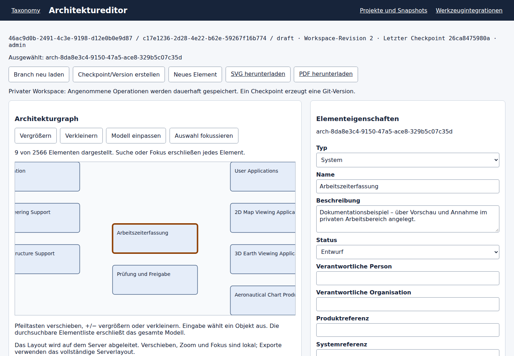
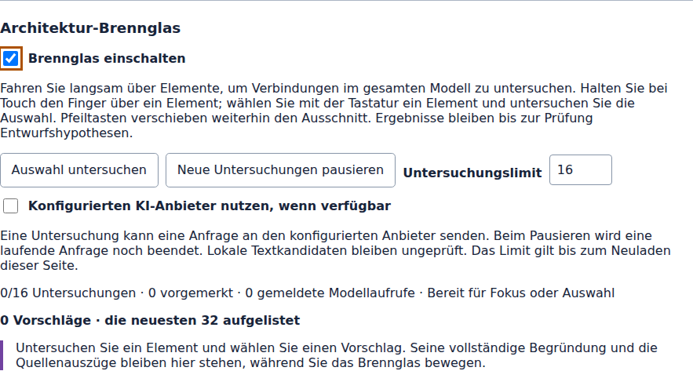

# Architektureditor

Den **Architektureditor** über Projekte oder die Snapshot-Workbench öffnen. Der gemeinsame Kontext zeigt Architektur, Projekt, Anforderung und gewählten Stand. **Technische Details** enthält die exakten Repository-/Workspace-Kennungen, den vollständigen Commit und vorhandene Snapshot-/Versionskennungen. Historische Revisionen/Versionen und zentrale Lesekontexte sind schreibgeschützt. **Privaten Workspace anlegen** erstellt bei passender Repository-Mitgliedschaft eine Arbeitskopie. Zum Bearbeiten ist außerdem die Rolle ARCHITECT oder ADMIN nötig.

*Anwendungsaufnahme eines privaten Beispiel-Workspaces nach dem Anlegen zweier Systemelemente über **Änderung vorschauen → Operation annehmen**. Ausgewählt ist „Arbeitszeiterfassung“. [Quellstand und Bildnachweis](../images/ui-documentation-2026-10-25.json); dieser einzelne Zustand ist keine Abnahme aller Editoraktionen.*

1. Die Elementliste durchsuchen oder ein Objekt im Graph auswählen. Eigenschaften, Relationen, Belege und DSL-Leseansicht folgen derselben Auswahl. Die Seitenadresse enthält den exakten Kontext und das ausgewählte Element.
2. **Neues Element** wählen oder bestehende Eigenschaften bearbeiten. Der Server vergibt neue Identitäten; eine Umbenennung ändert diese nicht. Taxonomiereferenzen und importierte Herkunftsangaben bleiben schreibgeschützt.
3. Eine Begründung eintragen und **Änderung vorschauen** wählen. Die betroffenen Blöcke und die Revision prüfen, dann **Operation annehmen**. Eingabe und Vorschau speichern nichts. **Entwurf verwerfen** stellt die angenommenen Eigenschaften wieder her.
4. Zum Verbinden den Relationstyp und die Identität des Zielelements angeben. Die Auswahl einer Graphkante füllt das Relationsformular. Bei einem vorhandenen Tripel ändert das Formular den Prüfstatus. Der Server lehnt unpassende Richtung/Typen, Duplikate und Selbstbezüge ab. Das Feld für das übergeordnete Element verschiebt oder löst eine Zugehörigkeit; Kreise und mehrere Eltern sind verboten.
5. **Löschung vorschauen** zeigt blockierende Abhängigkeiten. Diese zuerst ausdrücklich entfernen oder neu zuordnen. Es gibt keine verdeckte Kaskadenlöschung.
6. **Rückgängig vorschauen** bzw. **Wiederholen vorschauen** fordert einen neuen protokollierten Gegenbefehl an. Spätere abhängige Änderungen können ihn blockieren. Die Historie übersteht das Neuladen. Text rückgängig machen betrifft nur die Formulareingabe; Git-Revert einer Baseline bleibt ein separater Versionsvorgang.

Jede angenommene Änderung wird mit rekonstruierbaren Invers-Daten, Benutzer und Begründung dauerhaft gespeichert. Sie erhöht die Workspace-Revision und **erzeugt keinen Git-Commit**. Undo/Redo und angenommene Änderungen überstehen Browser-Neuladen und Anwendungsneustart.

Die **Editor-Historie** zeigt einzelne persönliche Operationen, die **Versionshistorie** zeigt Git-Checkpoints separat. **Checkpoint/Version erstellen** speichert mit Begründung den vollständigen Workspace als stabile Git-Version. Bei unverändertem Inhalt entsteht kein weiterer Commit. Nachfolgende Änderungen bleiben dauerhaft im Workspace bis zum nächsten Checkpoint. Publish, Merge, Branch-/Baseline-Erstellung und Restore sichern ausstehende Änderungen an ihrer Versionsgrenze.

Hat sich die Workspace-Revision seit der Vorschau geändert, **Aktualisieren, vergleichen und erneut vorschauen** wählen und ausdrücklich annehmen. Bei Netzwerkfehlern bleibt die Befehlsidentität erhalten. **Ausstehenden Checkpoint fortsetzen** beendet nach dem Neuladen einen unterbrochenen Versionsvorgang ohne doppelten Git-Commit. **Abgeschlossene Version wiederherstellen** gleicht einen abgeschlossenen Versionsschreibvorgang ab, sofern keine neueren uncheckpointeten Änderungen vorliegen. Graph und Suche werden beim Laden aus der kanonischen Quelle aufgebaut.

Graph und Elementliste verwenden dasselbe Servermodell. Die Liste zeigt 50 durchsuchbare Einträge pro Seite; der Graph stellt höchstens 200 Knoten und 400 Kanten gleichzeitig dar. Suche und Fokus erschließen auch Objekte außerhalb des sichtbaren Ausschnitts. Im fokussierten Graph verschieben Pfeiltasten den Ausschnitt, +/− ändern den Zoom. Formulare bieten eine vollständige Tastaturalternative zur Graphauswahl.

SVG und Vektor-PDF verwenden das vollständige deterministische Serverlayout der angezeigten Workspace-Revision oder des Git-Checkpoints, unabhängig von lokalem Zoom und Ausschnitt. Der Editor verwendet derzeit abgeleitetes Layout und eine synchronisierte DSL-Leseansicht. Bearbeitbare DSL-Übersetzung, gespeicherte Layouts, gemeinsames Undo, weitergehende Belegentscheidungen und erweiterte Historie bleiben in [#814](https://github.com/carstenartur/Taxonomy/issues/814) verfolgt. Bestehende Analysesnapshots bleiben unveränderlich.

Technische Entscheidung: [ADR 0005](../adr/0005-private-architecture-editor.md). [English guide](../en/ARCHITECTURE_EDITOR.md).

## Geänderten Git-Stand mit lokaler Arbeit abgleichen

Eine angenommene lokale Operation kann erhalten sein, obwohl ihr Git-Checkpoint
noch nicht abgeschlossen ist. `CHECKPOINT_PENDING` ist keine fertige Git-Version.
Nach einem unterbrochenen Git-Schreibvorgang neu laden und **Ausstehenden Checkpoint
fortsetzen** mit der erhaltenen Absicht verwenden. Das Editordokument nennt diese
als `pendingCheckpointId`. Eine exakte Wiederholung behält dieselbe Befehlsidentität
und führt ihre fachlichen Änderungen nicht erneut aus.

Bei geändertem Git-HEAD **Lokalen und eingehenden Stand abgleichen** verwenden. Wiederholtes Speichern
entscheidet keinen Branch-Konflikt. **Abgeschlossene Version wiederherstellen**
gilt nur, sofern keine neueren uncheckpointeten lokalen Änderungen bestehen.

1. **Vorschau** wählen und Basis, lokalen Arbeitsstand, eingehende
   Git-Quelle und vorgeschlagenes Ergebnis prüfen. Die Vorschau schreibt nichts.
2. Jeden Konflikt lesen und **Lokal behalten** oder **Eingehend übernehmen** auswählen. Jede Entscheidung übernimmt den vollständigen Quellblock
   samt erhaltenen Kommentaren und unbekannten Eigenschaften. Ein gesonderter
   Quellkonflikt kann Dokumentmetadaten betreffen.
3. Ergänzungen und Löschungen prüfen. Eine leere Seite kann einen unterstützten
   Modellblock entfernen, aber keine verwaltete Portfoliohistorie löschen.
4. Nach den Entscheidungen erneut **Vorschau** wählen und die resultierende
   Quelle prüfen. Spätere Änderungen an Auswahl oder Geltungsbereich verwerfen die Annahme.
5. Nur für diese exakte Vorschau **Geprüfte Änderung übernehmen** wählen.
   Ändern sich Workspace-Revision oder Git-HEAD, eine neue Vorschau erstellen und prüfen.

Verwalteter Anforderungstext, Titel, Version und Hash müssen zur portablen aktuellen
unveränderlichen Version passen. Die Quelle einer vorhandenen unveränderlichen
Version darf nicht umgeschrieben werden. Lokale Blöcke behalten und für geänderten
Text eine neue Anforderungsversion anlegen. Lässt die eingehende Quelle verwaltete
Fachblöcke weg, **Lokal behalten** und den ausdrücklichen Archivierungsablauf
verwenden. Unverträgliche Entscheidungen werden abgewiesen; sie ergeben kein
teilweise angenommenes Portfolio. Angenommene Portfolioänderungen und Editorstand
werden zusammen gespeichert, bevor der Git-Checkpoint veröffentlicht wird. Ein
späterer Git-Speicherfehler verwendet weiterhin die oben beschriebene Wiederaufnahme.

Der [API-Vertrag](PROJECT_PORTFOLIO_API.md#editor-version-reconciliation-api)
beschreibt die Bindung an exakte Revision, HEAD und Vorschau-Fingerprint.

## Anforderungsumsetzung prüfen

**Anforderungen, Realisierung und Historie** aufklappen. **Textversion im gewählten Stand** ist
die Anforderungsversion im geladenen Modell; die geprüfte Version ist die exakt
gegen Abhängigkeiten bewertete Fassung. Der aktuelle Anforderungskopf kann daher
Version 2 zeigen, während ein historisches Modell noch Version 1 enthält.
Snapshot-Quellversionen bleiben davon getrennt.

Im aktuellen bearbeitbaren Workspace ursprüngliche Anforderung, beitragendes
Projekt, `OPEN`, `PARTIAL` oder `COMPLETE`, unterstützende Architekturabhängigkeiten
und Begründung wählen. Vorschauen, exakte Version und Änderungen vergleichen und
ausdrücklich annehmen. Teilweise und vollständige Prüfungen benötigen Nachweise.
Relationsendpunkte und Mappingziele werden in die Abhängigkeitsprüfung aufgenommen.
Eine spätere Text- oder Abhängigkeitsänderung ergibt `REVIEW_REQUIRED`; fehlerhafte
Nachweise ergeben `INVALID_EVIDENCE`. Die frühere geprüfte Version bleibt erhalten.
Weder ein KI-Relevanzwert noch ein Projektabschluss ersetzt diese Prüfung.

Dieser angenommene Lifecycle-Beitrag besitzt eine ausdrückliche Git-Checkpoint-Grenze.
Den Veröffentlichungszustand prüfen, bevor er als abgeschlossene Version behandelt
wird. Eine frühere semantische Revision oder ein Git-Checkpoint ist schreibgeschützt
und ohne Überblendung durch das heutige Portfolio. Lifecycle-Bereich, Editor und
gemeinsamer Kontext folgen derselben Standwahl, auch bei Zurück/Vorwärts im Browser.
**Aktuellen Arbeitsstand anzeigen** und **Aktualisieren** laden das zugehörige
Editordokument ebenfalls neu.

Siehe [Architektur-Lifecycle](PROJECT_REQUIREMENT_PORTFOLIO.md#architecture-lifecycle)
und [Anforderungshistorie](PROJECT_REQUIREMENT_PORTFOLIO.md#requirement-history).

## Brennglas und Anordnung

Über **Projekte → Architektureditor** öffnen und unter dem Graphen sowie den
Anordnungsreglern zum Bereich **Architektur-Brennglas** scrollen. Dort das
Kontrollkästchen **Brennglas einschalten** aktivieren. Es ist nur im aktuellen
bearbeitbaren Arbeitsbereich verfügbar; historische Revisionen und zentrale
Lesekontexte erlauben keine Untersuchung.

*Aufnahme des Brennglas-Bedienfelds in einem bearbeitbaren Beispiel-Workspace:
**Brennglas einschalten** ist aktiviert, die KI-Option ist ausgeschaltet.
[Quellstand und Bildnachweis](../images/architecture-editor-focus-capture.json).*

Langsam über Elemente fahren oder ein Element auswählen und **Auswahl untersuchen**
wählen. Bei Touch den Finger kurz über einem Element halten. Der Fokus bestimmt
die Ausgangselemente; mögliche Endpunkte können im gesamten aktuellen Modell
liegen, auch bei neu angelegten Elementen. Pfeiltasten und Zoom bleiben verfügbar,
während das Brennglas die Zeigerbewegung verwendet.

An jedem untersuchten Element ist erkennbar, ob die Untersuchung vorgemerkt, aktiv,
bewertet, ungeprüft, fehlgeschlagen oder veraltet ist. Das voreingestellte Limit
beträgt 16 Untersuchungen pro Seitensitzung und lässt sich von 1 bis 128 einstellen.
**Neue Untersuchungen pausieren** lässt eine laufende Anfrage noch enden. Mit der
KI-Option kann der konfigurierte generative Anbieter verwendet werden. Lokaler
Betrieb sowie nicht verfügbare oder simulierte Anbieter lassen Kandidaten
ausdrücklich ungeprüft. Quellen sind die kanonischen Elementtexte und zugeordneten
Anforderungen; externe Systeme und tatsächlich betriebene Verbindungen werden
dadurch nicht automatisch ermittelt.

Gestrichelte Pfeile und die Vorschlagsliste öffnen einen festen Prüfbereich mit
vollständiger Begründung, Methode, untersuchter Revision und Quellenauszügen.
**Beziehung übernehmen** ist die Bestätigung: Ein protokollierter Befehl speichert
Beziehung, Begründung und Herkunft ohne zweiten Dialog. **Vorschlag verwerfen**
gilt nur für diese Untersuchung. **Rückgängig** verwendet die angenommene Operation;
nach dem Neuladen stehen Rückgängig/Wiederholen in der Historie bereit. Ein erneuter
Versuch nach Netzwerkfehlern behält dieselbe Befehlsidentität. Bei geändertem
Architekturstand veralten andere Vorschläge und müssen vor der Übernahme erneut
untersucht werden. Vorschläge sind vorübergehend, angenommene Beziehungen und
Belege dauerhaft.

**Stabile Reihenfolge** verwendet die bisherige Anordnung. **Kreuzungen reduzieren**
und **Ausdrücklich neu anordnen** berechnen eine deterministische Heuristik ohne
Garantie auf einen kreuzungsfreien Graphen. Die Reihenfolge wird an die gewählte
Arbeitsbereichsrevision gebunden. Übernahme oder Rücknahme einer Beziehung behalten
dadurch Positionen und Ausschnitt bei. Erneutes Anordnen berücksichtigt spätere
Änderungen. Die URL enthält Strategie und Referenzrevision; SVG und PDF verwenden
dieselbe Serveranordnung mit dem aktuell angezeigten Modell. Vorschlagspfeile
werden nicht exportiert.

## Neutrale Pakete und Anforderungszuordnungen

Der Bereich **Pakete** erstellt, benennt, beschreibt, verschiebt und löscht
Organisationsgrenzen ohne Taxonomieelemente oder `CONTAINS`-Beziehungen. Vorschau,
Begründung, exakte Arbeitsbereichsrevision und Rückgängig/Wiederholen verwenden
dasselbe Journal wie die Elementbearbeitung. Paket oder Element, Elternpaket und
Position ab null auswählen; **Ausgewähltes Element lösen** entfernt die Zuordnung.
Vor dem Löschen eines Pakets müssen seine Kinder gelöst werden. Alle Steuerelemente
sind per Tastatur erreichbar.

`SET_PACKAGE_PLACEMENTS` übernimmt einen atomaren Endzustand. `placements` enthält
`{kind: "PACKAGE"|"ELEMENT", memberId, parentPackageId, position}`;
`completeParentScopes` nennt alle berührten alten/neuen Eltern. Eine leere
Elternzeichenfolge bezeichnet die Modellwurzel; null mit Position -1 löst nur ein
Element. Alle Geschwister der berührten Bereiche bleiben ausdrücklich enthalten.
Unabhängige, ungruppierte Elemente müssen nicht aufgelistet werden. Vertauschungen
und Verschiebungen werden gemeinsam geprüft; Zyklen, doppelte/lückenhafte Positionen
und Tiefe über 80 scheitern vor dem Journaleintrag. Paketänderungen erlauben nur
Titel/Beschreibung, keine Umgehung der Platzierungsprüfung.

`UPSERT_REQUIREMENT_MAPPING` verbindet eine echte kanonische Anforderung (`sourceId`)
mit einem Architekturelement (`targetId`) und bewahrt Begründung und begrenzte
`x-exchange-*`-Herkunftsdaten. Analysezuordnungen können nicht überschrieben werden.
`DELETE_REQUIREMENT_MAPPING` entfernt eine Austauschzuordnung. Die Typregeln für
Architekturbeziehungen bleiben unverändert.

## Werkzeugintegrationen

Öffnen Sie **Werkzeugintegrationen** im Architektureditor. Wählen Sie eine Verbindung mit ihrem Formatprofil und prüfen Sie die vorgeschlagenen Änderungen im ausgewählten privaten Arbeitsbereich. Die Vorschau erhält die externe Evidenz, ohne das Modell zu verändern. Übernehmen Sie einen Import erst nach der Prüfung; die Übernahme ändert das Modell und erzeugt eine explizite Version. Die Autorität der Verbindung bestimmt die verfügbaren Austauschoperationen.
