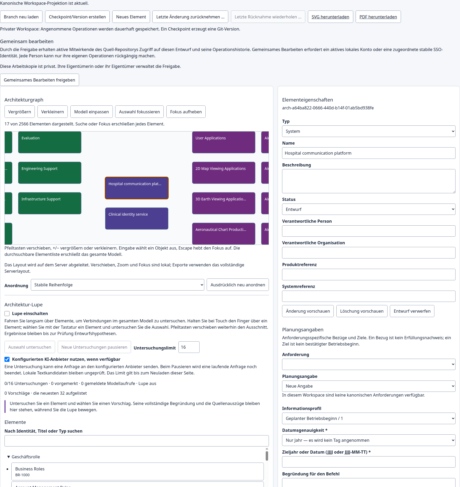

# Architektureditor

**Architektur** in der gemeinsamen Hauptnavigation öffnen und unter **Angezeigte Architektur** die **Arbeitsarchitektur** wählen. Links aus Projekten oder gespeicherten Analysen öffnen denselben Arbeitsbereich mit dem jeweiligen Kontext. Der gemeinsame Kontext zeigt Architektur, Projekt, Anforderung und gewählten Stand. **Technische Details** enthält die exakten Repository-/Workspace-Kennungen, den vollständigen Commit und vorhandene Snapshot-/Versionskennungen. Historische Revisionen/Versionen und zentrale Lesekontexte sind schreibgeschützt. **Privaten Workspace anlegen** erstellt bei passender Repository-Mitgliedschaft eine Arbeitskopie. Zum Bearbeiten ist außerdem die Rolle **ARCHITECT** nötig.

**Aktuelle Analyse**, **Gespeicherter Analysezustand** und **Arbeitsarchitektur**
bezeichnen drei Quellen innerhalb desselben Architekturbereichs. Beim Wechsel
bleiben Analysetext und Ergebnisse sowie zurückgestellte Editorentwürfe erhalten.
Ein anderer Arbeitskontext oder eine andere Elementauswahl darf unangenommene
Formulareingaben erst nach Rückfrage ersetzen. Die Übernahme einer gespeicherten
Analyse bleibt ein ausdrücklicher Vorgang mit Vorschau und Annahme; die Quellwahl
übernimmt keine Elemente oder Beziehungen. Alte Editor- und Workbench-Links führen
mit ihren Quellen- und Versionsangaben in diesen Bereich.

*Anwendungsaufnahme eines privaten Beispiel-Workspaces nach dem Anlegen zweier Systemelemente über **Änderung vorschauen → Operation annehmen**. Ausgewählt ist „Hospital communication platform“; gespeicherte Beispielnamen bleiben in beiden Oberflächensprachen gleich. [Quellstand und Bildnachweis](../images/documentation-screenshots.json); dieser einzelne Zustand ist keine Abnahme aller Editoraktionen.*

1. Die Elementliste durchsuchen oder ein Objekt im Graph auswählen. Eigenschaften, Relationen, Belege und DSL-Leseansicht folgen derselben Auswahl. Die Seitenadresse enthält den exakten Kontext und das ausgewählte Element.
2. **Neues Element** wählen oder bestehende Eigenschaften bearbeiten. Der Server vergibt neue Identitäten; eine Umbenennung ändert diese nicht. Taxonomiereferenzen und importierte Herkunftsangaben bleiben schreibgeschützt.
3. Eine Begründung eintragen und **Änderung vorschauen** wählen. Die betroffenen Blöcke und die Revision prüfen, dann **Operation annehmen**. Eingabe und Vorschau speichern nichts. **Entwurf verwerfen** stellt die angenommenen Eigenschaften wieder her.
4. Zum Verbinden den Relationstyp und die Identität des Zielelements angeben. Die Auswahl einer Graphkante füllt das Relationsformular. Bei einem vorhandenen Tripel ändert das Formular den Prüfstatus. Der Server lehnt unpassende Richtung/Typen, Duplikate und Selbstbezüge ab. Das Feld für das übergeordnete Element verschiebt oder löst eine Zugehörigkeit; Kreise und mehrere Eltern sind verboten.
5. **Löschung vorschauen** zeigt blockierende Abhängigkeiten. Diese zuerst ausdrücklich entfernen oder neu zuordnen. Es gibt keine verdeckte Kaskadenlöschung.
6. **Rückgängig vorschauen** bzw. **Wiederholen vorschauen** fordert einen neuen protokollierten Gegenbefehl an. Spätere abhängige Änderungen können ihn blockieren. Die Historie übersteht das Neuladen. Text rückgängig machen betrifft nur die Formulareingabe; Git-Revert einer Baseline bleibt ein separater Versionsvorgang.

Direkt über dem Graph führen **Letzte Änderung zurücknehmen …** und **Letzte
Rücknahme wiederholen …** zur Vorschau der jeweils letzten passenden eigenen
Operation aus der vollständigen Historie. Die Vorschau muss weiterhin
angenommen werden. Ein vorhandener unangenommener Entwurf wird vor einer möglichen
Verwerfung ausdrücklich angezeigt. Die Serverprüfung kann eine Rücknahme wegen
späterer abhängiger Änderungen ablehnen; eine ältere Operation wird dabei nicht
stillschweigend ausgewählt.

Jede angenommene Änderung wird mit rekonstruierbaren Invers-Daten, Benutzer und Begründung dauerhaft gespeichert. Sie erhöht die Workspace-Revision und **erzeugt keinen Git-Commit**. Undo/Redo und angenommene Änderungen überstehen Browser-Neuladen und Anwendungsneustart.

Die **Editor-Historie** zeigt einzelne persönliche Operationen, die **Versionshistorie** zeigt Git-Checkpoints separat. **Checkpoint/Version erstellen** speichert mit Begründung den vollständigen Workspace als stabile Git-Version. Bei unverändertem Inhalt entsteht kein weiterer Commit. Nachfolgende Änderungen bleiben dauerhaft im Workspace bis zum nächsten Checkpoint. Publish, Merge, Branch-/Baseline-Erstellung und Restore sichern ausstehende Änderungen an ihrer Versionsgrenze.

Hat sich die Workspace-Revision seit der Vorschau geändert, **Aktualisieren, vergleichen und erneut vorschauen** wählen und ausdrücklich annehmen. Bei Netzwerkfehlern bleibt die Befehlsidentität erhalten. **Ausstehenden Checkpoint fortsetzen** beendet nach dem Neuladen einen unterbrochenen Versionsvorgang ohne doppelten Git-Commit. **Abgeschlossene Version wiederherstellen** gleicht einen abgeschlossenen Versionsschreibvorgang ab, sofern keine neueren uncheckpointeten Änderungen vorliegen. Graph und Suche werden beim Laden aus der kanonischen Quelle aufgebaut.

Im **Architekturbaum** öffnet die Suche den Pfad zum Treffer. Unter **Organisationsverzeichnis** eine Abteilung oder ein Referat anlegen und bei Bedarf eine übergeordnete Einheit wählen. Das Verzeichnis gehört zur angezeigten Architekturversion. Die Einträge stehen allen Bearbeitenden derselben Arbeitskopie zur Verfügung.

Bei **Neue Architektur** können Sie einen installierten Projektdatensatz wählen. Er legt die Katalogversion und die mitgelieferten Organisationseinheiten fest. Für einen bestehenden beschreibbaren Arbeitsbereich öffnet **Projektdatensatz importieren** die Vorschau. Sie zeigt, wie viele Einheiten hinzukommen und wie viele anhand ihrer Quellkennungen bereits vorhanden sind. Bereits vergebene Zuständigkeiten bleiben erhalten. Bei Ergänzungen versioniert **Übernehmen** auch die übrigen aktuellen Änderungen des Arbeitsbereichs.

Einen Ast im Baum auswählen, unter **Verantwortliche Organisationseinheit für diesen Ast** die Einheit wählen und die Änderung über die Vorschau übernehmen. Unterelemente erben die nächstgelegene Zuweisung. Eine eigene Zuweisung am Unterast hat Vorrang. **Vom übergeordneten Element erben** entfernt die Ausnahme. Das Formular zeigt, an welchem Element die wirksame Zuständigkeit festgelegt wurde. Vorhandene Freitexteinträge bleiben sichtbar und lassen sich durch eine Einheit aus dem Verzeichnis ersetzen.

Mit **Zuständigkeiten anzeigen** erhält jedes zugewiesene Element im Architektur- und Entscheidungsbaum einen Farbstreifen. Wo die Zuweisung beginnt oder wechselt, steht zusätzlich der Name der Einheit. Im Exportdialog lässt sich die Anzeige auch für den Entscheidungsbericht einschalten. Bei gespeicherten Analysen stammen die Zuständigkeiten aus dem zugehörigen Modellstand. Fehlt dieser Bezug, bleiben die Markierungen aus.

Baum und Graph verwenden dieselbe Auswahl. Der Graph stellt bis zu 200 Knoten und 400 Kanten gleichzeitig dar. Im fokussierten Graph verschieben Pfeiltasten den Ausschnitt, +/− ändern den Zoom.

SVG und Vektor-PDF verwenden das vollständige deterministische Serverlayout der angezeigten Workspace-Revision oder des Git-Checkpoints, unabhängig von lokalem Zoom und Ausschnitt. Der Editor verwendet derzeit abgeleitetes Layout und eine synchronisierte DSL-Leseansicht. Bearbeitbare DSL-Übersetzung, gespeicherte Layouts, gemeinsames Undo, weitergehende Belegentscheidungen und erweiterte Historie bleiben in [#814](https://github.com/carstenartur/Taxonomy/issues/814) verfolgt. Bestehende Analysesnapshots bleiben unveränderlich.

Technische Entscheidung: [ADR 0005](../adr/0005-private-architecture-editor.md). [English guide](../en/ARCHITECTURE_EDITOR.md).

## Architekturänderungen als Paket prüfen

Öffnen Sie in der bearbeitbaren Arbeitsarchitektur **Architekturänderungen als
Paket prüfen**. Wählen Sie ein neues Element, seine gerichtete Relation zu einem
vorhandenen Element und die Anforderung, die dem neuen Element zugeordnet werden
soll. Ausgangspunkt ist ein Git-Checkpoint, der die aktuelle Arbeitsrevision
enthält. Erfassen Sie eine Begründung und prüfen Sie die Vorschau vor der Übernahme.

Die Vorschau zeigt den Git-Zielstand sowie den Zustand jedes betroffenen
Modellblocks vor und nach der Änderung. Die Übernahme speichert das Paket in einem
Git-Checkpoint. Bei einem ungültigen Teilschritt oder geändertem Branch-Stand
ist eine neue Prüfung erforderlich.

Bei der Vorschau einer gespeicherten Analyse steht **Analyse übernehmen und
Checkpoint erstellen** zur Verfügung, wenn die Arbeitsrevision bereits in Git
gespeichert ist. Prüfen Sie die Modelländerungen und den Git-Zielstand in der
Vorschau. Die Übernahme hält den Bezug zur gespeicherten Analyse fest und
schreibt die geprüften Änderungen gemeinsam in Git.

## Eine Arbeitskopie gemeinsam bearbeiten

Arbeitskopien sind zunächst privat. Als Eigentümerin oder Eigentümer wählen Sie
im Abschnitt **Gemeinsam bearbeiten** die Aktion **Gemeinsames Bearbeiten freigeben**, damit
berechtigte Mitwirkende dieselbe Arbeitskopie bearbeiten können. Sie benötigen
eine aktive, ausdrücklich zugewiesene Mitgliedschaft als Mitwirkende im
Quell-Repository, die Rolle **ARCHITECT** und ein aktives lokales Konto
oder eine zugeordnete stabile SSO-Identität. Bearbeiten und Ändern der Freigabe
erfordern **ARCHITECT**; Bearer-API-Aufrufe benötigen zusätzlich den Scope
`architecture:write`.

Kopieren Sie die vollständige Adresse aus dem schreibgeschützten Feld
**Link für berechtigte Mitwirkende** und teilen Sie genau diesen Link. Er öffnet diese
Arbeitskopie für Personen, die bereits die erforderliche Berechtigung besitzen.

**Branch neu laden** lädt die angenommenen Änderungen anderer Mitwirkender. Ihr
ungespeicherter Formularentwurf bleibt erhalten. Nach einem Revisionskonflikt
aktualisieren Sie den Stand, vergleichen ihn mit Ihrem Entwurf und erstellen vor
der Annahme eine neue Vorschau. Rückgängig betrifft eigene angenommene Operationen;
spätere abhängige Änderungen können die Rücknahme verhindern.

Als Eigentümerin oder Eigentümer wählen Sie **Arbeitskopie wieder privat machen**,
um den weiteren Zugriff durch Mitwirkende zu beenden. Bereits angenommene Änderungen
und ihre Operationshistorie bleiben in der Arbeitskopie erhalten.

## Geänderten Git-Stand mit lokaler Arbeit abgleichen

Eine angenommene lokale Operation kann erhalten sein, obwohl ihr Git-Checkpoint
noch nicht abgeschlossen ist. `CHECKPOINT_PENDING` ist keine fertige Git-Version.
Nach einem unterbrochenen Git-Schreibvorgang neu laden und **Ausstehenden Checkpoint
fortsetzen** mit der erhaltenen Absicht verwenden. Das Editordokument nennt diese
als `pendingCheckpointId`. Eine exakte Wiederholung behält dieselbe Befehlsidentität
und führt ihre fachlichen Änderungen nicht erneut aus.

Bei geändertem Git-HEAD **Lokalen und eingehenden Stand abgleichen** verwenden. Wiederholtes Speichern
entscheidet keinen Branch-Konflikt. **Abgeschlossene Version wiederherstellen**
gilt nur, sofern keine neueren uncheckpointeten lokalen Änderungen bestehen.

1. **Vorschau** wählen und Basis, lokalen Arbeitsstand, eingehende
   Git-Quelle und vorgeschlagenes Ergebnis prüfen. Die Vorschau schreibt nichts.
2. Jeden Konflikt lesen und **Lokal behalten** oder **Eingehend übernehmen** auswählen. Jede Entscheidung übernimmt den vollständigen Quellblock
   samt erhaltenen Kommentaren und unbekannten Eigenschaften. Ein gesonderter
   Quellkonflikt kann Dokumentmetadaten betreffen.
3. Ergänzungen und Löschungen prüfen. Eine leere Seite kann einen unterstützten
   Modellblock entfernen, aber keine verwaltete Portfoliohistorie löschen.
4. Nach den Entscheidungen erneut **Vorschau** wählen und die resultierende
   Quelle prüfen. Spätere Änderungen an Auswahl oder Geltungsbereich verwerfen die Annahme.
5. Nur für diese exakte Vorschau **Geprüfte Änderung übernehmen** wählen.
   Ändern sich Workspace-Revision oder Git-HEAD, eine neue Vorschau erstellen und prüfen.

Die vier Diagramme verwenden eine gemeinsame Anordnung der Objektidentitäten.
Umbenennungen und Typänderungen verschieben das Objekt dadurch nicht zwischen den
Ansichten. Gelöschte Objekte bleiben in den Ständen sichtbar, die sie enthalten.
Ein ausgewähltes Objekt hebt seine Eigenschaftszeilen hervor. Die Tabelle trennt
Modellbedeutung, Änderungen an Ansichten und Anordnung sowie Austauschnachweise.
Unbekannte wiederholte Eigenschaften behalten alle Werte. Die aufklappbaren
vollständigen Quellen zeigen auch Kommentare und Dokumentmetadaten, die ein
Diagramm nicht abbildet. Solange Entscheidungen offen sind, ist das vorgeschlagene
Modell ausdrücklich noch nicht verfügbar. Änderungen an Begründung oder Auswahl
und ein Wechsel des gewählten Kontexts verwerfen den angezeigten Vergleich und
erfordern eine neue Vorschau.

Verwalteter Anforderungstext, Titel, Version und Hash müssen zur portablen aktuellen
unveränderlichen Version passen. Die Quelle einer vorhandenen unveränderlichen
Version darf nicht umgeschrieben werden. Lokale Blöcke behalten und für geänderten
Text eine neue Anforderungsversion anlegen. Lässt die eingehende Quelle verwaltete
Fachblöcke weg, **Lokal behalten** und den ausdrücklichen Archivierungsablauf
verwenden. Unverträgliche Entscheidungen werden abgewiesen; sie ergeben kein
teilweise angenommenes Portfolio. Angenommene Portfolioänderungen und Editorstand
werden zusammen gespeichert, bevor der Git-Checkpoint veröffentlicht wird. Ein
späterer Git-Speicherfehler verwendet weiterhin die oben beschriebene Wiederaufnahme.

Der [API-Vertrag](PROJECT_PORTFOLIO_API.md#editor-version-reconciliation-api)
beschreibt die Bindung an exakte Revision, HEAD und Vorschau-Fingerprint.

## Anforderungsumsetzung prüfen

**Anforderungen, Realisierung und Historie** aufklappen. **Textversion im gewählten Stand** ist
die Anforderungsversion im geladenen Modell; die geprüfte Version ist die exakt
gegen Abhängigkeiten bewertete Fassung. Der aktuelle Anforderungskopf kann daher
Version 2 zeigen, während ein historisches Modell noch Version 1 enthält.
Snapshot-Quellversionen bleiben davon getrennt.

Im aktuellen bearbeitbaren Workspace ursprüngliche Anforderung, beitragendes
Projekt, `OPEN`, `PARTIAL` oder `COMPLETE`, unterstützende Architekturabhängigkeiten
und Begründung wählen. Vorschauen, exakte Version und Änderungen vergleichen und
ausdrücklich annehmen. Teilweise und vollständige Prüfungen benötigen Nachweise.
Relationsendpunkte und Mappingziele werden in die Abhängigkeitsprüfung aufgenommen.
Eine spätere Text- oder Abhängigkeitsänderung ergibt `REVIEW_REQUIRED`; fehlerhafte
Nachweise ergeben `INVALID_EVIDENCE`. Die frühere geprüfte Version bleibt erhalten.
Weder ein KI-Relevanzwert noch ein Projektabschluss ersetzt diese Prüfung.

Dieser angenommene Lifecycle-Beitrag besitzt eine ausdrückliche Git-Checkpoint-Grenze.
Den Veröffentlichungszustand prüfen, bevor er als abgeschlossene Version behandelt
wird. Eine frühere semantische Revision oder ein Git-Checkpoint ist schreibgeschützt
und ohne Überblendung durch das heutige Portfolio. Lifecycle-Bereich, Editor und
gemeinsamer Kontext folgen derselben Standwahl, auch bei Zurück/Vorwärts im Browser.
**Aktuellen Arbeitsstand anzeigen** und **Aktualisieren** laden das zugehörige
Editordokument ebenfalls neu.

Siehe [Architektur-Lifecycle](PROJECT_REQUIREMENT_PORTFOLIO.md#architecture-lifecycle)
und [Anforderungshistorie](PROJECT_REQUIREMENT_PORTFOLIO.md#requirement-history).

## Architektur-Lupe und Anordnung

Unter **Architektur** zunächst die angezeigte Quelle prüfen. Die Lupe der Analyse
öffnet die Untersuchung in diesem Bereich und behält Analysetext und Auswahl bei.
Bei **Aktuelle Analyse** wird der dargestellte Analyseentwurf vor der Untersuchung
gespeichert und seine bestätigte Version geprüft. Bei **Gespeicherter Analysezustand**
untersucht die Lupe den exakt ausgewählten Snapshot. Beide Quellen bleiben
unverändert. Fehlt eine vollständige gespeicherte Quelle, zeigt die Anwendung den
Grund; **Quelle aktualisieren** prüft den Stand erneut.

Der Bereich **Beziehungsvorschläge** zeigt die zum gewählten Architekturstand
passenden Vorschläge. Wählen Sie im Diagramm ein Element, öffnen Sie dort die
**Architektur-Lupe** und klicken Sie auf **Auswahl untersuchen**. Direkt am
Diagramm können Sie auch **Beim Zeigen auf Elemente untersuchen** einschalten.
Mögliche Endpunkte liegen im gesamten angezeigten Modell.

Eine Untersuchung verwendet standardmäßig lokale Texte. Wenn Sie
**Konfigurierten KI-Anbieter nutzen, wenn verfügbar** wählen, kann eine Anfrage
an den konfigurierten Anbieter gesendet werden. Das Limit beträgt 16
Untersuchungen pro Seite und lässt sich auf 1 bis 128 einstellen. Beim Pausieren
endet eine laufende Anfrage regulär.

Klicken Sie auf einen Vorschlag oder einen gestrichelten Pfeil, um Richtung,
Begründung und Quellenauszüge zu prüfen. **Quelle und Methode** zeigt die
technischen Belege zum untersuchten Stand. Beim Analyseentwurf und beim
gespeicherten Snapshot können Sie den Vorschlag verwerfen oder zum anderen Element
wechseln. Die Aktion **Vorschau zur Übernahme öffnen** am Snapshot öffnet
die Übernahmevorschau für den vollständigen gespeicherten Stand.

In der aktuellen bearbeitbaren **Arbeitsarchitektur** öffnet
**Änderungsvorschau öffnen** eine fachliche Vorschau mit Namen, Richtung und
Belegen. Für eine gemeinsame Übernahme markieren Sie die gewünschten Vorschläge
in der Liste und öffnen die Vorschau für die Auswahl. Erst die Bestätigung
speichert alle ausgewählten Beziehungen mit ihren jeweiligen Begründungen und
Belegen. **Rückgängig** stellt die gesamte bestätigte Änderung zur Vorschau.
Bei einem veralteten Vorschlag untersuchen Sie das Element am neuen Stand
erneut. Angenommene Beziehungen und ihre Belege bleiben dauerhaft gespeichert.

**Stabile Reihenfolge** verwendet die bisherige Anordnung. **Kreuzungen reduzieren**
und **Ausdrücklich neu anordnen** berechnen eine deterministische Heuristik ohne
Garantie auf einen kreuzungsfreien Graphen. Die Reihenfolge wird an die gewählte
Arbeitsbereichsrevision gebunden. Übernahme oder Rücknahme einer Beziehung behalten
dadurch Positionen und Ausschnitt bei. Erneutes Anordnen berücksichtigt spätere
Änderungen. Die URL enthält Strategie und Referenzrevision; SVG und PDF verwenden
dieselbe Serveranordnung mit dem aktuell angezeigten Modell. Vorschlagspfeile
werden nicht exportiert.

## Fragen zum angezeigten Modellstand

Öffnen Sie im Arbeitsbereich **Architektur** die gewünschte Analyse, einen gespeicherten Snapshot, einen Git-Checkpoint oder die aktuelle Arbeitsrevision. Klappen Sie **Fragen zu dieser Architektur** auf und fragen Sie beispielsweise „Welche Dienste unterstützen die Rechnungsprüfung?“ oder „Welche dieser Zuordnungen sind noch offen?“. Eine Anschlussfrage kann sich auf die vorherige Antwort beziehen.

**Modellbelege anzeigen** öffnet die Modellstellen, auf die sich die jeweilige Aussage stützt. Unter jeder Antwort stehen der verwendete Anbieter und der Umfang des ausgewählten Ausschnitts. Die Antworten sind eine KI-Interpretation des angezeigten Stands. Der Wechsel des Modellstands leert den Dialog. Für einen eigenen vLLM-Endpunkt verwenden Sie den vorhandenen OpenAI-kompatiblen Anbieter. Der Dialog erfordert die Berechtigung zur Analyseausführung.

## Neutrale Pakete und Anforderungszuordnungen

Der Bereich **Pakete** erstellt, benennt, beschreibt, verschiebt und löscht
Organisationsgrenzen ohne Taxonomieelemente oder `CONTAINS`-Beziehungen. Vorschau,
Begründung, exakte Arbeitsbereichsrevision und Rückgängig/Wiederholen verwenden
dasselbe Journal wie die Elementbearbeitung. Paket oder Element, Elternpaket und
Position ab null auswählen; **Ausgewähltes Element lösen** entfernt die Zuordnung.
Vor dem Löschen eines Pakets müssen seine Kinder gelöst werden. Alle Steuerelemente
sind per Tastatur erreichbar.

`SET_PACKAGE_PLACEMENTS` übernimmt einen atomaren Endzustand. `placements` enthält
`{kind: "PACKAGE"|"ELEMENT", memberId, parentPackageId, position}`;
`completeParentScopes` nennt alle berührten alten/neuen Eltern. Eine leere
Elternzeichenfolge bezeichnet die Modellwurzel; null mit Position -1 löst nur ein
Element. Alle Geschwister der berührten Bereiche bleiben ausdrücklich enthalten.
Unabhängige, ungruppierte Elemente müssen nicht aufgelistet werden. Vertauschungen
und Verschiebungen werden gemeinsam geprüft; Zyklen, doppelte/lückenhafte Positionen
und Tiefe über 80 scheitern vor dem Journaleintrag. Paketänderungen erlauben nur
Titel/Beschreibung, keine Umgehung der Platzierungsprüfung.

`UPSERT_REQUIREMENT_MAPPING` verbindet eine echte kanonische Anforderung (`sourceId`)
mit einem Architekturelement (`targetId`) und bewahrt Begründung und begrenzte
`x-exchange-*`-Herkunftsdaten. Analysezuordnungen können nicht überschrieben werden.
`DELETE_REQUIREMENT_MAPPING` entfernt eine Austauschzuordnung. Die Typregeln für
Architekturbeziehungen bleiben unverändert.

## Werkzeugintegrationen

Öffnen Sie **Werkzeugintegrationen** im Architektureditor. Wählen Sie eine Verbindung mit ihrem Formatprofil und prüfen Sie die vorgeschlagenen Änderungen im ausgewählten privaten Arbeitsbereich. Die Vorschau erhält die externe Evidenz, ohne das Modell zu verändern. Übernehmen Sie einen Import erst nach der Prüfung; die Übernahme ändert das Modell und erzeugt eine explizite Version. Die Autorität der Verbindung bestimmt die verfügbaren Austauschoperationen.

Die Verbindungsübersicht zeigt Werkzeug, externes Projekt, Branch, Arbeitsstand und Datenhoheit. Technische Angaben zur Verbindung und zum Vorgang lassen sich bei Bedarf aufklappen.

Die gemeinsame Anwendungsnavigation bleibt auch auf dieser Seite verfügbar. Beim Wechsel zwischen Architektureditor und Werkzeugintegrationen bleiben Repository, Arbeitsbereich und Branch erhalten; über **Projekte** gelangen Sie zurück zur Projektübersicht.

## Von der Anforderung zur geprüften ADMBw-Liefersicht

Das Beispiel verwendet ein fiktives Ausbildungsportal. Für einen eigenen Lauf
brauchen Sie ein Projekt mit einer gespeicherten Anforderung, einen bearbeitbaren
Arbeitsbereich und einen erreichbaren generativen KI-Anbieter. Für die native
Lieferung kommen das Sparx-Plugin und eine geschlossene `.qea`-Basis (bis 32 MiB)
mit dem vereinbarten ADMBw-Katalog hinzu. Das öffentliche MASC-Beispiel eignet
sich als Referenz für eine Übung. Die [Bildfolge zum Ausbildungsportal](https://github.com/carstenartur/Taxonomy/blob/main/docs/features/admbw-conformance-de.md#bildfolge-zum-ausbildungsportal)
zeigt die Schritte am gespeicherten Teststand.
[KI-Anbieter einrichten](AI_PROVIDERS.md) · [Sparx-Plugin installieren](https://github.com/carstenartur/Taxonomy/blob/main/docs/features/sparx-integration-de.md)

**Anforderungen im Architekturauftrag festlegen.** Speichern Sie in einer beschreibbaren Arbeitskopie das Ziel des Architekturauftrags. Öffnen Sie **Anforderungen und Textbelege auswählen**. Wählen Sie die Projektanforderungen und geben Sie jeweils die wörtliche Textstelle an. Die Vorschau zeigt den vollständigen Ersatz für die alten Zuordnungen mit Projektschlüssel, Anforderungsschlüssel, Version und Inhaltshash. Eine zwischenzeitliche Textänderung erfordert eine neue Vorschau. Ein historischer Checkpoint behält die damals zugeordneten Versionen.

**Befund bearbeiten.** Bei unterstützten Befunden der Arbeitsvorschau öffnet **Betroffenes Objekt bearbeiten** das zugehörige Element, die Beziehung oder den R7-Planungseintrag. Prüfen und übernehmen Sie die Änderung am Modell. Die Liefervorschau berechnet den gültigen Entwurf für die neue Revision erneut. Bestätigen Sie danach beide fachlichen Prüfungen. Befunde historischer Checkpoints sind schreibgeschützt.

**Nach dem Neuladen fortsetzen.** Öffnen Sie im selben Tab den Arbeitsbereich und Branch mit demselben Benutzer. Die Oberfläche fragt den ursprünglichen Vorgang auch nach einer verlorenen Serverantwort erneut ab. Bei ausstehender Veröffentlichung können Sie den Checkpoint dieses Vorgangs fortsetzen. Wählen Sie die vereinbarte QEA-Datei erneut aus und klicken Sie auf **Nativen Export prüfen**. Die Prüfung verwendet den gespeicherten Checkpoint, das Projekt, die Sicht, das Modell-Root und die Gesamtabdeckung. Bei neu geprüften Lieferungen muss der SHA-256-Wert der Basis übereinstimmen. Der Download prüft die Datei erneut und erzeugt eine gesonderte Kopie für die fachliche Prüfung in Enterprise Architect.

### 1. Anforderung analysieren und offene Fragen klären

Öffnen Sie **Projekte → Anforderung → Analysen** und wählen Sie **Copilot starten**
für die aktuelle Anforderungsversion. Für einen Lauf aus der allgemeinen Analyse
wählen Sie **Mit KI analysieren** oder **Copilot**. In der automatischen Analyse
sind **Alle Teiltaxonomien** und **Knotenbewertung und Relationssuche** vorausgewählt.
Aktivieren Sie **Architekturansicht**, wenn **Mit KI analysieren** auch Beziehungen
in einer Architekturansicht darstellen soll. **Copilot** aktiviert die Ansicht beim Start.
Lassen Sie den interaktiven Modus aus, wenn der Lauf die Teiltaxonomien
selbstständig untersuchen soll. Der Server verwendet seinen
konfigurierten Standardanbieter. Die hierarchische Relationssuche ist aktiviert
und setzt bei Bedarf im verfügbaren Gesamtbudget automatisch fort.

Prüfen Sie unter **Nächste Schritte** den Umfang und den Bearbeitungsstand.
Erledigen Sie offene Bewertungen oder setzen Sie eine budgetbegrenzt beendete
Suche fort. Öffnen Sie bei fachlichen Rückfragen **Analysefragen beantworten…**.
Im Beispiel muss der Auftraggeber entscheiden, wer die Auditprotokolle lesen
darf. Übernehmen Sie eine geprüfte Neuformulierung als neue Version und starten
Sie die Analyse für diese Version erneut.

### 2. Beziehungen prüfen und den analysierten Stand übernehmen

Öffnen Sie **Architektur** und wählen Sie die aktuelle Analyse oder den
gewünschten gespeicherten Snapshot. Öffnen Sie die **Architektur-Lupe**, wählen
Sie ein Element aus und verwenden Sie **Auswahl untersuchen**. Prüfen Sie für
jeden Kandidaten Richtung, Zweck und Originalbeleg. **Fragen zu dieser
Architektur** beantwortet Fragen zum ausgewählten Stand mit Modellbelegen.

Wählen Sie am gespeicherten Snapshot **Vorschau zur Übernahme öffnen**. Kontrollieren Sie
Anforderungsversion, Ausgangsstand und die betroffenen Elemente und Beziehungen
in der Vorschau. Nehmen Sie die Änderung ausdrücklich an. In der Arbeitsarchitektur
können Sie anschließend einzelne belegte Beziehungen prüfen, übernehmen und über
die Editor-Historie zurücknehmen.

### 3. Native Grundlage und fachliche Herleitung wählen

Öffnen Sie in der bearbeitbaren **Arbeitsarchitektur** den Bereich **C1–S1 und R7
aus diesem Arbeitsbereich vorbereiten**. Wählen Sie die geschlossene `.qea` und
**QEA-Basis einlesen**. Geben Sie das Projektkürzel an und wählen Sie Modellwurzel,
Dienst, Fähigkeit und Anforderung. Für R7 wählen Sie Anforderungstyp und Subjekt
aus der Basis. Markieren Sie den einschlägigen Ausschnitt im **Aktuellen
Anforderungstext** und übernehmen Sie ihn als wörtlichen Beleg. Tragen Sie die
daraus abgeleitete operationelle Vorgabe ein. Die native Referenz stammt aus der
eingelesenen QEA. Wenn eine Dienstspezifikation eindeutig auf den ursprünglichen
C3-Dienst verweist, zeigt Taxonomy den nativen Typbeleg für Ihre Prüfung an.

### 4. Liefervorschlag prüfen, speichern und öffnen

Erfassen Sie die Begründung und wählen Sie **Änderung vorschauen**. Vergleichen
Sie in der Vorschau die vorgeschlagenen Änderungen, den genauen
Quellenausschnitt und die Abdeckung von Liefersicht und Gesamtmodell. Prüfen Sie
die Dienst-Fähigkeits-Zuordnung und die R7-Herleitung einzeln. Wenn die Vorgabe
nur einen von mehreren Anforderungsteilen abdeckt, prüfen Sie die übrigen Teile
und erfassen Sie bei Bedarf eine separat versionierte Anforderung. Bestätigen Sie
beide Prüfungen und wählen Sie **Geprüfte Änderungen
speichern und Checkpoint erstellen**.

Laden Sie im selben Bereich den **ADMBw-Prüfbericht** und, wenn der native
Strukturcheck die Abgabe zulässt, die **ADMBw-QEA-Kopie** herunter. Beide
Downloads verwenden den gespeicherten Checkpoint und die geprüfte Liefersicht.
Für die QEA-Kopie verwendet Taxonomy die bereits eingelesene Basisdatei und
Modellwurzel. Der Prüfbericht führt die ausgewählte Sicht und die offenen
Punkte auf. Für einen später geöffneten Checkpoint steht **ADMBw-Abgabe am
Checkpoint prüfen** zur Verfügung.

Öffnen Sie die QEA-Kopie in Enterprise Architect mit der vereinbarten ADMBw-MDG.
Prüfen Sie dort Diagramme, native Identitäten, Verbindungsrollen, Require.7-Felder
und die im Vorhaben vereinbarten Sichten. **Fachliche und technische Prüfung
erforderlich** bedeutet, dass Abnahmepunkte offen sind.

## ADMBw-Abgabe vorbereiten

Unter **ADMBw-Elementzuordnung** können Sie offizielle Katalogreferenzen und
Stereotype am Element erfassen. Das Profil **ADMBw R7 Anforderungsherleitung**
verbindet versionierte Anforderungen mit den zugehörigen Modellelementen.
Öffnen Sie einen Git-Checkpoint und laden Sie unter **ADMBw-Abgabe am Checkpoint prüfen**
den Prüfbericht für C1–S1 und R7. [Regeln und Liefernachweise](https://github.com/carstenartur/Taxonomy/blob/main/docs/features/admbw-conformance-de.md)

### Architekturauftrag und Quellenzuordnungen

Im Modellarbeitsbereich unter **Architekturauftrag** Ziel, Entscheidungsfrage, Beteiligte, Systemgrenze, Ist-/Übergangs-/Zielstand, Referenzarchitektur, vereinbarte Sichten und Liefergegenstände erfassen. In der Vorschau Arbeitsbereich und Version prüfen und die Änderung übernehmen. Frühere Modellversionen zeigen jeweils ihren damaligen Auftrag. Bearbeitet ein Folgeprojekt dieselbe Architektur weiter, bleibt ihr Auftrag über die Modellhistorie verfügbar.

Unter **Quellen und Modellierungsvorgaben** jede einschlägige Quelle mit Kennung, Ausgabe, Fundstelle, fachlicher Rolle, Verbindlichkeit und Geltungsbereich angeben. Je nach Auftrag kommen die European Interoperability Reference Architecture (EIRA) für interoperable Verwaltungsdienste, die Föderale IT-Architekturrichtlinie für einschlägige föderale Vorhaben, ein fachlich passendes Austauschprofil wie ADMBw R7 / FFFmLV oder eigene Auftraggebervorgaben infrage. Die Auswahl hinterlegt den Bezug. Importformate und Abbildungen liegen in den jeweiligen Austauschwerkzeugen. [EIRA](https://interoperable-europe.ec.europa.eu/collection/interoperability-architecture-solutions/solution/eira) · [Föderale IT-Architekturrichtlinie](https://www.it-planungsrat.de/beschluss/beschluss-2025-17)

Bei einer offenen Herleitung **Offen** wählen sowie Frage und Herkunft festhalten. Für eine verbindliche, architekturweit geltende Entscheidung mit belegter Ausgabe und Fundstelle lässt sich **Relationstyp für neue Vorschläge ausschließen (v1)** auswählen. Editor und modellbezogene KI-Vorschlagssuche berücksichtigen den Ausschluss vor der Erzeugung eines Vorschlags. Mehrere Quellenzuordnungen kombinieren ihre ausdrücklich erfassten Ausschlüsse. Eine Orientierungshilfe allein löst keine automatische Prüfung aus. Bestehende Beziehungen und die Historie angenommener Entscheidungen bleiben erhalten.
