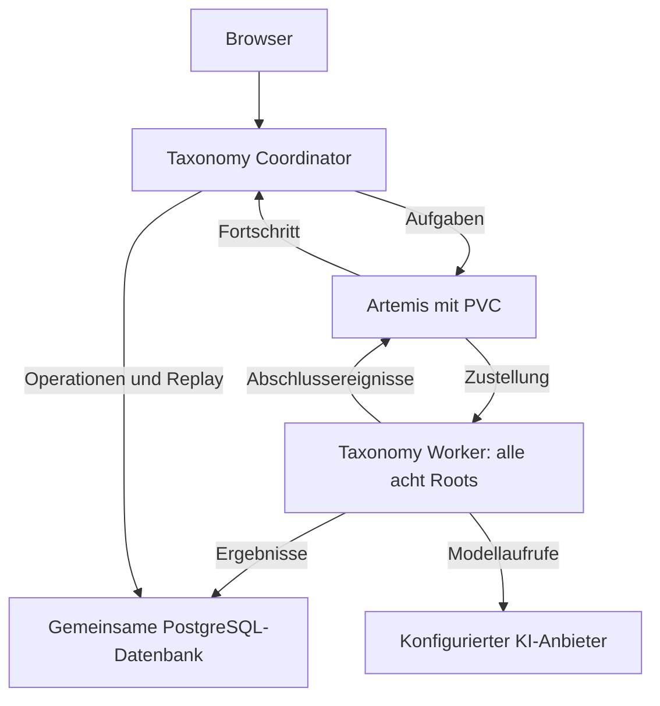

# Taxonomy mit Artemis in Kubernetes einrichten

Diese Anleitung führt vom fehlenden Broker zu einer kleinen verteilten
Taxonomy-Installation: **ein persistenter Artemis-Broker, ein Coordinator und ein
Worker für alle acht Taxonomie-Wurzeln**. Beide Taxonomy-Pods verwenden dieselbe
vorhandene PostgreSQL-Datenbank und dieselbe Anbieter-Konfiguration.

Das Taxonomy-Helm-Chart installiert die Anwendung und ihre Worker. Der Broker wird
mit dem separaten Beispiel unten bereitgestellt. Ein einzelner Broker mit PVC
übersteht normale Pod-Ersetzungen, bietet aber keine Hochverfügbarkeit und hat bei
Neustarts eine Unterbrechung. Die Ressourcenwerte sind Ausgangswerte, keine
gemessene Kapazitätszusage.

## Inhalt

1. [Betriebsart und Voraussetzungen](#1-betriebsart-und-voraussetzungen)
2. [Namespaces und private Arbeitsdateien](#2-namespaces-und-private-arbeitsdateien)
3. [Benutzer und TLS einrichten](#3-benutzer-und-tls-einrichten)
4. [Secrets und persistenten Broker bereitstellen](#4-secrets-und-persistenten-broker-bereitstellen)
5. [Taxonomy konfigurieren und installieren](#5-taxonomy-konfigurieren-und-installieren)
6. [Verbindung und tatsächliche Verarbeitung prüfen](#6-verbindung-und-tatsächliche-verarbeitung-prüfen)
7. [Eine vorhandene Installation umstellen](#7-eine-vorhandene-installation-umstellen)
8. [Neustart, Rotation und Sicherung](#8-neustart-rotation-und-sicherung)
9. [Fehlerbehebung](#9-fehlerbehebung)

## 1. Betriebsart und Voraussetzungen

| Einstellung | Taxonomy-Prozesse | Zusätzliche Voraussetzung |
|---|---|---|
| `local` / `all` | Web und Analyse in einer JVM | Kein Broker |
| `artemis` / `all` | Web und Worker weiterhin gemeinsam | Externer Broker |
| `artemis` / `coordinator` plus `worker` | Ein Web-Coordinator und getrennte Worker | Externer Broker und gemeinsame externe Datenbank |

Artemis verteilt Aufgaben und Ereignisse. Die Berechnung erfolgt in Taxonomy;
die gemeinsame Relationsvorbereitung verbleibt beim Coordinator. Die Wahl des
Transports ersetzt nicht die Wahl eines KI-Anbieters. `LOCAL_ONNX` bezeichnet
lokale Semantik und ist kein generatives Chatmodell.



Benötigt werden:

- Ein Kubernetes-Cluster ab 1.27 mit Zugriff über `kubectl`, Helm 3 und einem
  Netzwerk-Plugin, das NetworkPolicies durchsetzt.
- Eine StorageClass für ein `ReadWriteOnce`-PVC. Das Broker-Beispiel fordert 10 GiB
  an und nutzt zunächst die Standard-StorageClass. Bei Bedarf
  `spec.storageClassName` im PVC setzen. Der Datenträger muss Schreibzugriff für
  UID/GID beziehungsweise `fsGroup` 1001 ermöglichen. Das Beispiel richtet sich an
  Kubernetes/Rancher/K3s; OpenShift benötigt eine zur SCC passende Anpassung.
- Eine erreichbare PostgreSQL-Datenbank und eine gültige Taxonomy-Standortkonfiguration
  mit Datenbank-, Anmelde- und Anbieter-Secrets. Für eine Neuinstallation helfen
  [Datenbank-Einrichtung](DATABASE_SETUP.md),
  [Datenbank-Pods](../../deploy/helm/taxonomy/DATABASE_PODS.md) und
  [Helm-Grundinstallation](../../deploy/helm/taxonomy/README.md#secure-installation).
  Ein Wechsel des Spring-Profils kopiert keine vorhandenen HSQLDB-Daten.
- Lokal Bash, Python 3, OpenSSL 3 und `keytool` aus einem JDK 17 oder neuer für
  die Zertifikatsdateien. Die Java-Laufzeit der Anwendung kommt aus ihrem Image.
- Ein zusammenpassender, überprüfter Taxonomy-Quellstand/Chart und ein unveränderliches
  Anwendungsimage. Alle Taxonomy-Rollen verwenden denselben Image-Digest.

Alle folgenden Befehle laufen vom Repository-Stamm aus. Die festen Beispielnamen
sind absichtlich durchgängig:

| Ressource | Name |
|---|---|
| Taxonomy-Namespace und Helm-Release | `taxonomy` |
| Broker-Namespace | `messaging` |
| Broker-Deployment / PVC | `taxonomy-artemis` / `taxonomy-artemis-data` |
| Interner Broker-Service / Port | `artemis.messaging.svc` / TCP `61617` |
| Anwendungs-Zugang zum Broker | Benutzer `taxonomy-app`, Rolle `taxonomy-analysis` |
| Broker-Administration | Benutzer `taxonomy-operator`, Rolle `taxonomy-admin` |

Bei anderen Namen auch Zertifikat-SAN, Broker-URL, Secret-Namespace und beide
Seiten der NetworkPolicy anpassen. Ein Secret kann nur von Pods desselben
Namespaces eingehängt werden.

## 2. Namespaces und private Arbeitsdateien

Zuerst den angezeigten Kontext mit dem gewünschten Cluster abgleichen:

```bash
kubectl config current-context
kubectl create namespace taxonomy --dry-run=client -o yaml | kubectl apply -f -
kubectl create namespace messaging --dry-run=client -o yaml | kubectl apply -f -

umask 077
TAXONOMY_ARTEMIS_PRIVATE=$(mktemp -d)
export TAXONOMY_ARTEMIS_PRIVATE
```

Die nächsten Abschnitte verwenden dieselbe Shell und dieses private Verzeichnis.
Es enthält echte Zugangsdaten und private Schlüssel: außerhalb des Repositories
halten, kein `set -x` verwenden und keine Inhalte in Tickets oder Logs kopieren.
Vorhandene Secrets werden hier nicht automatisch erneuert; diese Schritte sind
für die Ersteinrichtung. Rotation steht in [Abschnitt 8](#8-neustart-rotation-und-sicherung).

## 3. Benutzer und TLS einrichten

### 3.1 Geschützte Konfiguration erzeugen

Der folgende lokale Schritt erzeugt vier unabhängige Zufallskennwörter und
übernimmt die Queues/ACLs aus der vorhandenen [broker.xml](../../deploy/artemis/broker.xml).
Die Anwendungskennung erhält keine Broker-Administrationsrolle. Tatsächliche
Passwörter werden weder als Programmargument noch in Helm-Werten übergeben.

```bash
python3 - <<'PY'
import os
import secrets
from pathlib import Path

private = Path(os.environ['TAXONOMY_ARTEMIS_PRIVATE'])
passwords = {}
for name in ('application-password', 'operator-password',
             'broker-keystore-password', 'client-truststore-password'):
    passwords[name] = secrets.token_hex(32)
    (private / name).write_text(passwords[name], encoding='utf-8')

source = Path('deploy/artemis/broker.xml').read_text(encoding='utf-8')
placeholder = '${artemis.keystore.password}'
assert source.count(placeholder) == 1, 'Broker-Vorlage vor Anpassung prüfen'
(private / 'broker.xml').write_text(
    source.replace(placeholder, passwords['broker-keystore-password']), encoding='utf-8')
(private / 'artemis-users.properties').write_text(
    'taxonomy-app=' + passwords['application-password'] + '\n'
    'taxonomy-operator=' + passwords['operator-password'] + '\n', encoding='utf-8')
(private / 'artemis-roles.properties').write_text(
    'taxonomy-analysis=taxonomy-app\ntaxonomy-admin=taxonomy-operator\n', encoding='utf-8')
(private / 'login.config').write_text('''activemq {
  org.apache.activemq.artemis.spi.core.security.jaas.PropertiesLoginModule required
    debug=false
    reload=true
    org.apache.activemq.jaas.properties.user="artemis-users.properties"
    org.apache.activemq.jaas.properties.role="artemis-roles.properties";
};
''', encoding='utf-8')
(private / 'bootstrap.xml').write_text('''<?xml version="1.0" encoding="UTF-8"?>
<broker xmlns="http://activemq.apache.org/schema">
  <jaas-security domain="activemq"/>
  <server configuration="file:/var/lib/artemis-instance/etc/broker.xml"/>
</broker>
''', encoding='utf-8')
(private / 'ARTEMIS_USER').write_text('taxonomy-app', encoding='utf-8')
(private / 'ARTEMIS_BROKER_URL').write_text(
    'tcp://artemis.messaging.svc:61617?sslEnabled=true&verifyHost=true'
    '&trustStoreType=PKCS12&trustStorePath=/var/run/taxonomy-artemis/client.p12'
    '&trustStorePassword=' + passwords['client-truststore-password'], encoding='utf-8')
PY
```

Die Bootstrap-Datei startet keinen Webserver. Das Beispiel veröffentlicht weder
Hawtio/Jolokia noch einen Administrationsport. Die Zuordnung der Properties-Dateien
folgt dem [Artemis-Sicherheitsvertrag für 2.53.0](https://github.com/apache/artemis/blob/2.53.0/docs/user-manual/security.adoc).

### 3.2 Zertifikat und Truststore

Für eine eigene interne Erstinstallation erzeugen diese Befehle eine CA und ein
90 Tage gültiges Serverzertifikat. Bei vorhandener Unternehmens-PKI stattdessen
deren Serverzertifikat, private Schlüssel und CA-Kette bereitstellen; der SAN muss
den tatsächlich verwendeten Namen `artemis.messaging.svc` enthalten.

```bash
openssl req -x509 -newkey rsa:3072 -sha256 -noenc -days 3650 \
  -subj '/CN=Taxonomy Artemis CA' \
  -addext 'basicConstraints=critical,CA:TRUE' \
  -addext 'keyUsage=critical,keyCertSign,cRLSign' \
  -keyout "$TAXONOMY_ARTEMIS_PRIVATE/ca.key" \
  -out "$TAXONOMY_ARTEMIS_PRIVATE/ca.crt"

openssl req -new -newkey rsa:3072 -sha256 -noenc \
  -subj '/CN=artemis.messaging.svc' \
  -keyout "$TAXONOMY_ARTEMIS_PRIVATE/broker.key" \
  -out "$TAXONOMY_ARTEMIS_PRIVATE/broker.csr"

cat > "$TAXONOMY_ARTEMIS_PRIVATE/broker.ext" <<'EOF'
basicConstraints=critical,CA:FALSE
keyUsage=critical,digitalSignature,keyEncipherment
extendedKeyUsage=serverAuth
subjectAltName=DNS:artemis.messaging.svc
EOF

openssl x509 -req -sha256 -days 90 \
  -in "$TAXONOMY_ARTEMIS_PRIVATE/broker.csr" \
  -CA "$TAXONOMY_ARTEMIS_PRIVATE/ca.crt" \
  -CAkey "$TAXONOMY_ARTEMIS_PRIVATE/ca.key" -CAcreateserial \
  -extfile "$TAXONOMY_ARTEMIS_PRIVATE/broker.ext" \
  -out "$TAXONOMY_ARTEMIS_PRIVATE/broker.crt"

openssl pkcs12 -export -name taxonomy-artemis \
  -in "$TAXONOMY_ARTEMIS_PRIVATE/broker.crt" \
  -inkey "$TAXONOMY_ARTEMIS_PRIVATE/broker.key" \
  -certfile "$TAXONOMY_ARTEMIS_PRIVATE/ca.crt" \
  -out "$TAXONOMY_ARTEMIS_PRIVATE/broker.p12" \
  -passout "file:$TAXONOMY_ARTEMIS_PRIVATE/broker-keystore-password"

keytool -importcert -noprompt -alias taxonomy-artemis-ca -storetype PKCS12 \
  -file "$TAXONOMY_ARTEMIS_PRIVATE/ca.crt" \
  -keystore "$TAXONOMY_ARTEMIS_PRIVATE/client.p12" \
  -storepass:file "$TAXONOMY_ARTEMIS_PRIVATE/client-truststore-password"

openssl verify -CAfile "$TAXONOMY_ARTEMIS_PRIVATE/ca.crt" \
  -verify_hostname artemis.messaging.svc "$TAXONOMY_ARTEMIS_PRIVATE/broker.crt"
```

Die letzte Prüfung muss `OK` melden. Sie prüft die erzeugte Zertifikatskette und
den Hostnamen, noch keine Clusterverbindung. Nur `client.p12` mit dem öffentlichen
CA-Zertifikat kommt zu Taxonomy; der private Broker-Schlüssel bleibt beim Broker.
Die CA-Schlüsseldatei gehört in die geschützte PKI-Verwaltung und nicht in einen
Pod. Ablaufüberwachung und rechtzeitige Erneuerung des Serverzertifikats einplanen.

## 4. Secrets und persistenten Broker bereitstellen

Die tatsächlichen Werte werden ausschließlich aus privaten Dateien gelesen:

```bash
kubectl -n messaging create secret generic taxonomy-artemis-config \
  --from-file=broker.xml="$TAXONOMY_ARTEMIS_PRIVATE/broker.xml" \
  --from-file=bootstrap.xml="$TAXONOMY_ARTEMIS_PRIVATE/bootstrap.xml" \
  --from-file=login.config="$TAXONOMY_ARTEMIS_PRIVATE/login.config" \
  --from-file=artemis-users.properties="$TAXONOMY_ARTEMIS_PRIVATE/artemis-users.properties" \
  --from-file=artemis-roles.properties="$TAXONOMY_ARTEMIS_PRIVATE/artemis-roles.properties"

kubectl -n messaging create secret generic taxonomy-artemis-broker-tls \
  --from-file=broker.p12="$TAXONOMY_ARTEMIS_PRIVATE/broker.p12"

kubectl -n taxonomy create secret generic taxonomy-artemis-client-tls \
  --from-file=client.p12="$TAXONOMY_ARTEMIS_PRIVATE/client.p12"

kubectl -n taxonomy create secret generic taxonomy-artemis \
  --from-file=ARTEMIS_USER="$TAXONOMY_ARTEMIS_PRIVATE/ARTEMIS_USER" \
  --from-file=ARTEMIS_PASSWORD="$TAXONOMY_ARTEMIS_PRIVATE/application-password" \
  --from-file=ARTEMIS_BROKER_URL="$TAXONOMY_ARTEMIS_PRIVATE/ARTEMIS_BROKER_URL"

kubectl apply -f deploy/artemis/kubernetes/broker.yaml
kubectl -n messaging get pvc taxonomy-artemis-data
kubectl -n messaging rollout status deployment/taxonomy-artemis --timeout=5m
kubectl -n messaging get service artemis
```

Das PVC muss `Bound` erreichen. Bei `Pending` zuerst StorageClass, Kapazität und
Mount-Berechtigungen klären. Bei `WaitForFirstConsumer` kann die Bindung erst mit
dem angelegten Broker-Pod erfolgen.

Das [Manifest](../../deploy/artemis/kubernetes/broker.yaml) enthält ein einzelnes
Deployment mit `Recreate`, ein separates PVC, einen internen ClusterIP-Service und
eine NetworkPolicy. Der Listener ist ausschließlich über TLS/CORE auf 61617
erreichbar. Die Broker-Seite erlaubt Taxonomy-Pods des Releases `taxonomy` im
Namespace `taxonomy`; das Anwendungs-Overlay ergänzt die passende Ausgangsregel.

Das persistente Verzeichnis ist `/var/lib/artemis-instance`, einschließlich
Journal, Bindings, Paging und Large Messages. Nur `/tmp` ist flüchtig. Ein Neustart
kopiert die fünf geschützten Konfigurationsdateien erneut aus dem Secret vor den
Broker-Start. Das ist erforderlich, weil das
[Standard-Startskript von Artemis 2.53.0](https://github.com/apache/artemis/blob/2.53.0/artemis-docker/docker-run.sh)
`etc-override` nur bei der ersten Instanzerstellung übernimmt. Der temporär von
`artemis create` angelegte Benutzer wird vor dem ersten Serverstart durch die
JAAS-Datei ersetzt; tatsächliche Zugangskennwörter stehen nicht in CLI-Argumenten.

## 5. Taxonomy konfigurieren und installieren

### 5.1 Standortkonfiguration erhalten

Die Standortdatei enthält deine bestehende Datenbank-, Anmelde-, Ingress- und
Anbieter-Konfiguration. Bei einer vorhandenen Helm-Installation deren Werte
zunächst in eine geschützte Datei außerhalb des Repositories exportieren und
prüfen. Keine geheime Datei als öffentliches Beispiel einchecken.

```bash
# Beispielpfad: auf deine vorhandene, geschützte Standortdatei ändern.
TAXONOMY_SITE_VALUES=/secure/config/taxonomy-site.yaml
export TAXONOMY_SITE_VALUES
```

Die Grundinstallation muss mindestens `existingSecret` und das gemeinsame
PostgreSQL-Profil korrekt setzen. Bei lokaler Anmeldung enthält das
Anwendungs-Secret die Schlüssel `SPRING_DATASOURCE_URL`,
`SPRING_DATASOURCE_USERNAME`, `SPRING_DATASOURCE_PASSWORD` und `ADMIN_PASSWORD`.
`ADMIN_TOKEN` ist ein davon getrennter optionaler Maschinen-Token. Für Keycloak
gelten die bestehenden [Anmelde-Einstellungen](../../deploy/helm/taxonomy/README.md#secure-installation).
Eine bereits funktionierende Anbieter-Konfiguration und deren API-Key-Secret
beibehalten; der Artemis-Wechsel fügt keinen Modellzugang hinzu.

Das kleine [Artemis-Overlay](../../deploy/helm/taxonomy/values-artemis-single-worker.yaml)
setzt diese Topologie:

```yaml
analysis:
  transportMode: artemis
  runtimeRole: coordinator
  workerSets:
    - name: all
      replicas: 1
      shards: [BP, BR, CP, CI, CO, CR, IP, UA]
      consumersPerShard: 1
```

Verwende die vollständige verlinkte Datei; der Ausschnitt zeigt nur die Rollen.
Sie bindet außerdem `taxonomy-artemis` und `taxonomy-artemis-client-tls` ein. Die
vollständige Broker-URL steht im Secret, weil sie das Truststore-Kennwort enthält.
`requireTls=true`, `sslEnabled=true` und `verifyHost=true` bleiben aktiv.

### 5.2 Netzwerkregeln vervollständigen

Das Overlay erlaubt den Broker ausdrücklich und deaktiviert die pauschale
Freigabe aller Ziele im eigenen Namespace. Deine Standortdatei muss daher die
**vollständige** Liste unter `networkPolicy.egress` für Datenbank, KI-Anbieter und
gegebenenfalls OIDC, OTLP oder andere benötigte Dienste enthalten. Eine bestehende
Installation, die allein von der bisherigen Same-Namespace-Freigabe abhing,
benötigt nun diese expliziten Regeln.

Beispiel für eine PostgreSQL-Instanz im Namespace `database`, deren Pods tatsächlich
das Label `app.kubernetes.io/name: postgres` besitzen:

```yaml
networkPolicy:
  egress:
    - to:
        - namespaceSelector:
            matchLabels:
              kubernetes.io/metadata.name: database
          podSelector:
            matchLabels:
              app.kubernetes.io/name: postgres
      ports:
        - protocol: TCP
          port: 5432
    # Hier zusätzlich die tatsächlichen Anbieter-/OIDC-/sonstigen Ziele erlauben.
```

Namespace- und Pod-Selektor stehen im selben `to`-Eintrag und gelten gemeinsam.
Gegebenenfalls muss auch eine Datenbank-/Anbieter-Ingress-Policy Taxonomy erlauben.
Für externe Ziele geprüfte CIDRs, einen Egress-Proxy oder eine separat verwaltete
CNI-FQDN-Policy verwenden: normale Kubernetes-NetworkPolicies lösen keine
Hostnamen auf. Die bestehende DNS-Regel des Charts muss zum Cluster passen.

Helm ersetzt Listen vollständig. Beim Kombinieren von Standort-, Rancher- und
Datenbank-Werten die benötigten `networkPolicy.egress`, `extraVolumes` und
`extraVolumeMounts` zusammenführen. Das hier verwendete kleine Overlay enthält
keine eigene allgemeine Egress-Liste und erhält deshalb die Standortliste.
Es wird direkt auf Chart und Standortwerte angewendet, nicht zusätzlich auf das
größere `values-artemis.yaml` mit dessen anderer Worker-Aufteilung.

### 5.3 Rendern und installieren

Den verifizierten Digest des gewünschten Anwendungsimages eingeben. Bereits
konfigurierte Tags werden ausdrücklich geleert, damit nicht Tag und Digest
gleichzeitig gesetzt sind:

```bash
read -r -p 'Taxonomy-Image-Digest (sha256:...): ' TAXONOMY_IMAGE_DIGEST
export TAXONOMY_IMAGE_DIGEST

helm lint deploy/helm/taxonomy \
  --values "$TAXONOMY_SITE_VALUES" \
  --values deploy/helm/taxonomy/values-artemis-single-worker.yaml \
  --set-string image.tag= --set-string image.digest="$TAXONOMY_IMAGE_DIGEST"

helm template taxonomy deploy/helm/taxonomy --namespace taxonomy \
  --values "$TAXONOMY_SITE_VALUES" \
  --values deploy/helm/taxonomy/values-artemis-single-worker.yaml \
  --set-string image.tag= --set-string image.digest="$TAXONOMY_IMAGE_DIGEST" \
  > "$TAXONOMY_ARTEMIS_PRIVATE/taxonomy-rendered.yaml"

helm upgrade --install taxonomy deploy/helm/taxonomy --namespace taxonomy \
  --values "$TAXONOMY_SITE_VALUES" \
  --values deploy/helm/taxonomy/values-artemis-single-worker.yaml \
  --set-string image.tag= --set-string image.digest="$TAXONOMY_IMAGE_DIGEST" \
  --wait --timeout 15m
```

Vor dem Installationsbefehl das Rendering prüfen: ein Coordinator-Deployment,
ein Worker-Deployment mit allen acht Roots, dasselbe Image und dieselbe Datenbank,
getrennte Secret-Referenzen sowie die benötigten Netzregeln. Die Queue-Präfixe
bleiben `taxonomy.analysis`, passend zur Broker-Datei. Clusterweite Provider-Permits
und RPM-/TPM-/RPD-Quoten bleiben zunächst deaktiviert; ihre spätere Aktivierung
braucht die [separate Provisionierung](OPERATIONS_GUIDE.md#clusterweite-provider-permits).

## 6. Verbindung und tatsächliche Verarbeitung prüfen

Bei den Standardnamen ohne `fullnameOverride`:

```bash
kubectl -n taxonomy rollout status deployment/taxonomy-taxonomy --timeout=15m
kubectl -n taxonomy rollout status deployment/taxonomy-taxonomy-worker-all --timeout=15m
kubectl -n taxonomy get pods -l app.kubernetes.io/instance=taxonomy
kubectl -n messaging get pods,pvc,service
kubectl -n taxonomy port-forward service/taxonomy-taxonomy 8080:80
```

Das Port-Forwarding im ersten Terminal laufen lassen. In einem zweiten Terminal:

```bash
curl --fail http://127.0.0.1:8080/actuator/health/readiness
curl --fail http://127.0.0.1:8080/actuator/health/broker
```

Detailzugriffe unterliegen der bestehenden Actuator-Autorisierung. Die erste
Readiness gilt für den Web-Coordinator. Die Worker-Readiness enthält den
Broker-Indikator; ein grüner Coordinator allein reicht nicht. Der TCP-Check am
Broker beweist nur einen geöffneten Listener. Keiner dieser Checks beweist
Modellverfügbarkeit oder eine erfolgreiche Analyse.

Für den vollständigen Funktionstest im Browser `http://localhost:8080` öffnen,
anmelden und eine kurze eigene Anforderung mit einem ausgewählten Root analysieren.
Dieser bewusst ausgelöste Test verwendet den konfigurierten Anbieter und kann
dessen Kontingent verbrauchen. Prüfen, dass der Lauf als Artemis-Ausführung
beobachtbar ist, tatsächlich fortschreitet und ein erfolgreiches Ergebnis erhält.
Bei Bedarf zeigen die authentifizierten Endpunkte `GET /api/analysis-runs` und
`GET /api/analysis-runs/{id}` Transport und Aufgabenstatus. Teilresultat, Abbruch
oder Providerfehler sind keine erfolgreiche Gesamtabnahme.

Zusätzliche Worker erst nach diesem kleinen Funktionstest konfigurieren. Ein
Worker für alle Roots reicht zur Funktionsprüfung; `consumersPerShard: 1` bedeutet
nicht nur einen gleichzeitigen Modellaufruf insgesamt. Die lokalen Provider-Grenzen
und gegebenenfalls separat provisionierten gemeinsamen Limits gelten zusätzlich.

## 7. Eine vorhandene Installation umstellen

1. **Datenhaltung prüfen:** Bei HSQLDB zuerst einen getesteten Umzug zur gemeinsamen
   PostgreSQL-Datenbank durchführen. Nur `transportMode` und Profile umzuschalten
   überträgt keine Daten. Bestehende PostgreSQL-Datenbank, Benutzer, Anmeldung und
   Anbieter-Konfiguration weiterverwenden.
2. **Version festhalten und sichern:** Chart-/Image-Stand und Standortwerte
   dokumentieren, Datenbank-Sicherung prüfen und Broker unabhängig bereitstellen.
3. **Laufende lokale Analysen beenden:** Neue Aufnahme für das Wartungsfenster
   stoppen und laufende Analysen abschließen oder bewusst abbrechen. Bereits im
   lokalen Executor laufende Arbeit wird nicht nachträglich in Broker-Queues verschoben.
4. **Rollen umstellen:** Standortwerte zusammen mit dem kleinen Overlay rendern und
   anwenden. Vor einem gleichzeitig inkompatiblen Schema-Upgrade alle bestehenden
   Taxonomy-Rollen stoppen; `Recreate` koordiniert mehrere Deployments nicht gemeinsam.
5. **Verarbeitung prüfen:** Die Checks aus Abschnitt 6 und einen neuen Analyseauftrag
   durchführen. Eine separate Worker-Replikazahl ist keine Freigabe für mehrere
   Web-Replikate; `scaling.allowMultipleReplicas` bleibt eine eigene Betriebsentscheidung.

Wer zunächst nur den Transport wechseln möchte, kann mit externer Broker-Anbindung
`analysis.runtimeRole=all` und `analysis.workerSets=[]` verwenden. Dann bleibt die
Analyse im selben Taxonomy-Pod. In Helm muss die Worker-Liste tatsächlich leer sein;
`all` zusammen mit konfigurierten Worker-Sets wird abgewiesen.

## 8. Neustart, Rotation und Sicherung

- **Normaler Neustart:** `kubectl -n messaging rollout restart deployment/taxonomy-artemis`
  ersetzt den Broker-Pod bei unverändertem PVC. Danach Rollout, Broker-Health und
  Verarbeitung prüfen. Der Einzelbroker ist währenddessen vorübergehend nicht erreichbar.
- **Zugänge/Zertifikate rotieren:** Nur die betroffenen Dateien neu erstellen und
  die entsprechenden Secrets über den Secret-Manager oder einen geschützten
  `kubectl create secret ... --dry-run=client -o yaml | kubectl apply -f -`-Ablauf
  aktualisieren. Nicht den gesamten Ersteinrichtungsblock erneut ausführen: Er
  ersetzt alle Kennwörter und würde eine neue CA erzeugen. Bei einer CA-Rotation
  zunächst den Truststore um die neue CA ergänzen und die Anwendungsrollen neu
  starten, anschließend das neue Broker-Zertifikat aktivieren. Alten Trust erst
  nach erfolgreicher Umstellung entfernen. Für Kennwortwechsel ein Wartungsfenster
  mit gestoppten Consumern und abgestimmter Aktualisierung beider Seiten verwenden.
- **Änderungen aktivieren:** Broker-Deployment nach Broker-Konfigurations-/TLS-Änderungen
  neu starten; Coordinator und alle Worker nach Änderungen ihrer Umgebungs-Secrets
  oder Truststores ebenfalls. Ein aktualisiertes Secret allein erneuert die
  laufende JMS-Connection-Factory nicht.
- **Sichern:** Gemeinsame PostgreSQL-Datenbank, Broker-Journal/Bindings/Paging/Large
  Messages sowie Konfiguration/Secrets nach einem konsistenten Verfahren sichern.
  Ein Taxonomy-PVC sichert weder den Broker noch eine externe Datenbank. Restore in
  einer isolierten Umgebung prüfen; keine ältere Datenbank ungeprüft mit einem
  neueren Broker-Journal kombinieren.
- **Images aktualisieren:** Dieses Beispiel ist an Artemis 2.53.0 gebunden. Vor
  einem Broker-Versionswechsel dessen Upgrade-Verfahren für die persistente
  Instanz prüfen; ein Austausch des Image-Tags aktualisiert gespeicherte
  Instanzskripte und Profile nicht automatisch. Kein `artemis create --force`
  als Reparatur verwenden.
- **Daten erhalten:** Ein Helm-Uninstall von Taxonomy entfernt diesen separat
  bereitgestellten Broker nicht. `kubectl delete -f deploy/artemis/kubernetes/broker.yaml`
  würde dagegen auch das PVC löschen und kann je nach ReclaimPolicy Daten vernichten.
  PVC und Namespace erst nach einer ausdrücklichen Entscheidung zur Datenlöschung entfernen.

Nach sicherer Übernahme der Zugangsdaten und CA-Verwaltung die privaten lokalen
Arbeitsdateien nach dem eigenen Löschverfahren entfernen. Brokerkopien und
Sicherungen der Instanz enthalten ebenfalls vertrauliche Konfiguration.

Für HA, Administrationszugang, DLQ/Expiry, gemeinsame Provider-Grenzen und
Upgrade-Koordination gilt das [Betriebshandbuch](OPERATIONS_GUIDE.md#betrieb-mit-externem-artemis-broker).
Zwei unabhängig gestartete Broker ergeben keine replizierte Queue; dieses
Deployment deshalb nicht einfach auf zwei Replikate skalieren.

## 9. Fehlerbehebung

| Beobachtung | Zuerst prüfen |
|---|---|
| Broker-PVC bleibt `Pending` | Standard-StorageClass, freie Kapazität, Zugriffsmodus und `WaitForFirstConsumer`. |
| Broker startet mit Dateizugriffsfehler | Schreibrechte des PVC für 1001/`fsGroup`, Secret-Dateien und deren Namen; kein fremdes bestehendes Broker-Volume verwenden. |
| TLS-Handshake schlägt fehl | SAN `artemis.messaging.svc`, CA in `client.p12`, Store-Kennwörter und Pfade; nicht durch `trustAll` oder abgeschaltete Hostnamenprüfung umgehen. |
| Anmeldung oder Queue-Zugriff wird verweigert | `taxonomy-app` in beiden Secrets mit demselben Kennwort, Rollen-Datei `taxonomy-analysis=taxonomy-app`, vollständige Broker-XML/ACLs. |
| Queue fehlt | Den Taxonomy-Adressblock aus `broker.xml` übernehmen; die Vorlage deaktiviert automatische Queue-/Adressanlage bewusst. |
| `WAITING_FOR_BROKER` oder Worker nicht ready | DNS, beide NetworkPolicies, TCP 61617, TLS und Secret-Referenzen. Web-Readiness allein bleibt möglicherweise grün. |
| Worker ready, aber Analyse bleibt liegen | Root-Zuordnung, exakt gleicher Quell-/Image-Stand, gemeinsame Datenbank und passende gespeicherte Quell-Snapshots; danach Providerfehler prüfen. |
| Modell-/Datenbankverbindung funktioniert nach Umschaltung nicht | Die vollständige Standort-Egress-Liste: die bisherige pauschale Same-Namespace-Freigabe ist deaktiviert. |
| Helm meldet Tag und Digest gleichzeitig | `image.tag` wie im Installationsbefehl leeren oder ausschließlich einen freigegebenen Tag verwenden. |
| Änderungen am Secret wirken nicht | Betroffene Rollen neu starten; der Broker übernimmt seine Dateien beim Start, Taxonomy erzeugt dann seine Connection-Factory neu. |

Die Anleitung und ihre Beispiele lassen sich durch Helm-Rendering, Schema- und
Dateiprüfungen kontrollieren. Das ersetzt keine Abnahme im eigenen Cluster:
StorageClass, tatsächliche NetworkPolicy-Durchsetzung, TLS/JAAS, Neustart/Restore
und echte Verarbeitung müssen dort nachgewiesen werden. Der bestehende
[Artemis-Smoke-Test](../../deploy/helm/taxonomy/CAPACITY.md#additive-external-artemis-acceptance-case)
verwendet eigene wegwerfbare Ressourcen und ist nicht diese persistente Installation.
