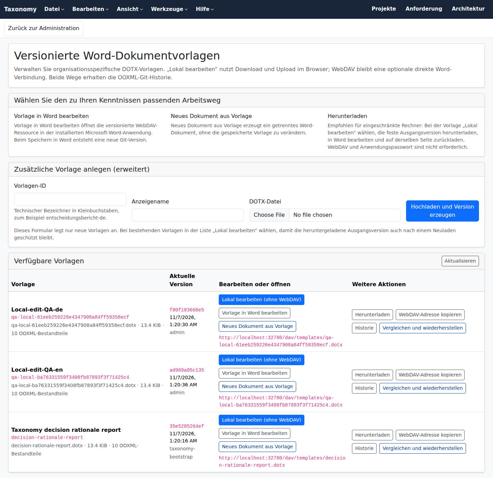
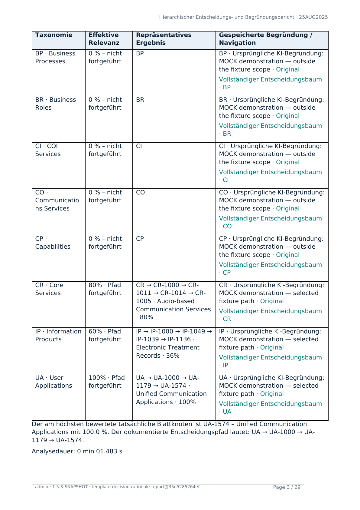

# Versionierte Word-Vorlagen

Taxonomy verwaltet Word-Vorlagen als entpackte OOXML-Paketbäume im logischen
JGit-/Hibernate-Repository `taxonomy-document-templates`. WebDAV und Downloads
stellen daraus vollständige `.dotx`-Dateien zusammen.

<a id="template-editing"></a>
## Oberfläche und automatisierter Downloadtest

Die Administrationsseite `/admin/document-templates` zeigt die beim Erststart
angelegte Berichtsvorlage, ihre Git-Version, den vollständigen WebDAV-Pfad sowie die
Aktionen **Vorlage in Word bearbeiten**, **Neues Dokument aus Vorlage**,
**Herunterladen**, **Historie** und **Vergleichen und wiederherstellen**. Die folgende
Aufnahme stammt aus dem automatisierten Browsertest und zeigt insbesondere den
`ms-word:ofe`-Link an der tatsächlich initialisierten Vorlage.

[](../images/document-template-management.png)

Der GitHub-Workflow `Document Template Report E2E` startet die paketierte Taxonomy-
Anwendung über Testcontainers. Playwright meldet sich als Administrator an, wartet auf
die idempotent erzeugte Standardvorlage, prüft den sichtbaren Word- und WebDAV-Link,
öffnet die Detailansicht und lädt dort einen datenfreien DOCX-Testbericht herunter.
Der Test verlangt HTTP 200, den DOCX-Medientyp, den erwarteten Dateinamen in
`Content-Disposition`, eine plausible ZIP-/DOCX-Signatur und eine Mindestgröße.
Anschließend rendert LibreOffice den tatsächlich heruntergeladenen Bericht als PDF;
`pdftoppm` erzeugt daraus die folgende Aufnahme der ersten Seite.

[](../images/decision-rationale-template-test-report.png)

Das Testartefakt enthält zusätzlich die heruntergeladene DOCX-Datei, das gerenderte
PDF, beide Screenshots, den Playwright-Log sowie einen JSON-Nachweis mit URL,
Medientyp, Dateiname, Dateigröße und SHA-256-Prüfsumme. Dieser Test belegt den
Containerstart, die Erstanlage der Vorlage, die Browseroberfläche und den
Berichtsdownload. Er ersetzt nicht die getrennte Abnahme mit einer real installierten
Microsoft-Word-Version über öffentliches HTTPS und WebDAV.
Die dafür benötigte Umgebung und die Nachweise stehen in
[EXT-03](../internal/TODO-EXTERNAL-INPUT.md#ext-03); gemeinsame Sperren und
Wiederanlauf bleiben Implementierungsaufgaben in
[#828](https://github.com/carstenartur/Taxonomy/issues/828).

## Standardvorlage für den Bewertungsbericht

Die Anwendung liefert die erforderliche Vorlage

```text
decision-rationale-report
```

im Container beziehungsweise JAR mit. Beim ersten erfolgreichen Start wird sie
idempotent als erster Git-Commit importiert. Existiert die Vorlage bereits, wird sie
weder beim Neustart noch bei einem Softwareupdate überschrieben. Eigene Logos,
Organisationsangaben und Layoutänderungen bleiben daher erhalten.

Der DOCX-Bewertungsbericht wird tatsächlich aus der jeweils aktuellen Git-Version
dieser Vorlage erzeugt. Testberichte in der Vorlagenhistorie und beim lokalen
Bearbeiten verwenden die am Link angezeigte Version. Die DOCX-Datei enthält den
Git-Commit und die Paketprüfsumme dieser Version.

Taxonomy verwendet insbesondere:

```text
{{taxonomy.report.title}}
{{taxonomy.report.subtitle}}
{{taxonomy.report.status}}
{{taxonomy.report.requirement}}
{{taxonomy.report.generatedAt}}
{{taxonomy.report.generatedBy}}
{{taxonomy.report.taxonomyVersion}}
{{taxonomy.report.applicationVersion}}
{{taxonomy.report.workspace}}
{{taxonomy.report.branch}}
{{taxonomy.template.id}}
{{taxonomy.template.commit}}
{{taxonomy.report.body}}
```

`{{taxonomy.report.body}}` muss genau einmal als eigener Absatz vorkommen und der
letzte nicht leere Inhaltsblock des Dokuments sein. Taxonomy entfernt ihn beim Export
und fügt dort Kurzfassung, Entscheidungskapitel, Diagramme und Anhang ein. Titelseite,
Bilder, Kopf- und Fußzeilen, Seitenformat und Word-Formatvorlagen bleiben Bestandteil
der bearbeitbaren DOTX-Vorlage.

Uploads und Wiederherstellungen der Standardvorlage werden zusätzlich zum
allgemeinen OOXML-Sicherheitscheck gegen diesen Vertrag validiert. Der
Actuator-Health-Check `decisionRationaleTemplate` meldet `DOWN`, wenn die Pflichtvorlage
fehlt oder strukturell ungültig ist.

## Audit-Nachweis

Jeder vorlagenbasierte DOCX-Bericht speichert die genaue Identität seiner Word-Vorlage
unabhängig von sichtbaren Feldern auf der Titelseite. Die benutzerdefinierten
Dokumenteigenschaften heißen `Taxonomy.Template.Id`, `Taxonomy.Template.Commit`,
`Taxonomy.Template.PackageSha256` und `Taxonomy.Template.SchemaVersion`. Der Commit ist
die vollständige 40-stellige Git-Objekt-ID; der Paket-Digest ist der kanonische
64-stellige SHA-256-Wert aus dem validierten Vorlagenmanifest. Das Entfernen der
optionalen Anzeigetoken `{{taxonomy.template.*}}` entfernt daher nicht den
Audit-Nachweis.

Der DOCX-Download liefert dieselben Werte in den explizit freigegebenen Headern
`X-Taxonomy-Template-Id`, `X-Taxonomy-Template-Commit`,
`X-Taxonomy-Template-SHA256` und `X-Taxonomy-Template-Schema-Version`. Intern trägt das
formatneutrale Renderergebnis dieselben vier Felder als unveränderliche
Artefaktmetadaten. HTML- und JSON-Ausgaben behaupten keine Word-Vorlagenidentität.

Prüfer können die Werte in Word unter **Datei → Informationen → Eigenschaften →
Erweiterte Eigenschaften → Anpassen** ansehen. Ohne Word lässt sich
`docProps/custom.xml` direkt aus dem DOCX-ZIP-Paket lesen. Die vollständige Commit-ID
ist mit der Vorlagenhistorie und der SHA-256-Wert mit dem zugehörigen
`template.json`-Manifest zu vergleichen.

<a id="template-versions"></a>
## Versions- und Konkurrenzmodell

Jede Vorlage verwendet den letzten Git-Commit, der ihren eigenen OOXML-Unterbaum
geändert hat, als Version und HTTP-ETag. Eine Änderung an einer anderen Vorlage macht
deshalb keinen geöffneten Editor ungültig und erzeugt keinen falschen Konflikt. Die
Erstanlage ist ausschließlich create-only; Ersetzen und Wiederherstellen benötigen das
aktuelle Vorlagen-ETag. `If-Match` verwendet starke HTTP-Entity-Tags, akzeptiert mehrere
Alternativen in einer kommaseparierten Liste und legt niemals eine fehlende Ressource
an.

WebDAV-Sperren verwenden die konfigurierte gemeinsame Datenbank. Anlegen,
Verlängern, Ablauf und Freigabe gelten dadurch über Anwendungsinstanzen hinweg;
ein Neustart erhält eine noch gültige Sperre. Die Datenbankzeit bestimmt den Ablauf.
Eine Transaktionssperre bleibt während des vorhandenen begrenzten Git-Speichervorgangs
gehalten. Eine andere Instanz kann eine abgelaufene Sperre deshalb nicht während
eines angenommenen Speichervorgangs übernehmen. Jeder erfolgreiche PUT prüft und
committet seine Bytes vor der Bestätigung; es gibt keinen ungespeicherten Sitzungspuffer.

Die Vorlagenfunktion migriert ihre eigenen temporären Koordinationstabellen über
`webdav_lock_schema_history`. Alle Instanzen müssen dieselbe Installationsdatenbank
verwenden. Bei nicht verfügbarer Sperrverwaltung werden WebDAV-Schreibzugriffe mit
HTTP 503 abgewiesen; es gibt keinen Rückfall auf unabhängige lokale Sperren. Nach
einer unklaren Antwort sollten die aktuelle Vorlage und ihr ETag vor einem erneuten
Speicherversuch gelesen werden. Die erwartete Git-Vorlagenversion verhindert weiterhin
veraltete Schreibzugriffe und erhält frühere Versionen. Diese Sperrgarantien belegen
weder eine Cluster-Kapazitätsgrenze noch eine native Microsoft-Word-Zertifizierung;
der ausgelieferte Helm-Standard bleibt bei einer Replik.

<a id="template-access"></a>
## Zugriff und Transport

Angemeldete Benutzer dürfen vollständige Vorlagen lesen und daraus ein neues Dokument
erzeugen. Nur Administratoren dürfen Vorlagen hochladen, wiederherstellen, sperren oder
speichern. Direkte Desktop-Word-Links benötigen HTTPS; ausgenommen sind lokale
Loopback-Adressen für die Entwicklung. Der normale HTTPS-Download und eine kopierbare
WebDAV-Adresse bleiben als Rückfallwege verfügbar.

Im Keycloak-Profil sind direkte `ms-word:`-Links standardmäßig deaktiviert. Desktop-
Word kann die OIDC-Sitzung des Browsers nicht übernehmen und erhält den erforderlichen
Bearer-Token nicht. Die Links dürfen erst wieder aktiviert werden, wenn der Betrieb
einen WebDAV-kompatiblen, begrenzten Zugang wie ein App-Passwort implementiert und
getestet hat. WebDAV-Clients mit Bearer-Token-Unterstützung können den Endpunkt weiter
verwenden.

Taxonomy-App-Zugangsdaten haben genau ein 71 Zeichen langes ASCII-Format. Der
WebDAV-Filter weist zu große Basic-Header, ungültiges UTF-8, zu lange decodierte
Benutzernamen oder Passwörter sowie fehlerhafte `taxdav_`-Kandidaten vor
Repository-Zugriff oder BCrypt zurück. Normale Kontopasswörter, die nicht mit
`taxdav_` beginnen, laufen weiterhin durch den gewöhnlichen HTTP-Basic-Pfad von
Spring Security.

Kann der Zugangsdaten-Speicher die Prüfung nicht abschließen, erhält der WebDAV-Client
HTTP 503 mit leerem Antworttext und `Cache-Control: no-store`. Nach der Wiederherstellung
kann der Client dieselben Zugangsdaten erneut verwenden. Für die Sperre zählen nur
fehlgeschlagene Anmeldungen. Taxonomy protokolliert einen Widerruf, sobald die Datenbank
die Transaktion bestätigt hat.

Fehlgeschlagene App-Anmeldungen werden über einen SHA-256-Digest fester Länge aus dem
vom Framework aufgelösten Peer und dem normalisierten übermittelten Benutzernamen
gezählt; rohe Identitäten bleiben nicht in der Sperrtabelle. Zehn Fehlversuche innerhalb
einer Minute sperren diese Identität. Die reguläre Tabelle ist pro Anwendungsinstanz
hart auf 10.000 Schlüssel begrenzt. Nicht mehr aufnehmbare Identitäten teilen ein
fehlgeschlossenes Überlaufkontingent, statt bestehende Sperren zu löschen. Eine
gesperrte Anfrage erhält UTF-8-JSON mit HTTP 429, `Retry-After` und
`Cache-Control: no-store`. Die Verarbeitung von Weiterleitungs-Headern darf nur hinter
einem vertrauenswürdigen Ingress aktiviert werden, weil der Filter bewusst das
Framework-Ergebnis `getRemoteAddr()` verwendet und Weiterleitungs-Header niemals
selbst auswertet. Der Filter protokolliert weder den übermittelten Basic-Authorization-
Header noch dessen Zugangsdateninhalt.

Taxonomy weist Makros, ActiveX, eingebettete OLE-Objekte, Signaturen, unsichere
ZIP-Pfade, nur in Groß-/Kleinschreibung kollidierende Paketbestandteile, fehlerhaftes
XML, externe Beziehungen außer Hyperlinks, fehlende interne Beziehungsziele, Pakete
ohne genau eine Root-`officeDocument`-Beziehung auf `word/document.xml` sowie
OOXML-Bestandteile namens `template.json` zurück. Dieser Name ist dem internen
Taxonomy-Manifest vorbehalten.

## Eingefrorene Architekturinhalte

Snapshot-Entscheidungsberichte behalten diesen Vorlagenpfad bei und ergänzen die gemeinsamen eingefrorenen Architekturabschnitte sowie den vollständig verlinkten Entscheidungsbaum. Vorhandene Formatvorlagen `Title`, `Heading1`–`Heading3` und `Caption` bleiben erhalten; fehlende erhalten Ersatzdefinitionen. Statischer eigener Titeltext wird nicht übersetzt oder überschrieben. Die datenfreie Vorschau bleibt auch ohne Architekturgraph gültig. Siehe [Snapshot-Word-Routen und Grenzen](DECISION_RATIONALE_REPORT.md#word-berichte-aus-unveränderlichen-snapshots).

## Lesebudgets für Vorlagen reproduzieren

Mit Java 25 startet `./mvnw -pl taxonomy-templates -am -Dtest=DocumentTemplateScaleBudgetTest -Dsurefire.failIfNoSpecifiedTests=false test` vier Messreihen. 10 oder 100 Vorlagen teilen sich gleichmäßig 100 oder 1.000 Git-Revisionen auf dem ersten Elternpfad. Eine Vorlage erhält alle ihre Revisionen, bevor die nächste geändert wird. Alle Revisionen verwenden die kanonischen Bestandteile von `template-fixtures/report.dotx`. Jede Operation startet mit einem neuen Dienst und leerem Cache auf demselben JGit-Repository im Speicher. Der zweite Aufruf misst den warmen Zustand. Erfasst werden Liste, Historie und Download der ältesten Vorlage sowie PROPFIND mit Tiefe 1 für die Sammlung. Unter `taxonomy-templates/target/template-scale-evidence/` stehen Quell-Commit in GitHub Actions, Paket-Prüfsumme, JVM-Version, maximaler Heap, Laufzeit, Allokationen des Anfragethreads, geöffnete Git-Commits und -Trees sowie Anzahl und Größe gehaltener Cacheeinträge.

Die Grenzen pro Lesevorgang sind 30 Sekunden, 768 MiB Allokation bei kaltem bzw. 64 MiB bei warmem Cache sowie höchstens Revisionszahl plus doppelte Vorlagenzahl plus vier Commit-Öffnungen. Der normale Archivcache hält maximal 64 Archive oder 100 MiB. Für Sammlungsabfragen speichert der Dienst zusätzlich die Länge von bis zu 1.024 validierten ZIP-Repräsentationen nach Vorlage, Revision und Codec-Version. Bei 100 Vorlagen und 1.000 Revisionen benötigte PROPFIND unter Java 25.0.5 mit 512 MiB Heap 556,9 MB Allokation kalt und 2,15 MB warm. Die Git-Arbeit sank dabei von 1.193 Commits und 33.086 Trees auf einen Commit und 602 Trees. Die Messung erfasst Anfragethread und gebundene Cacheinhalte. Antwortzeiten im Betrieb, maximaler Prozessspeicher und Datenübertragung hängen von der Installation ab.
