# Beispiele

Dieses Dokument zeigt ausgearbeitete Beispiele für häufige Aufgaben im Taxonomy Architecture Analyzer.

Abschnitt 1 erklärt einen gespeicherten, historisch belegten Architekturstand mit
verfassten Modellantworten. Die Zahlen und Antworten der übrigen Abschnitte sind
illustrative Anwendungsbeispiele, keine gemessenen Ergebnisse eines aktuellen
Modelllaufs. Beibehaltene Baum-/Impact-Bilder zeigen ältere Beispielzustände und
können andere Bewertungen oder Bedienelemente enthalten.
Die eingebettete Impact-Ansicht ist von der Workbench eines unveränderlichen
Snapshots zu unterscheiden. Aktuelle Navigation steht im [Benutzerhandbuch](USER_GUIDE.md),
versionsgebundene Nachweise in der [Szenario-Abnahme](https://github.com/carstenartur/Taxonomy/blob/main/docs/testing/scenario-acceptance.md).

---

## Inhaltsverzeichnis

- [1. Anforderung → Architektur](#1-anforderung--architektur)
- [2. Ausfallauswirkungsanalyse](#2-ausfallauswirkungsanalyse)
- [3. Architektur-Lückenanalyse](#3-architektur-lückenanalyse)
- [4. Beziehungsvorschläge](#4-beziehungsvorschläge)
- [5. Architekturempfehlungen](#5-architekturempfehlungen)
- [6. Diagramm-Export](#6-diagramm-export)
- [7. Feldservice-Überwachung — Ende-zu-Ende](#7-feldservice-überwachung--ende-zu-ende)
- [8. Architektur-DSL-Workflow](#8-architektur-dsl-workflow)

---

## 1. Anforderung → Architektur

**Ziel:** Eine fachliche Anforderung in unterscheidbare Funktionen, gerichtete
Beziehungen und ausdrücklich offene Entscheidungen überführen.

### Schritt 1 — Eine nachvollziehbare Anforderung verwenden

Der Referenzfall **FLOOD-001** beschreibt einen ergänzenden Hochwasserinformationsdienst:

- Veröffentlichte Warnungen, betroffene Gebiete und Wasserbeobachtungen mit Quelle
  und Beobachtungszeit verständlich anzeigen.
- Den Dienst administrativ betreuen; Gebietsabonnements und ausgewählte SMS-,
  Telefon- oder E-Mail-Kanäle unterstützen.
- Kontaktdaten ändern, Gebiete entfernen und Konten löschen können.
- Den neuesten Beobachtungsstapel gemäß dem Originalwortlaut „at most every
  15 minutes“ abrufen; veraltete oder nicht verfügbare Daten anzeigen und die
  offiziellen Warnkanäle erhalten. Oberflächenwasser liegt außerhalb des Umfangs.
- Unter der zusätzlichen **Testannahme A1** eine dauerhafte Zustellwarteschlange,
  idempotente Wiederholungen, geschützte Abonnentendaten und eine Auditspur vorsehen.

Den vollständigen Originaltext und die Quellen enthält die
[Szenariodatei](https://github.com/carstenartur/Taxonomy/blob/main/taxonomy-app/src/test/resources/scenarios/flood-information.json).
Der Dienst ersetzt keine offiziellen sicherheitskritischen Warnungen.

### Schritt 2 — Den gespeicherten Modellstand lesen

Das folgende Beispiel verwendet die **tatsächlich gespeicherte Architektur vom
19. Oktober 2026**, Snapshot `0a4c6367-ff1d-487b-8286-d51b0834964c`:
**50 Knoten, 36 gerichtete Beziehungen, Status `PARTIAL`**. Architektur und
Entscheidungsbericht stammen aus demselben gespeicherten Ergebnis. Die
Modellantworten wurden als Testdaten verfasst; die Anwendung hat Analyse,
Persistenz und Ableitung ausgeführt. Das ist kein Live-Modellergebnis und keine
Aussage über eine heute bestandene Abnahme.

Nachweise: [gespeicherte Architektur](https://github.com/carstenartur/Taxonomy/blob/9cd9b68f0dc55a4cd358d900cd0bbc7b206ce7bb/taxonomy-tooling/src/test/resources/scenario-documents/complete-flood-v1/architecture.json.gz),
[Laufbeleg](https://github.com/carstenartur/Taxonomy/blob/9cd9b68f0dc55a4cd358d900cd0bbc7b206ce7bb/taxonomy-tooling/src/test/resources/scenario-documents/complete-flood-v1/run.json.gz) und
[Entscheidungsbericht](https://github.com/carstenartur/Taxonomy/blob/9cd9b68f0dc55a4cd358d900cd0bbc7b206ce7bb/taxonomy-tooling/src/test/resources/scenario-documents/complete-flood-v1/decision.json.gz).
Der Laufbeleg nennt den damaligen Quellstand
`2fb5a7ae342af5c1ade5b97b65de4bed658f38f5`. Der Verzeichnisname
`complete-flood-v1` bezeichnet den bewahrten Dokumentensatz; der Snapshot bleibt
fachlich ein Teilergebnis.

| Fachliche Funktion | Im gespeicherten Modell enthaltene Begriffe |
|---|---|
| Veröffentlichte Informationen lesen und anzeigen | `UA-1580` Hydrographic Applications; `IP-1116` Recognized Environmental Pictures; `IP-2130` Geospatial Support Alerts |
| Zustellungen nach Gebiet und Kanal organisieren | `BP-1535` Information Retrieval and Dissemination; `CR-1098` Message Routing Services |
| Text-, Telefon- und E-Mail-Benachrichtigungen unterstützen | `CR-1060` Text-based Communication Services; `CO-1048` Short Messaging Access Services; `CO-1066` Voice Access Services; `CR-1037` Informal Messaging Services |
| Kontaktdaten, Gebiete und Konten verwalten | `BP-1521` IKM Entity Management; `BP-1530` Information Disposition; `CR-1022` Digital Identity Services |
| Zustellungen zuverlässig und nachvollziehbar bearbeiten (A1) | `CR-1097` Message Queueing Services; `CR-1198` Records Management Services |
| Zugriff schützen und Dienstbetrieb betreuen | `CR-1006` Authentication Services; `CR-1007` Authorization and Access Control Services; `CI-1060` IT Service Management Services; `UA-1522` Service Desk Applications |

### Schritt 3 — Beziehungen statt bloßer Trefferlisten prüfen

Dieser **Ausschnitt aus den 36 gespeicherten Beziehungen** zeigt die
Zustellfunktion. Die Pfeile behalten Quelle, Typ und Ziel des Snapshots bei;
die beschreibenden Texte sind zur Lesbarkeit auf Deutsch zusammengefasst.

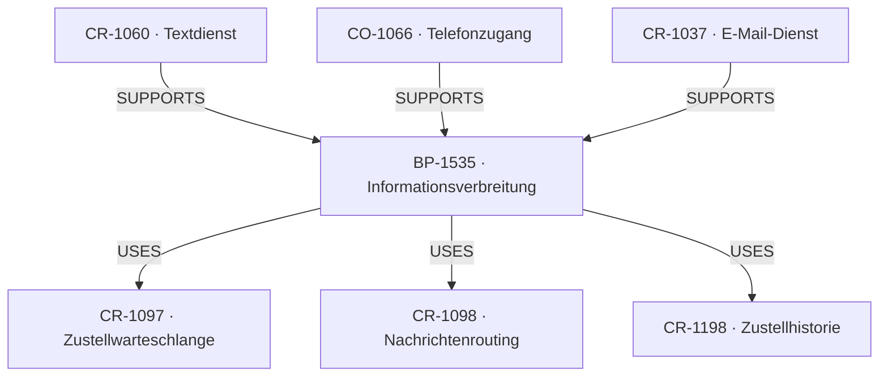

Weitere konkrete Beziehungen desselben Snapshots:

| Quelle → Typ → Ziel | Fachliche Aussage im Anforderungskontext |
|---|---|
| `UA-1580 CONSUMES IP-1116` | Die Anwendung liest bereits vorliegende Umweltinformationen. |
| `UA-1580 CONSUMES IP-2130` | Sie liest veröffentlichte gebietsbezogene Warnungen. |
| `CO-1048 SUPPORTS BP-1535` | Der SMS-Zugang unterstützt die Zustellfunktion zusätzlich zum Textdienst. |
| `BP-1521 USES CR-1022` | Kontakt- und Abonnementverwaltung verwendet die Identitätsfunktion. |
| `BP-1530 USES CR-1022` | Kontolöschung benötigt die Identitätsverwaltung einschließlich Deprovisionierung. |
| `UA-1522 USES CI-1060` | Die administrative Anwendung verwendet die Dienstmanagementfunktion. |

Eine solche Beziehung bezeichnet einen begründeten Vorschlag, keine bereits
implementierte Schnittstelle. Insbesondere macht eine Warteschlangenkategorie
Dauerhaftigkeit oder Idempotenz noch nicht technisch wahr. Prüfen Sie die an die
Originalklauseln gebundenen Begründungen, Bedingungen und verbleibenden Entscheidungen.

**Offen bleibt:** Ist der eingehende F5-Beobachtungsstapel bereits ein
„Recognized Environmental Picture“, oder ist seine Produktidentität noch
unbestimmt? Der Snapshot bewahrt diese Frage und bleibt `PARTIAL`. Die vorhandene
Lesebeziehung zu `IP-1116` beantwortet diese separate Frage zur Eingabe nicht.
Auch konkrete Broker, Datenverträge, Aufbewahrungs-/Löschregeln und die technische
Umsetzung der Wiederholungen benötigen Entscheidungen. Scores messen hier
Relevanz im Katalog, keine Vollständigkeit oder Freigabe.

### Schritt 4 — Den Ablauf mit einer eigenen Anforderung durchführen

1. Öffnen Sie **Projekte**, legen Sie eine Anforderung an und speichern Sie den
   vollständigen Text als versionierten Stand.
2. Wählen Sie die Teiltaxonomien und den vollständigen Analysemodus. Starten Sie
   den Copilot ausdrücklich mit einem bereiten generativen Anbieter. Die
   dokumentierte manuelle Voreinstellung ist Profil `FULL` mit einem Prüfdurchlauf;
   die historische Szenarioabnahme verwendet `EXHAUSTIVE` mit zwei Durchläufen.
3. Lesen Sie nach dem Lauf den tatsächlichen Status und die offenen Bewertungen.
   Prüfen oder beantworten Sie offene Fragen, bevor Sie eine angebotene Fortsetzung
   starten. Ein Budgetende oder eine fachliche Unklarheit ist kein negativer Befund.
4. Öffnen Sie das gespeicherte Ergebnis und dessen **Architektur**. Prüfen Sie in
   der Workbench die Snapshot-Identität; suchen Sie etwa `BP-1535`, wählen Sie den
   Knoten aus und verwenden Sie den Fokusmodus für seine direkten Nachbarn.
5. Prüfen Sie im Detailbereich Herkunft, Begründung, Bedingungen und Review-Status.
   Verwenden Sie Druckansicht und Exportmenü für genau dieses gespeicherte Ergebnis;
   beachten Sie bei Austauschformaten das Mapping- und Verlustmanifest.
6. Nutzen Sie bei unklaren Anforderungen ein gespeichertes Neuformulierungsangebot.
   Beantworten und prüfen Sie dessen Fragen; übernehmen Sie einen neuen Entwurf
   ausdrücklich und analysieren Sie ihn anschließend gesondert.

Die Schritte und aktuellen Bedienelemente erläutern
[Benutzerhandbuch](https://github.com/carstenartur/Taxonomy/blob/main/docs/de/USER_GUIDE.md#analysis-scope-and-progress),
[Copilot und persistierte Workbench](https://github.com/carstenartur/Taxonomy/blob/main/docs/de/COPILOT_AUTOPILOT.md#persistierte-architektur-workbench)
und [Anforderungsklärung](https://github.com/carstenartur/Taxonomy/blob/main/docs/de/USER_GUIDE.md#requirement-clarification-workflow).
Die [Szenarioabnahme](https://github.com/carstenartur/Taxonomy/blob/main/docs/testing/scenario-acceptance.md) beschreibt die
reproduzierbare Testgrenze und die Exportprüfung. Eigene Anbieterantworten und
ein heutiger Lauf können andere Vorschläge liefern; dieses historische Beispiel
ist kein versprochenes identisches Ergebnis.


---

## 2. Ausfallauswirkungsanalyse

**Ziel:** Bestimmen, was ausfällt, wenn ein bestimmtes Taxonomie-Element nicht funktioniert.

### Web-Oberfläche

1. Öffnen Sie das **Graph Explorer**-Panel auf der rechten Seite.
2. Geben Sie den Knoten-Code ein, z. B. `CR-1047` (Infrastructure Services).
3. Klicken Sie auf **Failure Impact**.
4. Das Ergebnis zeigt jedes Element, das direkt oder transitiv von `CR-1047` abhängt.

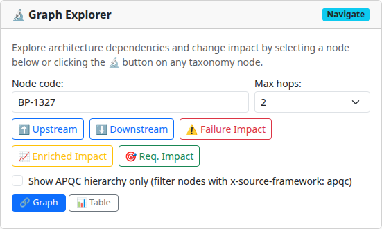

Siehe auch [Benutzerhandbuch](USER_GUIDE.md) für Details zur Graph-Explorer-Oberfläche.

<details>
<summary>🔧 REST-API-Äquivalent (für Automatisierung)</summary>

```bash
curl -u "admin:${TAXONOMY_ADMIN_PASSWORD}" "http://localhost:8080/api/graph/node/CR-1047/failure-impact"
```

</details>

### Illustratives Beispielergebnis

```json
{
  "sourceNode": "CR-1047",
  "sourceTitle": "Infrastructure Services",
  "impactedNodes": [
    { "code": "UA-1574", "title": "Unified Communication Applications", "distance": 1 },
    { "code": "BP-1327", "title": "Enable", "distance": 2 }
  ]
}
```

---

## 3. Architektur-Lückenanalyse

**Ziel:** Fehlende Beziehungen und unvollständige Architekturmuster im Kontext einer Anforderung finden.

### Web-Oberfläche (empfohlen)

1. Analysieren Sie eine Anforderung (siehe [Beispiel 1](#1-anforderung--architektur)).
2. Wechseln Sie zum Reiter **Lücken** im Ergebnisbereich.
3. Klicken Sie auf **🔍 Lückenanalyse starten**.
4. Die Ergebnistabelle zeigt fehlende Beziehungen und unvollständige Architekturmuster.

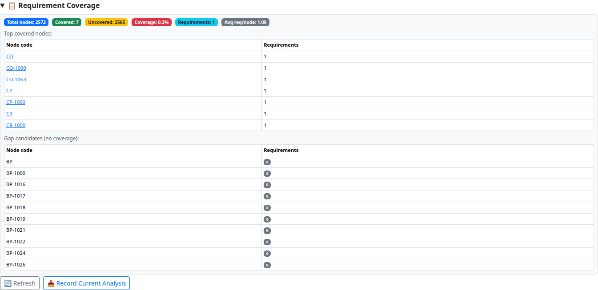

<details>
<summary>🔧 REST-API-Äquivalent (für Automatisierung)</summary>

```bash
curl -u "admin:${TAXONOMY_ADMIN_PASSWORD}" -X POST http://localhost:8080/api/gap/analyze \
  -H "Content-Type: application/json" \
  -d '{
    "businessText": "Patient data sharing across hospital departments",
    "scores": {"CP-1023": 92, "CO-1011": 88, "CR-1047": 81}
  }'
```

</details>

### Illustratives Beispielergebnis

```json
{
  "missingRelations": [
    {
      "source": "CO-1011",
      "target": "IP-1659",
      "suggestedType": "produces",
      "reason": "Communications service likely produces situation reports"
    }
  ],
  "incompletePatterns": [
    {
      "pattern": "Full Stack",
      "presentElements": ["CP-1023", "CO-1011", "CR-1047"],
      "missingLayers": ["Information Products"]
    }
  ]
}
```

---

## 4. Beziehungsvorschläge

**Ziel:** Die KI neue Beziehungen vorschlagen lassen und diese überprüfen.

### Schritt 1 — Vorschläge generieren

Klicken Sie im Panel **Relation Proposals** auf **Propose Relations** für einen bestimmten Knoten oder verwenden Sie den Massenvorschlags-Endpunkt.

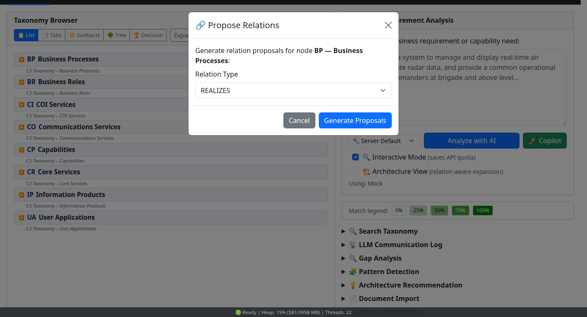

### Schritt 2 — Überprüfen

Jeder Vorschlag zeigt:

- **Quell-** und **Zielknoten**
- **Beziehungstyp** (z. B. supports, realises, produces)
- **KI-Begründung** — warum diese Beziehung existieren sollte

### Schritt 3 — Akzeptieren oder ablehnen

Klicken Sie auf **Accept**, um die Beziehung zum Wissensgraphen hinzuzufügen, oder auf **Reject**, um sie zu verwerfen.

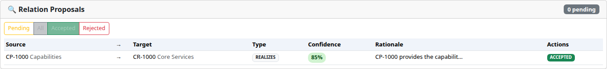

Nach dem Akzeptieren wird die Beziehung im Wissensgraphen sichtbar:

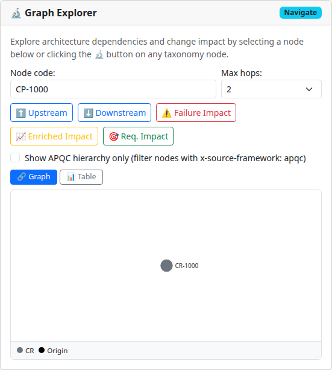

<details>
<summary>🔧 REST-API-Äquivalent (für Automatisierung)</summary>

```bash
# Vorschläge für einen Knoten generieren
curl -u "admin:${TAXONOMY_ADMIN_PASSWORD}" -X POST http://localhost:8080/api/proposals/propose \
  -H "Content-Type: application/json" \
  -d '{"sourceCode": "CR-1047", "relationType": "SUPPORTS"}'

# Ausstehende Vorschläge auflisten
curl -u "admin:${TAXONOMY_ADMIN_PASSWORD}" "http://localhost:8080/api/proposals/pending"

# Einen Vorschlag akzeptieren
curl -u "admin:${TAXONOMY_ADMIN_PASSWORD}" -X POST "http://localhost:8080/api/proposals/42/accept"

# Einen Vorschlag ablehnen
curl -u "admin:${TAXONOMY_ADMIN_PASSWORD}" -X POST "http://localhost:8080/api/proposals/42/reject"

# Massenweise akzeptieren/ablehnen
curl -u "admin:${TAXONOMY_ADMIN_PASSWORD}" -X POST http://localhost:8080/api/proposals/bulk \
  -H "Content-Type: application/json" \
  -d '{"ids": [42, 43, 44], "action": "ACCEPT"}'

# Eine Entscheidung zurücknehmen
curl -u "admin:${TAXONOMY_ADMIN_PASSWORD}" -X POST "http://localhost:8080/api/proposals/42/revert"
```

</details>

---

## 5. Architekturempfehlungen

**Ziel:** KI-gesteuerte Vorschläge für zusätzliche Architekturelemente und Beziehungen erhalten.

### Web-Oberfläche (empfohlen)

1. Analysieren Sie eine Anforderung (siehe [Beispiel 1](#1-anforderung--architektur)).
2. Wechseln Sie zum Reiter **Empfehlungen** im Ergebnisbereich.
3. Klicken Sie auf **💡 Empfehlungen generieren**.
4. Die Ergebniskarten zeigen empfohlene zusätzliche Architekturelemente und Beziehungen.

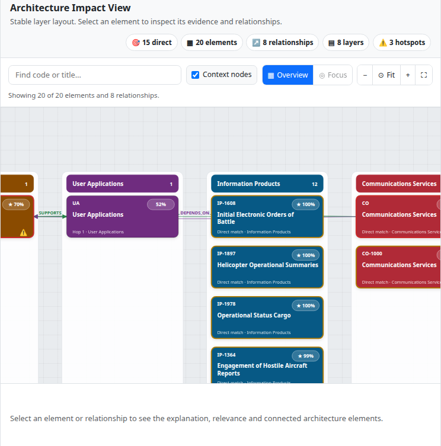

Siehe auch [Benutzerhandbuch](USER_GUIDE.md) für Details zur Empfehlungs-Oberfläche.

<details>
<summary>🔧 REST-API-Äquivalent (für Automatisierung)</summary>

```bash
curl -u "admin:${TAXONOMY_ADMIN_PASSWORD}" -X POST http://localhost:8080/api/recommend \
  -H "Content-Type: application/json" \
  -d '{
    "businessText": "Reliable remote access and coordination services for distributed field teams",
    "scores": {"CO-1056": 88, "CR-1047": 81}
  }'
```

</details>

### Illustratives Beispielergebnis

```json
{
  "recommendedNodes": [
    { "code": "CO-1063", "title": "Transport Services", "reason": "Directly relevant to remote access and coordination services requirement" },
    { "code": "CP-1023", "title": "Communication and Information System Capabilities", "reason": "Supports distributed field team coordination as stated in requirement" }
  ],
  "recommendedRelations": [
    { "source": "CO-1056", "target": "CO-1011", "type": "supports", "reason": "Transmission services support communications access" }
  ]
}
```

---

## 6. Diagramm-Export

**Ziel:** Eine Architekturansicht in ein branchenübliches Format exportieren.

### Web-Oberfläche (empfohlen)

Klicken Sie in der **Architekturansicht** auf die gewünschte Export-Schaltfläche:

- **📦 ArchiMate** — Exportiert die experimentelle ArchiMate-3.1-Teilmenge mit deklariertem Mapping-Profil; die Fremdwerkzeug-Abnahme steht aus
- **📊 Visio** — Exportiert als `.vsdx`-Datei
- **📝 Mermaid** — Exportiert als Mermaid-Flussdiagramm-Code

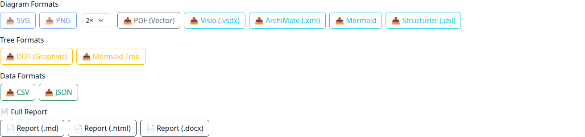

<details>
<summary>🔧 REST-API-Äquivalent (für Automatisierung)</summary>

### ArchiMate XML

```bash
curl -u "admin:${TAXONOMY_ADMIN_PASSWORD}" -X POST http://localhost:8080/api/diagram/archimate \
  -H "Content-Type: application/json" \
  -d '{"scores": {"CP-1023": 92, "CO-1011": 88, "CR-1047": 81}}' \
  -o architecture.xml
```

Die XML-Datei wird gegen den festgeschriebenen ArchiMate-3.1-XSD-Satz validiert. Eine Abnahme in benannten Architekturwerkzeugen ist noch nicht zertifiziert; beachten Sie [Mapping-Profil und Verlustbericht](../dev/ARCHIMATE_EXCHANGE_PROFILE.md).

### Visio

Für den exakt geprüften Snapshot verwenden Sie **Download Visio + manifest** in der Workbench (`{snapshotId}.visio.zip`). Das Paket erhält stabile Shape-Daten und ein durch Prüfsummen gebundenes Mapping-/Verlustmanifest. Der direkte VSDX-Endpunkt bleibt verfügbar. Die Microsoft-Visio-Desktop-Zertifizierung steht aus; siehe [Profil](../dev/VISIO_HANDOFF_PROFILE.md).

```bash
curl -u "admin:${TAXONOMY_ADMIN_PASSWORD}" -X POST http://localhost:8080/api/diagram/visio \
  -H "Content-Type: application/json" \
  -d '{"scores": {"CP-1023": 92, "CO-1011": 88, "CR-1047": 81}}' \
  -o architecture.vsdx
```

### Mermaid

```bash
curl -u "admin:${TAXONOMY_ADMIN_PASSWORD}" -X POST http://localhost:8080/api/diagram/mermaid \
  -H "Content-Type: application/json" \
  -d '{"businessText": "Integrierte Kommunikationsplattform für Krankenhauspersonal", "locale": "de"}'
```

</details>

Die Antwort ist ein Mermaid-Flussdiagramm-Codeblock, der in GitHub, GitLab, Notion und Confluence gerendert wird. Mit `"locale": "de"` werden Ebenen- und Beziehungsbeschriftungen auf Deutsch ausgegeben:

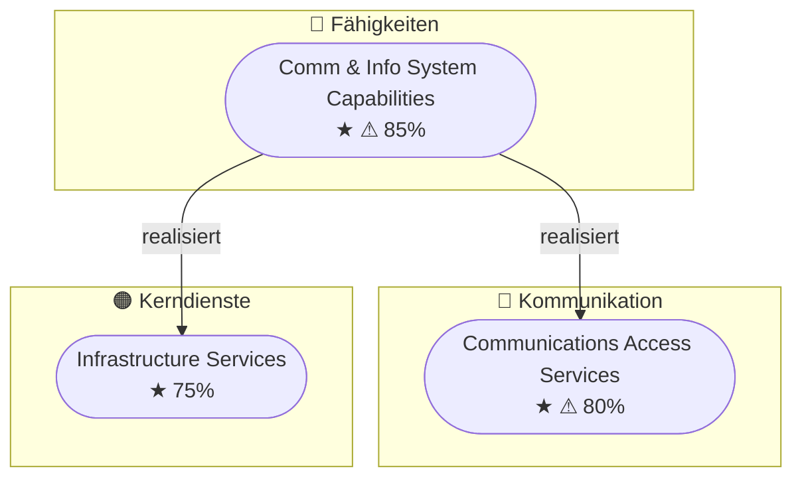

---

## 7. Feldservice-Überwachung — Ende-zu-Ende

**Ziel:** Einen hypothetischen Workflow durchlaufen — von der Anforderung bis zur exportierten Architektur.

**Illustration, kein protokollierter Modelllauf:** Die folgenden Bewertungen und
Vorschläge sind mögliche Prüfgegenstände. Für ein tatsächlich gespeichertes Modell
mit belegten Beziehungen verwenden Sie [Abschnitt 1](#1-anforderung--architektur).

### Anforderung

> _„Aufbau einer Feldservice-Überwachungsplattform zur Koordination von Wartungsteams, Echtzeit-Verfolgung des Asset-Status und Verwaltung von Arbeitsaufträgen über regionale Servicegebiete hinweg."_

### Schritt 1 — Analysieren

Fügen Sie die Anforderung in das Analyse-Panel ein und klicken Sie auf **Analyze with AI**.

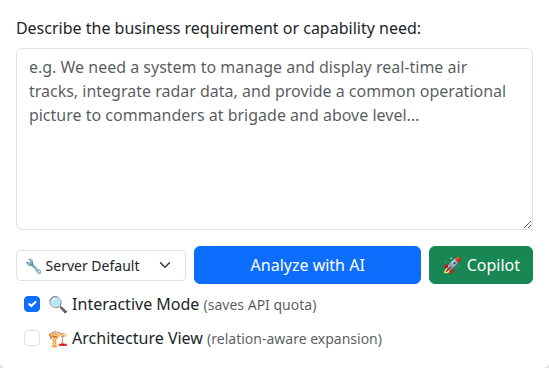

Die Analyse untersucht passende Katalogpfade; nicht besuchte Knoten sind keine
negativen Befunde. Hypothetische Treffer könnten folgende sein:

| Code | Knoten | Bewertung |
|---|---|---|
| CP-1022 | Intelligence Capabilities | 89 |
| CI-1023 | Surveillance Services | 85 |
| CR-1047 | Infrastructure Services | 78 |
| BP-1481 | Protect | 72 |

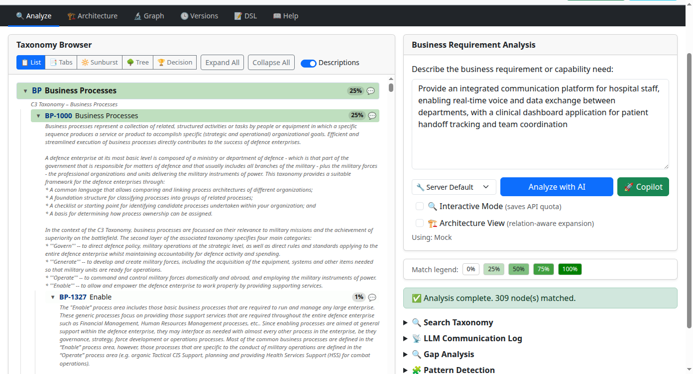

### Schritt 2 — Architekturansicht überprüfen

Die Architekturansicht gruppiert bewertete Knoten nach Schicht (Capability → Service → Process) und zeigt die Beziehungen zwischen ihnen.


### Schritt 3 — Auf Lücken prüfen

Die Lückenanalyse (automatisch im Reiter **Lücken**) kann folgende Ergebnisse liefern:
- Fehlende Verbindung zwischen Intelligence Capabilities und Surveillance Services
- Unvollständiges „Full Stack"-Muster (keine Information Product-Schicht)


### Schritt 4 — Beziehungsvorschläge generieren

Klicken Sie im Panel „Relation Proposals" auf **Propose Relations**. Die KI könnte vorschlagen:
- `CP-1022 REALIZES CI-1023` — „Fähigkeit → Dienst gemäß der REALIZES-Konvention dieses Katalogs“
- `CR-1047 SUPPORTS CI-1023` — „Infrastrukturdienste unterstützen die Feldüberwachung"

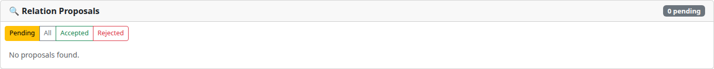

Akzeptieren Sie die sinnvollen Vorschläge; lehnen Sie die übrigen ab.

### Schritt 5 — Exportieren

Klicken Sie auf **ArchiMate**, um die Architektur als XML herunterzuladen. Die Abnahme in externen Architekturwerkzeugen steht noch aus; prüfen Sie Profil und Verlustbericht vor einer Übergabe.


---

## 8. Architektur-DSL-Workflow

**Ziel:** Die textbasierte DSL verwenden, um Architekturelemente zu definieren und zu versionieren.

### Web-Oberfläche (empfohlen)

1. Öffnen Sie den **DSL-Editor** über den Reiter **DSL** im rechten Panel.
2. Bearbeiten Sie die Architektur-DSL direkt im Editor.
3. Klicken Sie auf **💾 Speichern**, um die Änderungen zu committen.
4. Nutzen Sie den **Versionsverlauf** (Reiter **Versionen → Verlauf**), um Änderungen zu vergleichen.
5. Führen Sie Branches über das **Varianten-Panel** zusammen (siehe [Beispiel in der Git-Integration](GIT_INTEGRATION.md#merge)).

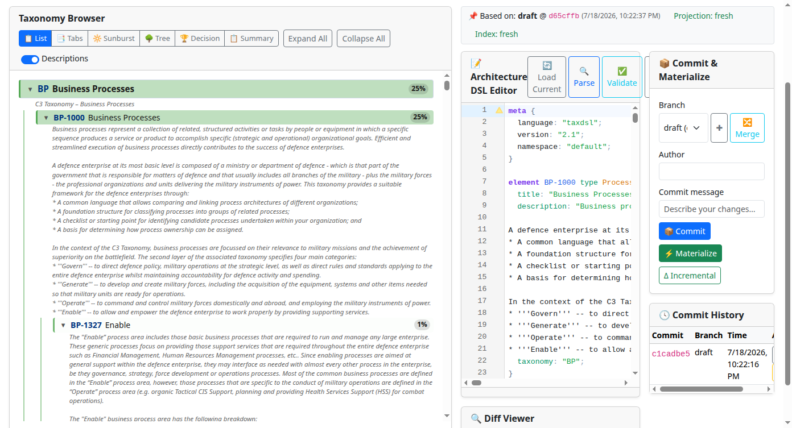

<details>
<summary>🔧 REST-API-Äquivalent (für Automatisierung)</summary>

### Schritt 1 — Aktuellen Zustand als DSL exportieren

```bash
curl -u "admin:${TAXONOMY_ADMIN_PASSWORD}" "http://localhost:8080/api/dsl/export"
```

Gibt DSL-Text zurück wie:

```
meta {
  language: "taxdsl";
  version: "2.0";
  namespace: "field-service-monitoring";
}

element CP-1022 type Capability {
  title: "Intelligence Capabilities";
}

element CI-1023 type Service {
  title: "Surveillance Services";
}

relation CP-1022 REALIZES CI-1023 {
  status: accepted;
  provenance: AI_PROPOSED;
}
```

### Schritt 2 — Bearbeiten und committen

Ändern Sie die DSL (Elemente, Beziehungen, Nachweise hinzufügen) und committen Sie:

```bash
curl -u "admin:${TAXONOMY_ADMIN_PASSWORD}" -X POST "http://localhost:8080/api/dsl/commit?branch=draft&message=add+field+monitoring+relations" \
  -H "Content-Type: text/plain" \
  -d @architecture.taxdsl
```

### Schritt 3 — Änderungen überprüfen

Zeigen Sie den Diff zwischen zwei Commits an:

```bash
curl -u "admin:${TAXONOMY_ADMIN_PASSWORD}" "http://localhost:8080/api/dsl/diff/semantic/{beforeId}/{afterId}"
```

### Schritt 4 — In accepted zusammenführen

```bash
curl -u "admin:${TAXONOMY_ADMIN_PASSWORD}" -X POST "http://localhost:8080/api/dsl/merge?fromBranch=draft&intoBranch=accepted"
```

Die zusammengeführten Änderungen werden in die Beziehungsdatenbank materialisiert und werden im Graphen und in den Architekturansichten sichtbar.

</details>
