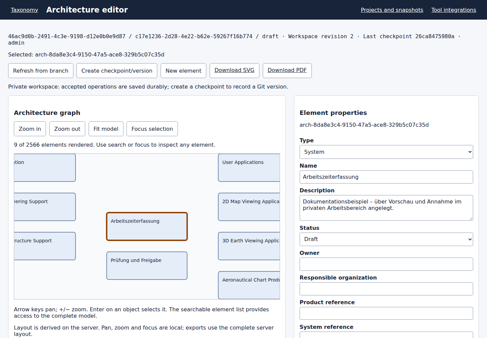
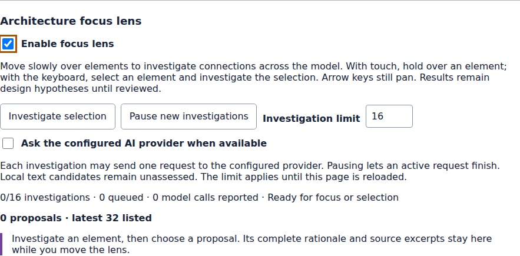

# Architecture editor

Open **Architecture editor** from Projects or the snapshot workbench. The context line shows repository, workspace, branch, semantic workspace revision, last checkpoint and actor. Historical revisions/versions and central read contexts are read-only. Use **Create private workspace** when repository membership allows it; editing also requires the ARCHITECT or ADMIN role.

*Application capture of a private example workspace after creating two System elements through **Preview change → Accept operation**. The selected element is “Arbeitszeiterfassung”; saved example names remain German in the English interface. [Source revision and capture record](../images/ui-documentation-2026-10-25.json); this single state does not establish acceptance of every editor action.*

1. Search the element list or select an object in the graph. Selection also updates properties, relations, evidence and the read-only DSL view. Copy the page URL to retain the exact context and selection.
2. Choose **New element**, or edit an existing element's properties. New identities are assigned by the server and remain stable when the display name changes. Taxonomy references and imported provenance remain read-only.
3. Enter a reason and choose **Preview change**. Review the affected blocks and displayed revision, then **Accept operation**. Nothing is persisted by typing or previewing. **Discard draft** restores the accepted properties.
4. To connect elements, choose a relation type and enter the target identity. Selecting a graph edge fills the relation form. Submitting an existing triple updates its review status. The server rejects incompatible directions/types, duplicates and self-relations. The containment parent field moves or ungroups an element with cycle and single-parent checks.
5. **Preview deletion** lists any blocking dependencies. Remove or reassign them explicitly before deleting the element or relation. No cascade is hidden behind the action.
6. **Preview undo** or **Preview redo** in history requests a new audited inverse command. Later dependent changes can block it. History survives reloads; native text undo affects only draft input. Git baseline revert is a separate versioning operation.

Every accepted edit is stored durably with its inverse data, actor and reason. It advances the workspace revision and **does not create a Git commit**. Undo/redo and all accepted changes survive browser reload and application restart.

**Editor history** lists individual personal operations. **Version history** lists Git checkpoints separately. Choose **Create checkpoint/version** with a reason to save the complete current workspace as a stable Git version. Equal content does not create another commit. Later edits stay durably in the workspace until the next checkpoint. Publish, merge, branch/baseline and restore commands checkpoint pending edits at their version boundary.

If the workspace revision changes after preview, choose **Refresh, compare and preview again**, inspect the new state and accept explicitly. A network failure retains the exact command identity. **Resume pending checkpoint** finishes an interrupted version write after reload; it does not duplicate an already written Git commit. **Recover completed version** reconciles a completed version write when no newer uncheckpointed edits exist. Graph/list projections are rebuilt from canonical source on each load.

Graph and element list share the server model. The list shows 50 searchable entries per page; the graph renders at most 200 nodes and 400 edges at once. Focus or search can reach objects outside the viewport. Arrow keys pan the focused graph and +/− change zoom. Forms provide a keyboard alternative to graph interaction.

SVG and vector PDF use the complete deterministic server layout at the displayed workspace revision or Git checkpoint. They are independent of local pan/zoom. The editor currently uses derived layout and a read-only synchronized DSL view; editable DSL translation, saved layouts, shared undo, richer evidence decisions and extended history remain tracked in [#814](https://github.com/carstenartur/Taxonomy/issues/814). Existing analysis snapshots remain immutable.

Implementation decision: [ADR 0005](../adr/0005-private-architecture-editor.md). [Deutsche Anleitung](../de/ARCHITECTURE_EDITOR.md).

### Focus lens and arrangement

Open **Projects → Architecture editor** and scroll below the graph and arrangement
controls to **Architecture focus lens**. Select the **Enable focus lens** checkbox.
It is available only in the current editable workspace; historical revisions and
central read contexts do not allow investigations.

*Application capture of the focus-lens panel in an editable example workspace:
**Enable focus lens** is checked and the AI option is unchecked.
[Source revision and capture record](../images/architecture-editor-focus-capture.json).*

Slowly sweep over elements, or select an element and choose **Investigate selection**. A touch
hold works as well. The lens chooses starting elements; possible endpoints can be
anywhere in the current model, including newly created elements. Arrow keys and
zoom controls remain available while the lens owns pointer movement.

Each element shows whether investigation is queued, running, assessed, unassessed,
failed or stale. The default limit is 16 investigations per page session (adjustable
from 1 to 128); **Pause new investigations** lets the current request finish.
With the AI option selected, an investigation can use the configured generative
provider. Local-only, unavailable and mock providers leave candidates explicitly
unassessed. The current sources are canonical element text and mapped requirements;
the lens does not discover external systems or verify deployed connections.

Dashed arrows and the proposal list open a pinned review with the full rationale,
method, source revision and quoted evidence. **Accept relationship** is the
confirmation: it stores one audited relation, its rationale and provenance, without
a second dialog. **Dismiss proposal** applies to this investigation only. **Undo**
uses the accepted operation; history offers undo/redo after reload. Network retries
retain the same operation identity. A changed revision makes other proposals stale
and requires a fresh investigation before acceptance. Suggestions themselves are
temporary; accepted relationships and evidence are durable.

**Stable order** preserves the default arrangement. **Reduce crossings**, followed
by **Rearrange explicitly**, computes a deterministic heuristic arrangement; it
does not guarantee a crossing-free graph. That ordering is pinned to the chosen
workspace revision, so accepting or undoing a relation keeps positions and the
camera stable. Rearrange again to optimize for subsequent changes. The URL records
the strategy and reference revision; SVG and PDF use that same server ordering
with the currently displayed model. Ghost suggestions are excluded from exports.

### Neutral packages and requirement mappings

The **Packages** panel creates, renames, describes, moves and deletes organization
boundaries without adding taxonomy elements or `CONTAINS` relations. It uses the
same preview, rationale, exact workspace revision and undo/redo journal as element
editing. Select a package or element, parent and zero-based position to move it;
**Detach selected element** removes explicit membership. Detach children before
deleting a package. All controls support keyboard navigation.

`SET_PACKAGE_PLACEMENTS` is one atomic final-state command. Its `placements` list
contains `{kind: "PACKAGE"|"ELEMENT", memberId, parentPackageId, position}` and
`completeParentScopes` lists every touched old/new parent. Empty-string parent is
the explicit model root; null parent with position -1 detaches only an element.
Retain every existing sibling in each touched scope. Unrelated ungrouped elements
are outside the root list. Swaps and cross-parent moves are validated together;
cycles, duplicate/gapped positions and depth above 80 fail before journal writes.
Package updates accept only title/description; placement cannot bypass this command.

`UPSERT_REQUIREMENT_MAPPING` uses `sourceId` for a real canonical requirement and
`targetId` for an architecture element. It retains review rationale and bounded
`x-exchange-*` provenance; analysis-owned mapping headers cannot be overwritten.
`DELETE_REQUIREMENT_MAPPING` removes an exchange-owned mapping. These operations
never relax the architecture relation type matrix.
