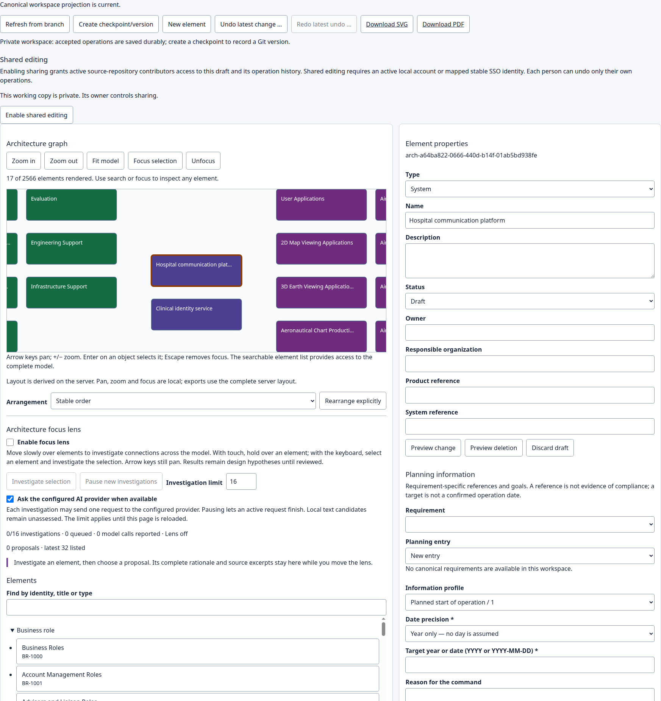

# Architecture editor

Open **Architecture** in the shared main navigation and choose **Working architecture** under **Displayed architecture**. Links from Projects or saved analyses open the same workspace with their selected context. The shared context shows the architecture, project, requirement and selected stand. **Technical details** exposes the exact repository/workspace identities, full commit and available snapshot/version identifiers. Historical revisions/versions and central read contexts are read-only. Use **Create private workspace** when repository membership allows it; editing also requires the **ARCHITECT** role.

**Current analysis**, **Saved analysis snapshot** and **Working architecture** are
three sources within this architecture workspace. Switching retains analysis text
and results as well as editor drafts. Replacing an unaccepted form with another
working context or element selection requires confirmation. Adopting a saved
analysis remains an explicit preview-and-accept action; selecting a source does
not import elements or relationships. Existing editor and workbench links resolve
into this workspace with their source and version coordinates.

*Application capture of a private example workspace after creating two System elements through **Preview change → Accept operation**. The selected element is “Hospital communication platform”. [Source revision and capture record](../images/documentation-screenshots.json); this single state does not establish acceptance of every editor action.*

1. Search the element list or select an object in the graph. Selection also updates properties, relations, evidence and the read-only DSL view. Copy the page URL to retain the exact context and selection.
2. Choose **New element**, or edit an existing element's properties. New identities are assigned by the server and remain stable when the display name changes. Taxonomy references and imported provenance remain read-only.
3. Enter a reason and choose **Preview change**. Review the affected blocks and displayed revision, then **Accept operation**. Nothing is persisted by typing or previewing. **Discard draft** restores the accepted properties.
4. To connect elements, choose a relation type and enter the target identity. Selecting a graph edge fills the relation form. Submitting an existing triple updates its review status. The server rejects incompatible directions/types, duplicates and self-relations. The containment parent field moves or ungroups an element with cycle and single-parent checks.
5. **Preview deletion** lists any blocking dependencies. Remove or reassign them explicitly before deleting the element or relation. No cascade is hidden behind the action.
6. **Preview undo** or **Preview redo** in history requests a new audited inverse command. Later dependent changes can block it. History survives reloads; native text undo affects only draft input. Git baseline revert is a separate versioning operation.

Above the graph, **Undo latest change …** and **Redo latest undo …** preview the
latest applicable personal operation from the full history.
The preview still requires acceptance. If an unaccepted draft exists, the editor
asks before it may be discarded. The server can reject an undo when later changes
depend on it; the toolbar does not silently select an older operation.

Every accepted edit is stored durably with its inverse data, actor and reason. It advances the workspace revision and **does not create a Git commit**. Undo/redo and all accepted changes survive browser reload and application restart.

**Editor history** lists individual personal operations. **Version history** lists Git checkpoints separately. Choose **Create checkpoint/version** with a reason to save the complete current workspace as a stable Git version. Equal content does not create another commit. Later edits stay durably in the workspace until the next checkpoint. Publish, merge, branch/baseline and restore commands checkpoint pending edits at their version boundary.

If the workspace revision changes after preview, choose **Refresh, compare and preview again**, inspect the new state and accept explicitly. A network failure retains the exact command identity. **Resume pending checkpoint** finishes an interrupted version write after reload; it does not duplicate an already written Git commit. **Recover completed version** reconciles a completed version write when no newer uncheckpointed edits exist. Graph/list projections are rebuilt from canonical source on each load.

Search in the **Architecture tree** opens the path to a matching element. Under **Organization directory**, create a department or team and optionally choose its parent unit. The directory belongs to the selected architecture version. Collaborators on the same working copy share its entries.

Select a branch in the tree, choose its **Responsible unit for this branch**, preview the change and accept it. Descendants inherit the closest assignment. A nested branch may have its own assignment. **Inherit from parent** removes that override. The form identifies the element where the effective assignment originated. Existing free-text entries remain visible and can be replaced with directory units.

Enable **Show responsibilities** to add a color stripe to each assigned element in the architecture and decision trees. The unit name appears where an assignment starts or changes. The report export dialog has the same option. Saved analyses show responsibilities from the model used for that analysis. Older results without a recorded model binding have no responsibility markings.

The tree and graph share their selection. The graph displays up to 200 nodes and 400 edges at once. Arrow keys pan the focused graph and +/− change zoom.

SVG and vector PDF use the complete deterministic server layout at the displayed workspace revision or Git checkpoint. They are independent of local pan/zoom. The editor currently uses derived layout and a read-only synchronized DSL view; editable DSL translation, saved layouts, shared undo, richer evidence decisions and extended history remain tracked in [#814](https://github.com/carstenartur/Taxonomy/issues/814). Existing analysis snapshots remain immutable.

Implementation decision: [ADR 0005](../adr/0005-private-architecture-editor.md). [Deutsche Anleitung](../de/ARCHITECTURE_EDITOR.md).

## Review an architecture change set

In the editable working architecture, open **Review an architecture change set**.
Choose a new element, its directed relation to an existing element, and the
existing requirement to allocate to the new element. Start from a Git checkpoint
that includes the current working revision. Enter a reason and preview the three
changes before accepting them.

The preview shows the Git target and the before and after of each affected
model block. Acceptance saves the set in one Git checkpoint. If any change is
invalid or the branch has advanced, the editor requires a new review.

When previewing adoption of a saved analysis from a checkpointed working
revision, choose **Adopt analysis and create checkpoint** to publish its
reviewed model changes together. The preview shows the Git target and the
resulting model changes. The checkpoint retains the exact source analysis.

## Share a working copy

Working copies start private. As the owner, choose **Enable shared editing** in
the **Shared editing** section to let authorized contributors work in this same copy.
Contributors need active, explicit contributor membership in the source repository,
the **ARCHITECT** role, and an active local account or mapped stable SSO identity.
Editing and changing sharing require **ARCHITECT**; Bearer API calls also require
the `architecture:write` scope.

Copy the complete address from the read-only **Link for authorized contributors**
field and share that exact link. It opens this working copy for people who already
have the required access.

Choose **Refresh from branch** to see other contributors' accepted changes. Your unsaved form
draft remains in place. After a revision conflict, refresh, compare the new state
with your draft and preview again before accepting. Undo applies to your own
accepted operations; later dependent changes can prevent it.

As the owner, choose **Make this working copy private** to stop further contributor
access. Previously accepted changes and their operation history remain in the copy.

## Reconcile a changed Git stand with local work

An accepted local operation can survive even when its Git checkpoint has not
finished. `CHECKPOINT_PENDING` is not a completed Git version. After an interrupted
Git write, reload and use **Resume pending checkpoint** with the retained intent.
The editor document exposes that intent as `pendingCheckpointId`. An exact retry
keeps the original command identity and does not repeat its business changes.

If Git HEAD has changed, use **Reconcile local and incoming state**. Simply repeating a save does
not choose how to resolve a branch conflict. The existing **Recover completed
version** action applies only when no newer uncheckpointed local changes exist.

1. Choose **Preview** and inspect the base, local working source,
   incoming Git source and proposed result. Previewing writes nothing.
2. Read every conflict and select **Keep local** or **Use incoming**.
   Each choice selects the complete source block, including its retained comments
   and unknown properties. A separate source conflict can concern document metadata.
3. Inspect additions and deletions. An absent side can remove a supported model
   block; it cannot silently delete managed portfolio history.
4. After choosing resolutions, choose **Preview** again and inspect
   the resulting source. Later changes to decisions or scope invalidate acceptance.
5. Choose **Accept reviewed change** only for that exact preview. If the
   workspace revision or Git HEAD changes, obtain and review a new preview.

The four diagrams use one shared arrangement of object identities, so a rename or
type change does not move the object between views. Deleted objects remain visible
in the versions that contain them. Select an object to highlight its property rows;
the table distinguishes model meaning, view/layout changes and exchange evidence.
Unknown repeated properties retain all their values. Complete source disclosures
also show comments and document metadata that diagrams do not represent.
While choices remain unresolved, the proposed model is explicitly unavailable.
Editing the rationale, changing a choice or leaving the selected context discards
the displayed comparison and requires another preview.

Managed requirement text, title, version and hash must remain consistent with the
portable current immutable version. Existing immutable version source cannot be
rewritten. Keep the local blocks and create a new requirement version for changed
text. If the incoming source omits managed business blocks, choose **Keep local** and use the explicit archival workflow. Incompatible choices are rejected;
they do not become a partially accepted portfolio. Accepted portfolio changes and
editor state are saved together before the Git checkpoint is published. A later
Git storage interruption still uses the pending-checkpoint recovery above.

The [API contract](PROJECT_PORTFOLIO_API.md#editor-version-reconciliation-api)
describes the exact revision, HEAD and preview fingerprint checks.

## Review requirement realization

Expand **Requirements, realization and history**. **Text version in selected stand** is
the requirement version in the loaded model; the reviewed version is the exact
version assessed against its dependencies. The current requirement header can
therefore show version 2 while a historical model still contains version 1.
Snapshot source versions remain separate from both.

In the current editable workspace, select the original requirement, contributing
project, `OPEN`, `PARTIAL` or `COMPLETE`, supporting architecture dependencies and a
rationale. Preview, compare the exact version and changes, then accept explicitly.
Partial and complete reviews require evidence. Relationship endpoints and mapping
targets are included in the dependency assessment. A later text or dependency
change produces `REVIEW_REQUIRED`; invalid evidence produces `INVALID_EVIDENCE`.
The previous reviewed version is retained. Neither an AI relevance score nor a
project's completion substitutes for this review.

This accepted lifecycle contribution includes an explicit Git checkpoint boundary.
Inspect its publication state before treating it as a completed version. An older
semantic revision or Git checkpoint is read-only and has no overlay from today's
portfolio. The lifecycle panel, editor and shared context follow the same selected
stand, including browser Back/Forward. **Show current working state** and **Refresh** reload the corresponding editor document as well.

See [Architecture lifecycle](PROJECT_REQUIREMENT_PORTFOLIO.md#architecture-lifecycle)
and [Requirement history](PROJECT_REQUIREMENT_PORTFOLIO.md#requirement-history).

## Focus lens and arrangement

In **Architecture**, check the displayed source first. The analysis lens opens
in this workspace and retains the input text and selection. For **Current analysis**,
the displayed draft is saved and its acknowledged version is checked before
investigation. For **Saved analysis snapshot**, the lens investigates the exact
selected snapshot. Both sources remain unchanged. If complete retained evidence
is unavailable, the application explains why; **Refresh source** checks it again.

**Relationship proposals** shows the proposals available for the displayed
architecture. Select an element in the diagram, open its **Architecture focus
lens**, and choose **Investigate selection**. The diagram also has an
**Investigate on hover** switch. Possible endpoints span the displayed model.

Investigations use local text by default. Selecting **Ask the configured AI
provider when available** allows a request to the configured provider. The
default limit is 16 investigations per page and can be set from 1 to 128.
Pausing lets the current request finish.

Select a proposal or a dashed arrow to review its direction, rationale and
source excerpts. **Source and method** shows the technical provenance. In
analysis and snapshot sources, you can dismiss the proposal or show the other
element. The snapshot action **Open adoption preview** opens an
adoption preview for the entire saved snapshot.

In the current editable **Working architecture**, **Preview relationship
change** shows the element names, direction, and evidence. To review several
relationships together, mark the relevant proposals in the list and open the
preview for the selection. Confirmation saves those relationships and their
individual rationale and evidence together. **Undo** previews reversing the
entire confirmed change. Investigate the element again when its
proposal becomes stale. Accepted relationships and their evidence are durable.

**Stable order** preserves the default arrangement. **Reduce crossings**, followed
by **Rearrange explicitly**, computes a deterministic heuristic arrangement; it
does not guarantee a crossing-free graph. That ordering is pinned to the chosen
workspace revision, so accepting or undoing a relation keeps positions and the
camera stable. Rearrange again to optimize for subsequent changes. The URL records
the strategy and reference revision; SVG and PDF use that same server ordering
with the currently displayed model. Ghost suggestions are excluded from exports.

## Ask about the displayed architecture

In the **Architecture** workspace, select an analysis draft, a saved snapshot, a Git checkpoint or the current working revision. Open **Ask about this architecture** and ask, for example, “Which services support invoice validation?” or “Which of those assignments are still open?” A follow-up can refer to the previous answer.

Use **Show model evidence** to see the records cited for each statement. The provider and the number of model facts supplied appear below each answer. Answers are AI interpretations of the selected version. Changing the version clears the conversation. For a vLLM endpoint use the existing OpenAI-compatible provider. The dialogue requires permission to execute analyses.

## Neutral packages and requirement mappings

The **Packages** panel creates, renames, describes, moves and deletes organization
boundaries without adding taxonomy elements or `CONTAINS` relations. It uses the
same preview, rationale, exact workspace revision and undo/redo journal as element
editing. Select a package or element, parent and zero-based position to move it;
**Detach selected element** removes explicit membership. Detach children before
deleting a package. All controls support keyboard navigation.

`SET_PACKAGE_PLACEMENTS` is one atomic final-state command. Its `placements` list
contains `{kind: "PACKAGE"|"ELEMENT", memberId, parentPackageId, position}` and
`completeParentScopes` lists every touched old/new parent. Empty-string parent is
the explicit model root; null parent with position -1 detaches only an element.
Retain every existing sibling in each touched scope. Unrelated ungrouped elements
are outside the root list. Swaps and cross-parent moves are validated together;
cycles, duplicate/gapped positions and depth above 80 fail before journal writes.
Package updates accept only title/description; placement cannot bypass this command.

`UPSERT_REQUIREMENT_MAPPING` uses `sourceId` for a real canonical requirement and
`targetId` for an architecture element. It retains review rationale and bounded
`x-exchange-*` provenance; analysis-owned mapping headers cannot be overwritten.
`DELETE_REQUIREMENT_MAPPING` removes an exchange-owned mapping. These operations
never relax the architecture relation type matrix.

## Tool integrations

Open **Tool integrations** from the architecture editor. Select a connection and its format profile, then review the proposed changes against the selected private workspace. The preview preserves the external evidence without changing the model. Accept an import only after reviewing its changes; acceptance changes the model and creates an explicit version. Connection authority determines which exchange operations are available.

The connection summary shows the tool, external project, branch, workspace revision and authority. Expand the connection or operation details when technical information is needed.

The shared application navigation remains available on this page. Repository, workspace and branch are retained when moving between the architecture editor and tool integrations; **Projects** returns to the project overview.

## From a requirement to a reviewed ADMBw delivery view

1. Open the saved requirement and run Copilot. The automatic analysis defaults
   to all taxonomies, node assessment and relation search, with the architecture
   view selected for a new draft. It uses the configured
   server provider and continues relation searches within its remaining budget.
   Resolve analysis questions and rerun any newly accepted requirement version.
2. Open Architecture and select the analysis or saved snapshot. Use the
   Architecture Lens to review proposed relationships and their source evidence.
   Use the separate snapshot action to preview and confirm adoption of the saved stand.
3. Open **Prepare C1–S1 and R7 from this workspace**. Inspect the agreed closed
   `.qea` file, select the native references, and review the service contribution
   and the operational constraint against the current requirement quotation.
4. Check delivery coverage and review the service contribution and R7
   derivation separately. Save the reviewed changes to a checkpoint. Download
   the assessment and, when the native checks permit it, the QEA copy from the
   same panel. Taxonomy uses the saved checkpoint, reviewed view and selected
   basis for the download. Verify the native delivery in Enterprise Architect
   with the agreed ADMBw MDG.

**Bind the architecture brief to requirements.** In a writable working copy, save the architecture objective and open **Select requirements and excerpts**. Select each project requirement and enter the exact supporting passage. Preview shows the complete replacement set, including project and requirement keys, version numbers and content hashes. A changed requirement requires a fresh preview. The selected checkpoint retains the previous assignment set for historical review.

**Correct a finding.** In a working delivery preview, choose **Edit the affected object** next to a supported finding. The editor opens the element, relationship or R7 planning entry named by the assessment. Preview and accept the model edit. The delivery panel recomputes a valid draft against the new revision. Review both approvals again before accepting the delivery. Findings on historical checkpoints remain available for inspection.

**Continue after reloading the tab.** Return to the same workspace, branch and user. The panel looks up the original operation, including after a response was lost. If publication is pending, retry its checkpoint. Reselect the agreed QEA file and choose **Check native export**. The check uses the saved checkpoint, project, view, root and whole-model coverage. Newly reviewed deliveries require the saved SHA-256 of the uploaded basis. Download rechecks the file and produces a separate copy for manual inspection in Enterprise Architect.

The Sparx plugin is required for native QEA delivery. See the
[illustrated walkthrough (German)](https://github.com/carstenartur/Taxonomy/blob/main/docs/de/ARCHITECTURE_EDITOR.md#architecture-delivery-guide).

## Prepare an ADMBw delivery

Use **ADMBw element assignment** to record catalogue references and stereotypes,
and **ADMBw R7 derivation** under requirement planning information to bind the
derivation to an exact requirement version. Open a Git checkpoint and use
**Assess ADMBw delivery at this checkpoint** to download the structural assessment and modeling
data for C1–S1 and R7. The report identifies the reviews required for native
delivery. [Rules and delivery evidence (German)](https://github.com/carstenartur/Taxonomy/blob/main/docs/features/admbw-conformance-de.md)

### Architecture brief and source assignments

Open **Architecture brief** in a model workspace to record the objective, decision question, stakeholders, system boundary, current/transition/target state, reference architecture, views and deliverables. Preview the change, check the displayed workspace and revision, then accept. Opening an earlier revision shows its own brief. A project that continues the same architecture can reuse the brief already recorded in its model history.

Add each applicable source separately under **Sources and modelling constraints**. Specify its identifier, edition, section, purpose, authority and scope. Choose the European Interoperability Reference Architecture (EIRA) for relevant public-service interoperability work, the Föderale IT-Architekturrichtlinie for applicable federal projects, an applicable exchange profile such as ADMBw R7 / FFFmLV, or enter the client's own reference. The selector records a reference. Actual import formats and mappings belong to the respective exchange tools. [EIRA](https://interoperable-europe.ec.europa.eu/collection/interoperability-architecture-solutions/solution/eira) · [Föderale IT-Architekturrichtlinie](https://www.it-planungsrat.de/beschluss/beschluss-2025-17)

For an unresolved interpretation, choose **Unresolved** and record the question and its source. For a binding, architecture-wide decision with an identified edition and section, choose **Exclude a relation type from new proposals (v1)** and select the type. The editor and model-focused AI candidate selection exclude that type before generating a proposal. Multiple source assignments combine their explicit restrictions. A guidance citation alone applies no automatic checks. Existing relationships and the history of accepted decisions are retained.
