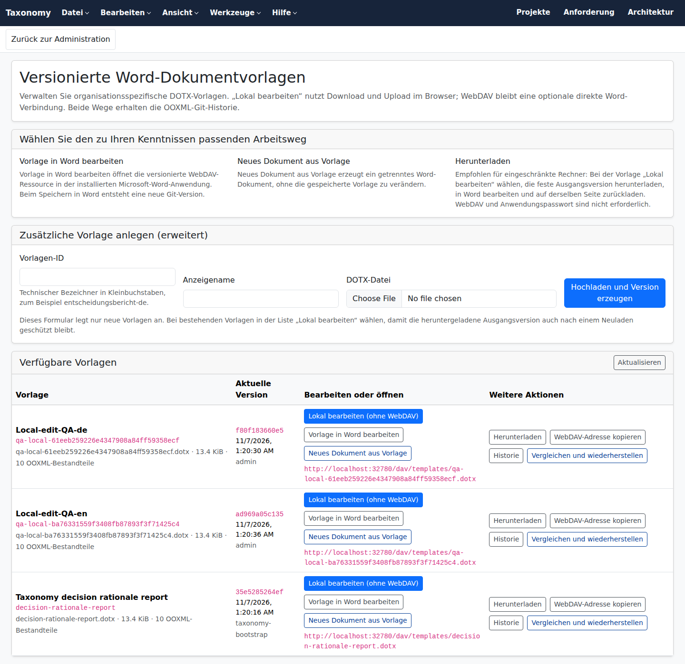
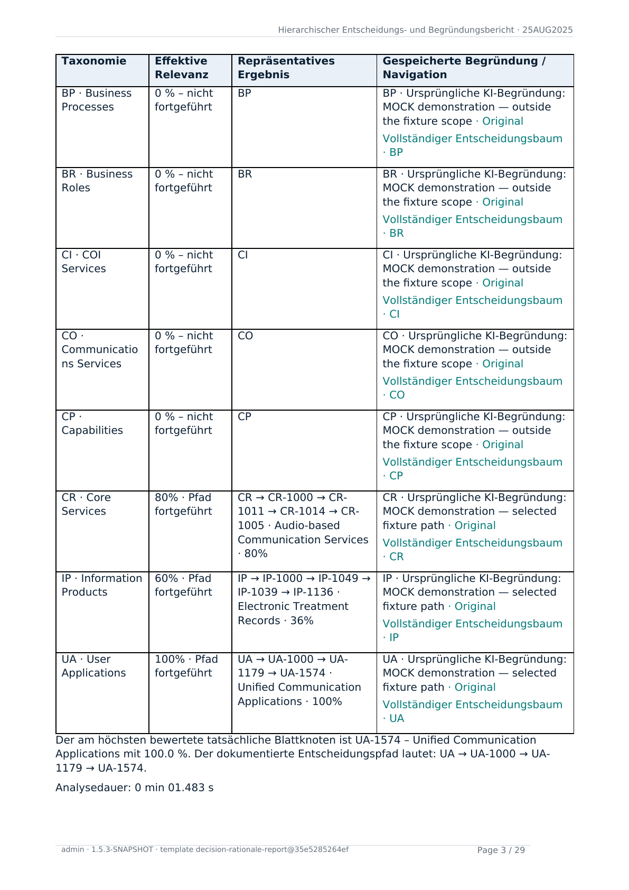

# Versioned Word templates

Taxonomy stores Word templates as unpacked OOXML package trees in the logical
JGit/Hibernate repository `taxonomy-document-templates`. WebDAV and downloads
materialize complete `.dotx` files from that canonical representation.

<a id="template-editing"></a>
## User interface and automated download test

The administration page at `/admin/document-templates` shows the report template
seeded on first startup, its Git version, the complete WebDAV address, and the actions
**Edit template in Word**, **New document from template**, **Download**, **History**,
and **Compare and restore**. The screenshot below was captured by the automated
browser test and shows the `ms-word:ofe` action on the template that was actually
created during application startup.

[](../images/document-template-management.png)

The `Document Template Report E2E` GitHub workflow starts the packaged Taxonomy
application through Testcontainers. Playwright signs in as an administrator, waits for
the idempotently seeded default template, verifies the visible Word and WebDAV links,
opens the template detail page, and downloads a data-free DOCX test report. The test
requires HTTP 200, the DOCX media type, the expected filename in
`Content-Disposition`, a plausible ZIP/DOCX signature, and a minimum file size.
LibreOffice then renders the report that was actually downloaded to PDF, and
`pdftoppm` captures its first page as shown below.

[](../images/decision-rationale-template-test-report.png)

The workflow artifact also contains the downloaded DOCX, the rendered PDF, both
screenshots, the Playwright log, and JSON evidence recording the URL, media type,
filename, file size, and SHA-256 digest. This test proves container startup, default
seeding, the browser surface, and the report-download path. It does not replace the
separate acceptance test with an installed Microsoft Word version through public HTTPS
and WebDAV.
The required environment and evidence are tracked in
[EXT-03](../internal/TODO-EXTERNAL-INPUT.md#ext-03); shared-lock and recovery
implementation remains in [#828](https://github.com/carstenartur/Taxonomy/issues/828).

## Default decision-rationale report template

The application ships the required template

```text
decision-rationale-report
```

inside the container/JAR. On the first successful startup it is imported
idempotently as an initial Git commit. If the template already exists, neither a
restart nor a software update overwrites it, so organisation-specific logos,
identity data, and layout changes remain intact.

The DOCX decision report is rendered from the current Git version of this template.
Test reports in the template history and local editing pages use the version shown
by their link. The DOCX records that version's Git commit and package checksum.

Taxonomy recognizes, among others, these tokens:

```text
{{taxonomy.report.title}}
{{taxonomy.report.subtitle}}
{{taxonomy.report.status}}
{{taxonomy.report.requirement}}
{{taxonomy.report.generatedAt}}
{{taxonomy.report.generatedBy}}
{{taxonomy.report.taxonomyVersion}}
{{taxonomy.report.applicationVersion}}
{{taxonomy.report.workspace}}
{{taxonomy.report.branch}}
{{taxonomy.template.id}}
{{taxonomy.template.commit}}
{{taxonomy.report.body}}
```

`{{taxonomy.report.body}}` must occur exactly once as its own paragraph and be the
last non-empty body block. Taxonomy removes it during export and appends the
executive summary, decision chapters, diagrams, and appendix. The cover, images,
headers and footers, page setup, and Word styles remain part of the editable DOTX
template.

Uploads and restores of the default template are checked against this semantic
contract in addition to the generic OOXML security validation. The
`decisionRationaleTemplate` Actuator health component reports `DOWN` when the
required template is missing or structurally invalid.

## Preflighting an exact candidate

From a template's history, choose **Preflight a candidate**, submit a DOTX and open its representative DOCX sample. The original upload and bounded JSON validation report are available on the candidate page. The sample's `Taxonomy.Template.Commit` property identifies the immutable candidate source. Administrators can activate that candidate while the displayed active revision still matches. A failed sample leaves the candidate available for inspection and repair. After another administrator changes the active revision, submit a fresh candidate. The submitted original and sample are stored in the installation's separate Git repository `taxonomy-document-template-candidates`. The current template's existing Git history and canonical DOTX downloads remain accessible on its history page.

The decision-report family accepts two version-one block content controls in the main Word body. Set the **Tag** property to `taxonomy.repeat.chapters.v1` or `taxonomy.repeat.appendix.v1`. Place styled paragraphs or tables inside the block and add inline controls tagged `taxonomy.field.<name>` inside their paragraphs. Use one block per kind. Chapter fields are `number`, `code`, `title`, `score`, `summary` and `comparison`. Appendix fields are `code`, `title`, `score`, `path` and `reason`. The sample text in each field supplies the run formatting. The DOCX renderer places one styled copy per frozen chapter or leading leaf below its generated section heading, strips the authoring controls and retains the ordinary evidence sections. Omitted sections and empty collections produce zero copies.

Use static branding and supported text tokens in the ordinary header/footer stories. Repeat blocks support unbound text and tables in the main story. Drawing/text-box tokens, nested repeat blocks, data bindings, section breaks, bookmarks, fields and linked or review-bearing content inside the repeat are rejected. The repeated copies are bounded to 120,000 XML elements and eight million text characters, including values. The validation report contains identities, digests and status; private text from a failed render is excluded.

## Audit provenance

Every template-backed DOCX stores its exact Word-template identity independently of
visible cover tokens. The custom document properties are
`Taxonomy.Template.Id`, `Taxonomy.Template.Commit`,
`Taxonomy.Template.PackageSha256`, and `Taxonomy.Template.SchemaVersion`. The commit
is the complete 40-character Git object ID and the package digest is the canonical
64-character SHA-256 from the validated template manifest. Removing the optional
`{{taxonomy.template.*}}` presentation tokens therefore does not remove the audit
record.

The DOCX download response exposes the same values through the allow-listed headers
`X-Taxonomy-Template-Id`, `X-Taxonomy-Template-Commit`,
`X-Taxonomy-Template-SHA256`, and `X-Taxonomy-Template-Schema-Version`. Internally the
format-neutral renderer result carries the same four fields as immutable artifact
metadata; HTML and JSON outputs do not claim a Word-template identity.

Auditors can inspect the properties in Word under **File → Info → Properties →
Advanced Properties → Custom**, or without Word by reading `docProps/custom.xml` from
the DOCX ZIP package. Compare the full commit with the template history and the
SHA-256 with the corresponding `template.json` manifest.

<a id="template-versions"></a>
## Version and concurrency semantics

Each template exposes the last Git commit that changed its own OOXML subtree as its
version and HTTP ETag. A commit to another template therefore does not invalidate an
open editor or cause a false conflict. Creating a template is create-only; replacing
or restoring one requires the current template ETag. `If-Match` uses strong HTTP
entity-tag semantics, accepts comma-separated alternatives, and never creates a
missing resource.

WebDAV leases use the configured shared database. Acquisition, refresh, expiry and
release therefore apply across application instances; a restart retains an unexpired
lease. Database time owns expiry. A transactional fence remains held through the
existing bounded Git save, so another instance cannot take over an expired lease
while that save is committing. Each accepted PUT validates and commits its bytes
before acknowledging success; no uncommitted edit-session buffer is introduced.

The template feature migrates its own transient coordination tables through
`webdav_lock_schema_history`. All instances must use the same installation database.
An unavailable coordination store rejects WebDAV writes with HTTP 503 and never
falls back to independent local locks. After an uncertain response, read the current
template and ETag before retrying. Git's per-template expected-version comparison
continues to reject stale saves and preserve previous revisions. These lock guarantees
do not establish a cluster capacity envelope or native Microsoft Word certification;
the shipped Helm default remains one replica.

<a id="template-access"></a>
## Access and transport

Authenticated users may read complete templates and create a new document from them.
Only administrators may upload, restore, lock, or save a template. Direct desktop Word
links require HTTPS, except for loopback development addresses. Normal HTTPS download
and a copyable WebDAV URL remain available as fallbacks.

The Keycloak profile disables direct `ms-word:` links by default. Desktop Word cannot
reuse the browser OIDC session and does not receive Taxonomy's bearer token. Operators
must not re-enable the links until they provide and test a WebDAV-compatible credential
flow such as a scoped application password. Bearer-capable WebDAV clients can continue
to use the endpoint directly.

New application passwords belong to the issuing account and login binding. In the local
profile, each WebDAV request checks the account, its binding and its current roles.
Removing the administrator role removes write access on the next request. Disabling
the account also removes read access. A different account with the same name cannot
manage those credentials.

In Keycloak, the displayed expiry is the earlier of the requested end date and the
expiry of the verified login assertion used to issue the credential. Sign in again
and issue a new application password when that time is reached. In STABLE mode each
use also checks the issuing OIDC binding in the local registry. In LEGACY mode the
issuer and subject identify the grant. Once that binding is registered for migration,
the old credential can no longer be used. After upgrading from a username-only
credential store, sign in and issue replacement credentials. Existing password
verifiers contain no evidence of the original account binding.

Taxonomy application credentials have one exact 71-character ASCII format. The WebDAV
filter rejects oversized Basic headers, invalid UTF-8, overlong decoded usernames or
passwords, and malformed `taxdav_` candidates before repository lookup or BCrypt.
Ordinary account passwords that do not start with `taxdav_` continue to the normal
Spring Security HTTP-Basic flow.

When the credential store cannot complete verification, the WebDAV request receives
HTTP 503 with an empty body and `Cache-Control: no-store`. The client can retry
with the same credential once storage recovers. Taxonomy counts only authentication
failures toward lockout and records a revocation in the audit log after its database
transaction commits.

Failed application-credential attempts are tracked by a fixed-size SHA-256 digest of
the framework-resolved peer and normalized supplied username; raw identities are not
retained in the lockout table. Ten failures within one minute lock that identity. The
regular table is capped at 10,000 keys per application instance, and identities that
cannot be admitted share a fail-closed overflow budget instead of clearing existing
lockouts. A blocked request receives UTF-8 JSON with HTTP 429, `Retry-After`, and
`Cache-Control: no-store`. Operators must configure forwarding-header processing only
behind a trusted ingress because the filter deliberately relies on the framework's
`getRemoteAddr()` result and never parses forwarding headers itself. The filter never
logs the supplied Basic Authorization header or its credential contents.

Taxonomy rejects macros, ActiveX, embedded OLE objects, signatures, unsafe ZIP paths,
case-colliding package parts, malformed XML, external non-hyperlink relationships,
missing internal relationship targets, packages without exactly one root
`officeDocument` relationship to `word/document.xml`, and OOXML parts named
`template.json`, which is reserved for Taxonomy's internal manifest.

## Frozen architecture content

Snapshot decision DOCX downloads retain this template pipeline and append the shared frozen architecture sections plus the complete linked decision tree. Existing `Title`, `Heading1`–`Heading3` and `Caption` styles are preserved; missing styles receive fallbacks. Static custom cover text is not translated or overwritten. A data-free template preview remains valid without an architecture graph. See [snapshot Word report routes and limits](DECISION_RATIONALE_REPORT.md#frozen-snapshot-word-reports).

## Reproducing template read budgets

Run `./mvnw -pl taxonomy-templates -am -Dtest=DocumentTemplateScaleBudgetTest -Dsurefire.failIfNoSpecifiedTests=false test` with Java 25. The four fixtures use 10 or 100 distinct templates and 100 or 1,000 total first-parent Git revisions, distributed evenly. Each template receives all of its revisions before the next template changes. All versions contain the test module's canonical `template-fixtures/report.dotx` parts. Each operation starts with a fresh service and its own caches over the same in-memory JGit repository. Its second call measures the warm state. The test records list, oldest-template history and download, and collection-wide depth-1 PROPFIND. Evidence under `taxonomy-templates/target/template-scale-evidence/` includes the source SHA in GitHub Actions, package digest, JVM version, maximum heap, elapsed time, current thread's allocated bytes, Git commit/tree opens and retained cache counts and archive bytes.

Each measured read must finish within 30 seconds, allocate at most 768 MiB cold or 64 MiB warm on the request thread, and open at most the revision count plus twice the template count plus four commits. The default archive cache retains at most 64 archives or 100 MiB. The collection also retains up to 1,024 integer lengths of validated ZIP representations keyed by template, revision and codec version. For the 100-template, 1,000-revision fixture, a Java 25.0.5 run with a 512 MiB heap allocated 556.9 MB cold and 2.15 MB warm for PROPFIND. The corresponding Git work was 1,193 commits and 33,086 trees cold, then one commit and 602 trees warm. The fixture measures request allocation and bounded retained representations. Deployment latency, peak process RSS and network transfer depend on the installation.
