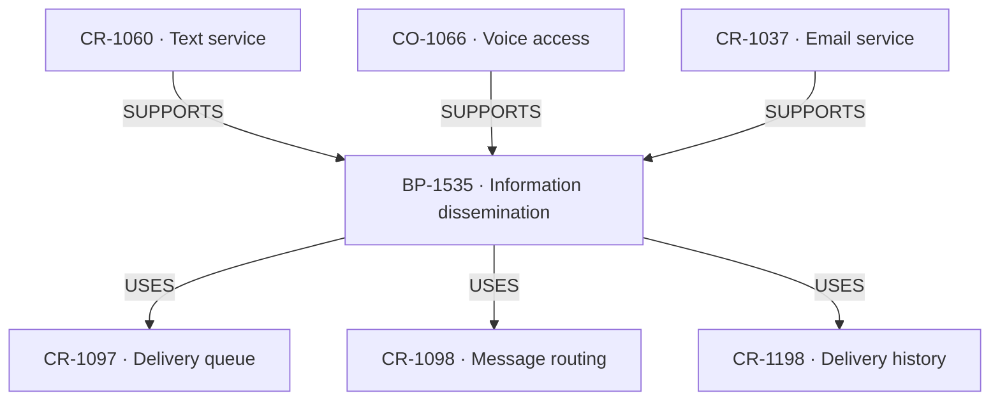
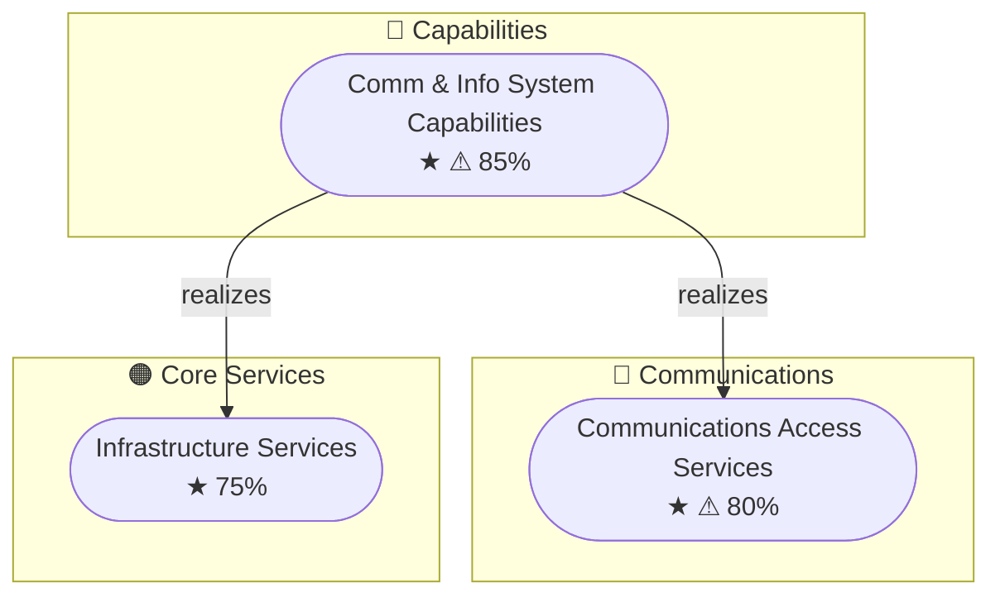

# Examples

This document shows worked examples of common tasks in the Taxonomy Architecture Analyzer.

Section 1 explains a retained historical architecture with authored model replies.
The numbers and responses in the other sections are illustrative worked examples,
not measured results from a current model run. Retained tree/impact-map images
illustrate older example states and may show different scores or controls. The in-page impact map is separate from the immutable
snapshot workbench. Use the [user guide](USER_GUIDE.md) for current navigation and
[scenario acceptance](https://github.com/carstenartur/Taxonomy/blob/main/docs/testing/scenario-acceptance.md) for version-bound evidence.

---

## Table of Contents

- [1. Requirement → Architecture](#1-requirement--architecture)
- [2. Failure Impact Analysis](#2-failure-impact-analysis)
- [3. Architecture Gap Analysis](#3-architecture-gap-analysis)
- [4. Relation Proposals](#4-relation-proposals)
- [5. Architecture Recommendations](#5-architecture-recommendations)
- [6. Diagram Export](#6-diagram-export)
- [7. Field Service Monitoring — End-to-End](#7-field-service-monitoring--end-to-end)
- [8. Architecture DSL Workflow](#8-architecture-dsl-workflow)
- [9. JSON Export with Source Provenance](#9-json-export-with-source-provenance)

---

## 1. Requirement → Architecture

**Goal:** Turn a business requirement into distinct functions, directed
relationships and explicit open decisions.

### Step 1 — Use a traceable requirement

Reference case **FLOOD-001** describes a supplementary flood-information service:

- Present published warnings, affected areas and water observations understandably,
  including source and observation time.
- Provide service administration, area subscriptions and selected text, phone or
  email notification channels.
- Allow contact-detail changes, area removal and account deletion.
- Consume the latest observation batch “at most every 15 minutes”; show stale or
  unavailable data and retain official warning channels. Surface-water flooding
  is outside scope.
- Under the additional **test design assumption A1**, provide a durable delivery
  queue, idempotent retries, protected subscriber details and an audit trail.

The [scenario resource](https://github.com/carstenartur/Taxonomy/blob/main/taxonomy-app/src/test/resources/scenarios/flood-information.json)
contains the full original requirement and its sources. This service is not a
safety-critical replacement for official alerts.

### Step 2 — Read the saved architecture

This example uses the **actual saved architecture from 19 October 2026**,
snapshot `0a4c6367-ff1d-487b-8286-d51b0834964c`: **50 nodes, 36 directed
relationships, status `PARTIAL`**. The architecture and decision report come
from the same saved result. Model responses were authored test data; the
application performed analysis, persistence and derivation. This is not a live
model result or a claim that today's acceptance run has passed.

Evidence: [saved architecture](https://github.com/carstenartur/Taxonomy/blob/9cd9b68f0dc55a4cd358d900cd0bbc7b206ce7bb/taxonomy-tooling/src/test/resources/scenario-documents/complete-flood-v1/architecture.json.gz),
[run receipt](https://github.com/carstenartur/Taxonomy/blob/9cd9b68f0dc55a4cd358d900cd0bbc7b206ce7bb/taxonomy-tooling/src/test/resources/scenario-documents/complete-flood-v1/run.json.gz) and
[decision report](https://github.com/carstenartur/Taxonomy/blob/9cd9b68f0dc55a4cd358d900cd0bbc7b206ce7bb/taxonomy-tooling/src/test/resources/scenario-documents/complete-flood-v1/decision.json.gz).
The receipt identifies historical source revision
`2fb5a7ae342af5c1ade5b97b65de4bed658f38f5`. The directory name
`complete-flood-v1` identifies the retained document set; the snapshot remains
a partial architecture result.

| Business function | Concepts retained in the saved model |
|---|---|
| Read and present published information | `UA-1580` Hydrographic Applications; `IP-1116` Recognized Environmental Pictures; `IP-2130` Geospatial Support Alerts |
| Organise delivery by area and channel | `BP-1535` Information Retrieval and Dissemination; `CR-1098` Message Routing Services |
| Support text, phone and email notifications | `CR-1060` Text-based Communication Services; `CO-1048` Short Messaging Access Services; `CO-1066` Voice Access Services; `CR-1037` Informal Messaging Services |
| Manage contact details, areas and accounts | `BP-1521` IKM Entity Management; `BP-1530` Information Disposition; `CR-1022` Digital Identity Services |
| Process deliveries reliably with an audit trail (A1) | `CR-1097` Message Queueing Services; `CR-1198` Records Management Services |
| Protect access and administer service operation | `CR-1006` Authentication Services; `CR-1007` Authorization and Access Control Services; `CI-1060` IT Service Management Services; `UA-1522` Service Desk Applications |

### Step 3 — Review relationships rather than a hit list

This **subset of the 36 saved relationships** focuses on delivery. Arrows retain
the snapshot's source, type and target; the descriptive labels are shortened
for readability.



Other concrete relationships in the same snapshot:

| Source → type → target | Meaning within the requirement |
|---|---|
| `UA-1580 CONSUMES IP-1116` | The application reads existing environmental information. |
| `UA-1580 CONSUMES IP-2130` | It reads published area-linked warnings. |
| `CO-1048 SUPPORTS BP-1535` | Short-message access supports delivery alongside the text service. |
| `BP-1521 USES CR-1022` | Contact and subscription management uses the identity function. |
| `BP-1530 USES CR-1022` | Account deletion uses identity lifecycle management, including deprovisioning. |
| `UA-1522 USES CI-1060` | The administrative application uses the service-management function. |

Each relationship is a reasoned proposal, not an implemented interface. A queue
category does not itself implement durability or idempotency. Review rationales,
conditions and remaining decisions against their original requirement clauses.

**Open question:** Is the incoming F5 observation batch already a “Recognized
Environmental Picture”, or is its product identity unspecified? The snapshot
retains that question and remains `PARTIAL`. The existing read relationship to
`IP-1116` does not resolve this separate input question. Concrete brokers, data
contracts, retention/deletion rules and retry implementation still require
decisions. Scores describe catalogue relevance, not completeness or approval.

### Step 4 — Follow the workflow with your own requirement

1. Open **Projects**, create a requirement and save its complete wording as a
   versioned record.
2. Select taxonomy roots and full analysis mode. Explicitly start Copilot with a
   ready generative provider. The documented manual default is profile `FULL`
   with one verification pass; the historical scenario acceptance uses
   `EXHAUSTIVE` with two passes.
3. Read the actual run status and open assessments. Review or answer open
   questions before requesting an offered continuation. A budget boundary or
   unresolved business question is not a negative finding.
4. Open the saved result and its **Architecture**. Check the snapshot identity
   in the workbench; search for `BP-1535`, select it and focus on its direct neighbours.
5. Inspect provenance, rationale, conditions and review status in the detail area.
   Use the print view and export menu for this saved result; inspect the mapping
   and loss manifest for exchange formats.
6. When requirements need clarification, request a saved reformulation offer.
   Answer and review its questions, explicitly adopt a new draft and request
   a separate analysis of that version.

See the [user guide](https://github.com/carstenartur/Taxonomy/blob/main/docs/en/USER_GUIDE.md#analysis-scope-and-progress),
[Copilot and persisted workbench](https://github.com/carstenartur/Taxonomy/blob/main/docs/en/COPILOT_AUTOPILOT.md#persisted-architecture-workbench)
and [requirement clarification](https://github.com/carstenartur/Taxonomy/blob/main/docs/en/USER_GUIDE.md#requirement-clarification-workflow)
for current controls. [Scenario acceptance](https://github.com/carstenartur/Taxonomy/blob/main/docs/testing/scenario-acceptance.md)
describes the reproducible test boundary and export checks. Your provider and a
current run may produce different proposals; this historical example does not
promise an identical result.


---

## 2. Failure Impact Analysis

**Goal:** Determine what breaks if a specific taxonomy element fails.

### Web UI

1. Open the **Graph Explorer** panel on the right.
2. Enter the node code, e.g. `CR-1047` (Infrastructure Services).
3. Click **Failure Impact**.
4. The result shows every element that depends on `CR-1047`, directly or transitively.


See also [User Guide](USER_GUIDE.md) for details on the Graph Explorer interface.

<details>
<summary>🔧 REST API equivalent (for automation)</summary>

```bash
curl -u "admin:${TAXONOMY_ADMIN_PASSWORD}" "http://localhost:8080/api/graph/node/CR-1047/failure-impact"
```

</details>

### Illustrative result

```json
{
  "sourceNode": "CR-1047",
  "sourceTitle": "Infrastructure Services",
  "impactedNodes": [
    { "code": "UA-1574", "title": "Unified Communication Applications", "distance": 1 },
    { "code": "BP-1327", "title": "Enable", "distance": 2 }
  ]
}
```

---

## 3. Architecture Gap Analysis

**Goal:** Find missing relations and incomplete architecture patterns in the context of a requirement.

### Web UI (recommended)

1. Analyze a requirement (see [Example 1](#1-requirement--architecture)).
2. Switch to the **Gaps** tab in the results area.
3. Click **🔍 Start Gap Analysis**.
4. The results table shows missing relations and incomplete architecture patterns.


<details>
<summary>🔧 REST API equivalent (for automation)</summary>

```bash
curl -u "admin:${TAXONOMY_ADMIN_PASSWORD}" -X POST http://localhost:8080/api/gap/analyze \
  -H "Content-Type: application/json" \
  -d '{
    "businessText": "Patient data sharing across hospital departments",
    "scores": {"CP-1023": 92, "CO-1011": 88, "CR-1047": 81}
  }'
```

</details>

### Illustrative result

```json
{
  "missingRelations": [
    {
      "source": "CO-1011",
      "target": "IP-1659",
      "suggestedType": "produces",
      "reason": "Communications service likely produces situation reports"
    }
  ],
  "incompletePatterns": [
    {
      "pattern": "Full Stack",
      "presentElements": ["CP-1023", "CO-1011", "CR-1047"],
      "missingLayers": ["Information Products"]
    }
  ]
}
```

---

## 4. Relation Proposals

**Goal:** Let the AI suggest new relations and review them.

### Step 1 — Generate proposals

In the **Relation Proposals** panel, click **Propose Relations** for a specific node or use the bulk proposal endpoint.


### Step 2 — Review

Each proposal shows:

- **Source** and **Target** nodes
- **Relation type** (e.g., supports, realises, produces)
- **AI justification** — why this relation should exist

### Step 3 — Accept or reject

Click **Accept** to add the relation to the knowledge graph, or **Reject** to discard it.


After accepting, the relation becomes visible in the knowledge graph:


<details>
<summary>🔧 REST API equivalent (for automation)</summary>

```bash
# Generate proposals for a node
curl -u "admin:${TAXONOMY_ADMIN_PASSWORD}" -X POST http://localhost:8080/api/proposals/propose \
  -H "Content-Type: application/json" \
  -d '{"sourceCode": "CR-1047", "relationType": "SUPPORTS"}'

# List pending proposals
curl -u "admin:${TAXONOMY_ADMIN_PASSWORD}" "http://localhost:8080/api/proposals/pending"

# Accept a proposal
curl -u "admin:${TAXONOMY_ADMIN_PASSWORD}" -X POST "http://localhost:8080/api/proposals/42/accept"

# Reject a proposal
curl -u "admin:${TAXONOMY_ADMIN_PASSWORD}" -X POST "http://localhost:8080/api/proposals/42/reject"

# Bulk accept/reject
curl -u "admin:${TAXONOMY_ADMIN_PASSWORD}" -X POST http://localhost:8080/api/proposals/bulk \
  -H "Content-Type: application/json" \
  -d '{"ids": [42, 43, 44], "action": "ACCEPT"}'

# Revert a decision
curl -u "admin:${TAXONOMY_ADMIN_PASSWORD}" -X POST "http://localhost:8080/api/proposals/42/revert"
```

</details>

---

## 5. Architecture Recommendations

**Goal:** Get AI-driven suggestions for additional architecture elements and relations.

### Web UI (recommended)

1. Analyze a requirement (see [Example 1](#1-requirement--architecture)).
2. Switch to the **Recommendations** tab in the results area.
3. Click **💡 Generate Recommendations**.
4. The result cards show recommended additional architecture elements and relations.


See also [User Guide](USER_GUIDE.md) for details on the recommendations interface.

<details>
<summary>🔧 REST API equivalent (for automation)</summary>

```bash
curl -u "admin:${TAXONOMY_ADMIN_PASSWORD}" -X POST http://localhost:8080/api/recommend \
  -H "Content-Type: application/json" \
  -d '{
    "businessText": "Reliable remote access and coordination services for distributed field teams",
    "scores": {"CO-1056": 88, "CR-1047": 81}
  }'
```

</details>

### Illustrative result

```json
{
  "recommendedNodes": [
    { "code": "CO-1063", "title": "Transport Services", "reason": "Directly relevant to remote access and coordination services requirement" },
    { "code": "CP-1023", "title": "Communication and Information System Capabilities", "reason": "Supports distributed field team coordination as stated in requirement" }
  ],
  "recommendedRelations": [
    { "source": "CO-1056", "target": "CO-1011", "type": "supports", "reason": "Transmission services support communications access" }
  ]
}
```

---

## 6. Diagram Export

**Goal:** Export an architecture view to an industry-standard format.

### Web UI (recommended)

Click the desired export button in the **Architecture View**:

- **📦 ArchiMate** — Exports the experimental ArchiMate 3.1 subset with a declared mapping profile; independent-tool acceptance is pending
- **📊 Visio** — Exports as `.vsdx` file
- **📝 Mermaid** — Exports as Mermaid flowchart code


<details>
<summary>🔧 REST API equivalent (for automation)</summary>

### ArchiMate XML

```bash
curl -u "admin:${TAXONOMY_ADMIN_PASSWORD}" -X POST http://localhost:8080/api/diagram/archimate \
  -H "Content-Type: application/json" \
  -d '{"scores": {"CP-1023": 92, "CO-1011": 88, "CR-1047": 81}}' \
  -o architecture.xml
```

The resulting XML is validated against the pinned ArchiMate 3.1 XSD set. Acceptance in named architecture tools is not yet certified; inspect the [mapping profile and loss report](../dev/ARCHIMATE_EXCHANGE_PROFILE.md).

### Visio

For the exact reviewed snapshot, use the workbench **Download Visio + manifest** action (`{snapshotId}.visio.zip`). This preserves stable Shape Data and a checksum-bound mapping/loss manifest. The existing direct VSDX route remains available. Microsoft Visio desktop certification is pending; see the [profile](../dev/VISIO_HANDOFF_PROFILE.md).

```bash
curl -u "admin:${TAXONOMY_ADMIN_PASSWORD}" -X POST http://localhost:8080/api/diagram/visio \
  -H "Content-Type: application/json" \
  -d '{"scores": {"CP-1023": 92, "CO-1011": 88, "CR-1047": 81}}' \
  -o architecture.vsdx
```

### Mermaid

```bash
curl -u "admin:${TAXONOMY_ADMIN_PASSWORD}" -X POST http://localhost:8080/api/diagram/mermaid \
  -H "Content-Type: application/json" \
  -d '{"businessText": "Integrated communication platform for hospital staff"}'
```

</details>

The response is a Mermaid flowchart code block that renders in GitHub, GitLab, Notion, and Confluence. Pass `"locale": "de"` for German labels:



---

## 7. Field Service Monitoring — End-to-End

**Goal:** Walk through a hypothetical workflow — from requirement to exported architecture.

**Illustration, not a recorded model run:** The scores and proposals below are
possible review subjects. For an actual saved model with evidenced relationships,
use [section 1](#1-requirement--architecture).

### Requirement

> _"Establish a field service monitoring platform for coordinating maintenance teams, tracking asset status in real time, and managing work orders across regional service areas."_

### Step 1 — Analyze

Paste the requirement into the analysis panel and click **Analyze with AI**.


The analysis explores relevant catalogue paths; unvisited nodes are not negative
findings. Hypothetical matches might include:

| Code | Node | Score |
|---|---|---|
| CP-1022 | Intelligence Capabilities | 89 |
| CI-1023 | Surveillance Services | 85 |
| CR-1047 | Infrastructure Services | 78 |
| BP-1481 | Protect | 72 |


### Step 2 — Review the architecture view

The architecture view groups scored nodes by layer (Capability → Service → Process) and shows relations between them.


### Step 3 — Check for gaps

The gap analysis (automatic in the **Gaps** tab) may identify:
- Missing link between Intelligence Capabilities and Surveillance Services
- Incomplete "Full Stack" pattern (no Information Product layer)


### Step 4 — Generate relation proposals

Click **Propose Relations** in the Relation Proposals panel. The AI might suggest:
- `CP-1022 REALIZES CI-1023` — "Capability → service under this catalogue’s REALIZES convention"
- `CR-1047 SUPPORTS CI-1023` — "Infrastructure services support field monitoring"


Accept the proposals that make sense; reject the rest.

### Step 5 — Export

Click **ArchiMate** to download the architecture as XML. Import into Archi or BiZZdesign for further refinement.


---

## 8. Architecture DSL Workflow

**Goal:** Use the text-based DSL to define and version architecture elements.

### Web UI (recommended)

1. Open the **DSL Editor** via the **DSL** tab in the right panel.
2. Edit the Architecture DSL directly in the editor.
3. Click **💾 Save** to commit your changes.
4. Use the **Version History** (**Versions → History** tab) to compare changes.
5. Merge branches via the **Variants Panel** (see [example in Git Integration](GIT_INTEGRATION.md#merge)).


<details>
<summary>🔧 REST API equivalent (for automation)</summary>

### Step 1 — Export current state as DSL

```bash
curl -u "admin:${TAXONOMY_ADMIN_PASSWORD}" "http://localhost:8080/api/dsl/export"
```

Returns DSL text like:

```
meta {
  language: "taxdsl";
  version: "2.0";
  namespace: "field-service-monitoring";
}

element CP-1022 type Capability {
  title: "Intelligence Capabilities";
}

element CI-1023 type Service {
  title: "Surveillance Services";
}

relation CP-1022 REALIZES CI-1023 {
  status: accepted;
  provenance: AI_PROPOSED;
}
```

### Step 2 — Edit and commit

Modify the DSL (add elements, relations, evidence) and commit:

```bash
curl -u "admin:${TAXONOMY_ADMIN_PASSWORD}" -X POST "http://localhost:8080/api/dsl/commit?branch=draft&message=add+field+monitoring+relations" \
  -H "Content-Type: text/plain" \
  -d @architecture.taxdsl
```

### Step 3 — Review changes

View the diff between two commits:

```bash
curl -u "admin:${TAXONOMY_ADMIN_PASSWORD}" "http://localhost:8080/api/dsl/diff/semantic/{beforeId}/{afterId}"
```

### Step 4 — Merge to accepted

```bash
curl -u "admin:${TAXONOMY_ADMIN_PASSWORD}" -X POST "http://localhost:8080/api/dsl/merge?fromBranch=draft&intoBranch=accepted"
```

The merged changes are materialized into the relation database and become visible in the graph and architecture views.

</details>

---

## 9. JSON Export with Source Provenance

When exporting analysis results that include source provenance, the JSON file
contains additional fields linking requirements to their original source
documents.

### Export

<details>
<summary>🔧 REST API equivalent (for automation)</summary>

```bash
curl -s http://localhost:8080/api/scores/export \
  -H 'Content-Type: application/json' \
  -d '{
    "requirement": "Digitale Antragsverarbeitung",
    "scores": {"CP-1023": 92, "BP-1327": 45},
    "reasons": {"CP-1023": "Direkte Fähigkeitszuordnung"},
    "provider": "GEMINI"
  }' | jq .
```

The response includes `"version": 2` and can optionally contain `sources` and
`requirementSourceLinks` arrays when provenance data is available.

### Import with Provenance

```bash
curl -s http://localhost:8080/api/scores/import \
  -H 'Content-Type: application/json' \
  -d '{
    "version": 2,
    "requirement": "Digitale Antragsverarbeitung",
    "scores": {"CP-1023": 92},
    "reasons": {"CP-1023": "Direkte Fähigkeitszuordnung"},
    "provider": "GEMINI",
    "sources": [{
      "sourceType": "REGULATION",
      "title": "VV Digitale Anträge"
    }],
    "requirementSourceLinks": [{
      "requirementId": "REQ-001",
      "linkType": "EXTRACTED_FROM",
      "confidence": 0.91
    }]
  }' | jq .
```

</details>

Legacy version 1 JSON files (without provenance) are still accepted.
