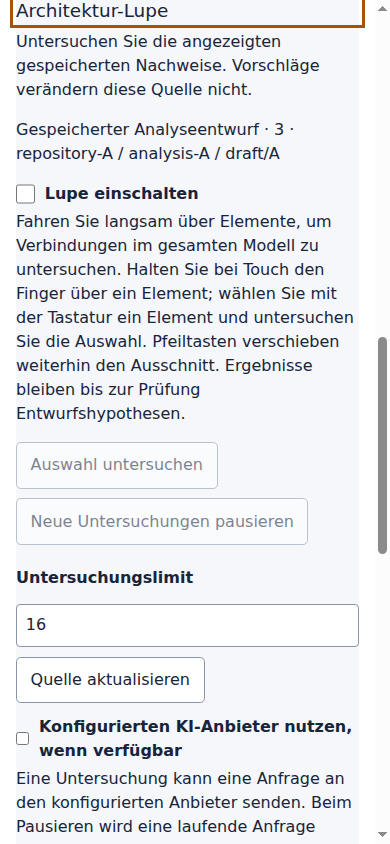
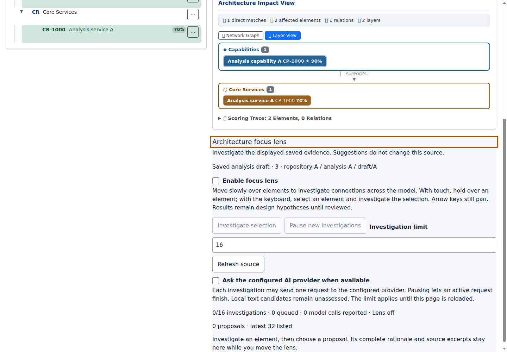
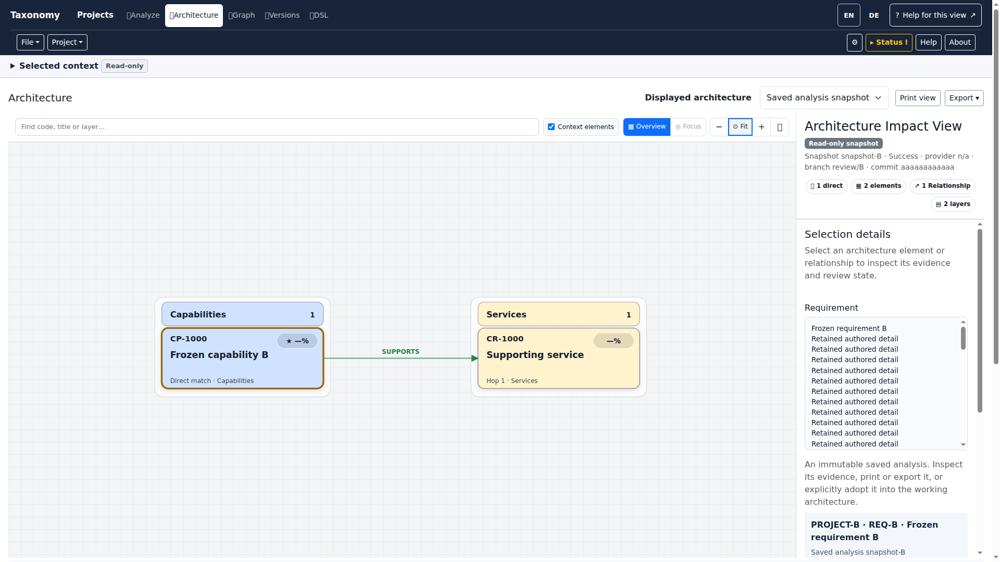
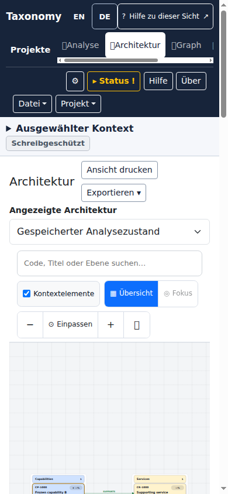

# QA: Gemeinsamer Architekturarbeitsbereich — 3. November 2026

## Erste Produktabnahme

Die erste lokale Abnahme bestätigt eine gemeinsame Primärnavigation und den Wechsel
zwischen Analyseentwurf, eingefrorenem Snapshot und Arbeitsarchitektur in der
Anwendung. Der geprüfte Produktstand ist
`4740af975add155868ffddcd5fa9c16caa5c0e37`. Die Teständerungen und die beiden
ausgewählten Browserbilder gehören zu diesem QA-Commit.

Verwendet wurden Java 25 und der festgelegte Chromium 149.0.7827.55. Paketierte
Anwendungsabläufe verwenden den vorhandenen Mock-Provider. Kostenpflichtige
Modellaufrufe wurden nicht ausgeführt. Die native Integrationsklasse rendert
das echte Thymeleaf-Template einschließlich Fragmenten, Übersetzungen, CSS und
Produktionsskripten; nur ihre HTTP-Quelldaten sind deterministische Fixtures.

| Prüfung | Produktstand | Bestätigtes Ergebnis |
| --- | --- | --- |
| `ci-ui-application-package` | `4740af97` | Alle 21 Module gebaut; dies ist ein Paketbau ohne Testausführung. |
| `SharedApplicationChromeBrowserIT` und `ArchitectureWorkspaceBrowserIT` | `4740af97` | 35 + 6 = **41 Tests bestanden**, keine Failures, Errors oder Skips. |
| Vollständige JavaScript-Browserinventur | `4740af97` | **96 Browserfälle + 2 Ownership-Prüfungen bestanden**, keine Fehler oder Skips. Einschließlich DE/EN bei 320 und 390 CSS-Pixeln. |
| Vollständige JavaScript-Verträge | `4740af97` | **1.748 Verträge + 2 Ownership-Prüfungen bestanden**, keine Fehler oder Skips. |
| Vier paketierte Abläufe: ARCHITECT mit erzwungenen Farben, Mobilgerät, USER mit 200-%-Reflow und gewöhnliche Desktop-Analyse | `4740af97` | **8 Maven-Prüfungen bestanden**, zusammen **101 Browserchecks** (32 + 16 + 32 + 21); keine unerwarteten HTTP-, Konsolen- oder externen Browseranfragen. |
| Testkatalog und Navigationsvertrag | `59f3f1f4` | 7 + 3 = **10 Tests bestanden**; Registrierung der neuen Browserklasse und aktualisierte Menüverträge geprüft. |
| Paketierter gewöhnlicher Analyze-Ablauf mit lokaler Lupe, enthalten in den vier Profilen | `4740af97` | Echter `ANALYSIS_DRAFT`-Request mit HTTP 200, exakten Quellkoordinaten, Quellhash und `modelCalls: 0`; Eingabe und angezeigter Graph bleiben unverändert. |

## Nachgewiesene Abläufe

- Die Lupe öffnet den Architekturabschnitt ohne Dokumentwechsel. Eingabetext,
  Analysequelle und Tastaturfokus bleiben erhalten. Die sechs primären Ziele
  kommen genau einmal vor; Fragment-IDs und Skriptreihenfolge sind geprüft.
- Analyse A → gemeinsamer beziehungsweise privater Snapshot B → Arbeitsmodell B
  → Analyse A erhält die jeweiligen Repository-, Workspace- und Branch-Pins.
  Snapshot-Auswahl und Kamera bleiben erhalten. Analysemetadaten übernehmen
  keinen fremden Commit oder Revisionsstand der Arbeitsarchitektur.
- Versteckte Editorentwürfe bleiben geschützt. Angenommene und abgelehnte
  Zurück-/Vorwärtsnavigation halten URL und sichtbare Quelle zusammen.
- Alle fokussierten Primärlinks sind auch mobil vollständig sichtbar und
  behalten ihre 44-Pixel-Ziele. Die bestehenden Eingabe-, Startaktions-,
  Lesbarkeits-, Disclosure- und Seitenüberlaufprüfungen bleiben erhalten.
- Der paketierte ARCHITECT-Ablauf prüft den unveränderten No-op-Preview,
  13 aufgezeichnete Editorbefehle, lokale Vorschlagsannahme mit idempotenter
  Wiederholung und Undo, veraltete Revisionen, getrennte Historien,
  Checkpoint-Recovery sowie Snapshot-Adoption mit Preview, Replay, Undo/Redo
  und Rückkehr zum ursprünglichen Anforderungstext. Der neue Auswahl-Guard
  wird durch seinen exakten Dialog ausdrücklich bestätigt.
- Eine echte lokale Untersuchung des eingefrorenen Snapshots liefert HTTP 200,
  die unveränderte Quelle und `modelCalls: 0`. Ihr Quellhash lautet
  `3a535466d3afd4999092f27cc0eb9c78f5b8db9f9a58cc9ac3cb070370eca81e`.
  Untersuchung und Vorschlagsanzeige verändern das eingefrorene Modell nicht.
- Der gewöhnliche Desktop-Analyze-Ablauf bestätigt ebenfalls die lokale Lupe auf
  dem tatsächlich gespeicherten Analyseentwurf. Sein Quellhash lautet
  `6fc293b35940d1e418160a5109ec45c8a0f348cea7662063488b539437ed8977`.
  Beide Rollenprofile prüfen jeweils acht axe-Zustände ohne blockierende Befunde.
  Die 200-%-Prüfung verwendet 720 × 500 effektive CSS-Pixel bei nominell
  1440 × 1000 Pixeln; sie ist ein Reflow-Nachweis, kein bedienter Browser-Zoomknopf.
- Der ARCHITECT-Ablauf prüft tatsächlichen SVG-Export, eingefrorenen
  Interoperabilitätsexport, deutschen Reload und erreichbare Editorkontrollen
  bei 720 und 360 CSS-Pixeln. Die native Snapshot-Prüfung erhält alle sechs
  Exportaktionen und prüft Druckklon, Provenienz, entfernte interaktive
  Kameratransformation, Aufräumen und unveränderten Bildschirm-Viewport.
  Diese Druckprüfung belegt die DOM-Vorbereitung, keine fertige Pagination.

## Ausgewählte echte Browserbilder

Beide Bilder wurden auf `4740af97` durch
`ArchitectureWorkspaceBrowserIT.renderedApplicationHasOneNavigationAndLensOpensAnalysisInPlace`
aufgenommen. Quelle: gespeicherter Analyseentwurf, Version **3**, Repository
`repository-A`, Workspace `analysis-A`, Branch `draft/A`. Die Daten sind
kontrollierte HTTP-Fixtures; Oberfläche und Interaktion sind die
Produktionsimplementierung. Die Bilder wurden nicht nachbearbeitet.

### Deutsch, 390 × 844 CSS-Pixel

### Englisch, 1440 × 1000 CSS-Pixel

## Integrationskorrekturen nach dem ersten CI-Lauf

Der erste vollständige CI-Durchlauf hat zusätzliche Integrationsgrenzen
aufgedeckt. Die Korrekturen erhalten die bestehenden Prüfziele und decken die
beobachteten Fehler zusätzlich ab:

- Die automatische Einführung überdeckt keinen direkten Architekturaufruf
  mehr. Ihre manuelle Hilfe und der gewöhnliche erste Analyseaufruf bleiben
  erhalten.
- Eine wieder aufgenommene Arbeitsarchitektur behält ihren exakt gepinnten
  Stand und unbestätigten Formularentwurf. Ein ausdrücklich ungepinnter Aufruf
  liest dagegen den aktuellen Branchstand; ein unbestätigter Entwurf wird dabei
  weiterhin durch die vorhandene Bestätigung geschützt.
- Ein ausdrücklich gewähltes Importziel bleibt beim Wechsel zwischen Analyse
  und Architektur sowie in der Browserhistorie erhalten. Leerer gemeinsamer
  Workspace, privater Workspace und fehlender Pin behalten ihre unterschiedliche
  Bedeutung. Angezeigte Analysedaten, Version, Hash, Kontextanzeige und Workflow
  bleiben an die tatsächliche Analysequelle gebunden.
- Die gespeicherte Herkunft ist mit der Tastatur erreichbar und scrollbar.
  Die neuen REST-Operationen sind im bestehenden OpenAPI-Inventar dokumentiert.
- Lange URLs in Fehlermeldungen der Anforderungsansicht umbrechen innerhalb
  der sichtbaren Meldung. Eine deterministische fehlgeschlagene Versionsabfrage
  prüft die vollständigen Textzeilen; bloßes Abschneiden würde weiterhin
  scheitern. Die übrigen Leseantworten der Fixture sind gültig.
- Die eingebettete Snapshot-Zeichenfläche nutzt die verbleibende Desktop-Höhe.
  Quelle, Workflow und Status bleiben als dieselben DOM-Knoten im scrollbar
  erreichbaren Inspektor erhalten und kehren beim Quellenwechsel an ihre genaue
  ursprüngliche Position zurück. Mobil überlagern die Druck-/Exportaktionen
  den Überschriftentext nicht; alle bisherigen Höhen- und Exportprüfungen
  bleiben bestehen.
- Die Standalone-Quellenparser übernehmen ausschließlich die kanonischen
  Quellfelder. Die Browser-Fixtures verwenden den HTML-Parser statt einer
  unvollständigen Bereinigung durch reguläre Ausdrücke.
- Die tatsächlich hinzugekommenen Architekturabhängigkeiten sind einzeln
  geprüft und dokumentiert. Zusätzliche strikte Wächter sichern die lesende
  Quellauflösung; die Kontextgrenzen und bestehenden Gate-Regeln bleiben
  bestehen.

Frische, getrennte Prüfläufe nach diesen Korrekturen:

| Prüfung | Bestätigtes Ergebnis |
| --- | --- |
| Vollständige JavaScript-Verträge | **1.756 + 2 Ownership-Prüfungen bestanden**, keine Failures, Errors oder Skips. |
| Vollständige JavaScript-Browserinventur | **111 + 2 Ownership-Prüfungen bestanden**, keine Failures, Errors oder Skips. |
| `ArchitectureWorkspaceBrowserIT` und `SharedApplicationChromeBrowserIT` | **10 + 35 = 45 Tests bestanden**, einschließlich tatsächlicher Textgrenzen, vier Snapshot-Viewportgrößen und vollständiger History-/Entwurfsprüfung. |
| `ArchitectureStandSelectionBrowserIT` | **34 Tests bestanden**, einschließlich aller sieben Wiederholungsfälle nach verlorener Dialogantwort. |
| `RestApiDocumentationTest` | **3 Tests bestanden**, tatsächlich **423 REST-Methoden** inventarisiert. |
| `ArchitectureContextDependencyRatchetTest` | **34 Tests bestanden**; zusätzliche mutierte Nur-Lesen-Verletzung wurde zuvor erwartungsgemäß erkannt. |
| Unveränderte `ArchiMateReturnUiIT` | **1 Test mit drei vollständigen Browser-/HTTP-/Datenbankdurchgängen bestanden**: privater Import, idempotente Wiederholung, gemeinsamer schreibgeschützter Preview. |

Nach der deterministischen Fehlerfixture und der Alert-Umbruchkorrektur wurde
die vollständige Navigationsklasse nochmals ausgeführt: **35/35 bestanden**.
Die vollständige Browserinventur wurde auf diesem letzten Produktstand ebenfalls
erneut ausgeführt: **111 + 2 bestanden**, jeweils ohne Fehler oder Skips.

Der Importfall prüft weiterhin genau eine importierte Relation im privaten
Arbeitsbereich des zweiten Repositorys, korrekte Herkunft und unveränderte
Relations-IDs im primären Repository. Die Erfolgsaufnahme zeigt den ausdrücklich
gemeinsamen Zielbereich und deaktivierte Übernahmeaktionen. Die ausgeführten
JavaScript-Assets stimmen mit dem geprüften Quellcode überein.

### Snapshot nach der Layoutkorrektur

Diese unveränderten Browseraufnahmen stammen aus
`embeddedSnapshotUsesRemainingViewportWithoutLosingSourceOrCamera` nach einem
echten Fit-Klick. Quelle: Snapshot **`snapshot-B`**, Repository **`repository-B`**,
gemeinsamer Workspace, Branch **`review/B`**, Projekt **42**, Anforderung **7**,
Anforderungsversion **11**. Es gelten dieselben kontrollierten HTTP-Fixtures und
echten Templates, Skripte und CSS wie oben beschrieben.

Bei 1920 × 1080 Pixeln reicht die Zeichenfläche von y = **273,13** bis
**1071,75**, bei einer Höhe von **798,63 Pixeln**. Der Inspektor bleibt innerhalb
des Viewports und scrollt unabhängig. Bei 390 × 844 Pixeln liegen zwischen
Überschriftentext und Aktionen **12 Pixel**; die Zeichenfläche beginnt bei
y = **584,59** und erfüllt die unveränderte Grenze von 70 Prozent der
Viewporthöhe. Auswahl und Kamera bleiben auch bei anschließendem Resize
erhalten.

## Nachprüfung des vollständigen CI-Stands `92a7452c`

Der [Hauptlauf 41651027183](https://github.com/carstenartur/Taxonomy/actions/runs/41651027183)
ist vollständig ausgewertet: 18 erfolgreiche Jobs, vier fehlgeschlagene Jobs
und zwei übersprungene Jobs. Die Fehler betreffen zwei UI-Gruppen, die native
Browsergruppe und deren abhängiges Maven-Aggregat. Die Coverage-Aggregation
wurde wegen dieser Fehler nicht ausgeführt. Die Dokumentationsgruppe war
aufgrund der bestehenden Änderungsauswahl nicht vorgesehen.

Core, Plugin-Paketierung, Runtime, Domain-Integration, Recovery und die
Anwendungsszenarien waren erfolgreich. Die App-Core-Teilmenge enthält
**3.985 Tests, keine Failures oder Errors und 55 ausgewiesene Skips**; dies ist
keine behauptete Gesamtzahl des Reaktors. Die drei
[Datenbankgruppen](https://github.com/carstenartur/Taxonomy/actions/runs/41651027063)
bestanden **138 Integrationsfälle** ohne Failures, Errors oder Skips:
33 SQL-Server-, 62 PostgreSQL- und 43 Oracle-Fälle.

Der [Push-CodeQL-Lauf](https://github.com/carstenartur/Taxonomy/actions/runs/41651014238)
ist für Java und JavaScript erfolgreich. Die neun ursprünglichen
JavaScript-Befunde sind in den weiterhin aktiven Regeln nicht mehr vorhanden;
es wurden keine zusätzlichen Baseline-Ausnahmen zugelassen. Ebenfalls
erfolgreich waren der tatsächliche Word-Download, Reformulierungsabrechnung,
Security Scan, Kubernetes-Smoke und der JGit-Speicherverbrauchertest.

### Korrekturen aus den Browserbefunden

- **Isolierte Testressourcen:** Der Runner liest Bootstrap und D3 aus derselben
  laufenden paketierten Anwendung und gibt ihre lokalen Dateien ausdrücklich
  an die Browserprüfungen weiter. HTTP-Status, Inhaltstyp und nicht leere Bytes
  werden geprüft. Ein leerer Browser-Maven-Cache funktioniert damit ebenfalls;
  es wird weder ein CDN noch eine neue Produktabhängigkeit verwendet.
- **Dunkles Exportmenü:** Die globalen Farben für helle Flächen überschrieben
  die beiden Info-Schaltflächen im dunklen Menü. Der eng begrenzte Selektor
  stellt dort lesbare Farben her. Alle sechs aktivierten Exportaktionen werden
  mit dem tatsächlichen globalen CSS geprüft, einschließlich Axe sowie Hover,
  gedrücktem Zustand und Tastaturfokus der beiden betroffenen Aktionen.
- **Historischer Stand:** Der native Adoptionstest klickte als einzige Aktion
  ohne den vorhandenen expliziten Scrollpfad auf einen Historienlink außerhalb
  des sichtbaren Viewports. Dieser
  reproduzierte Fehler verwendet jetzt denselben vorhandenen sofortigen
  Scroll-/nativen Klickpfad wie die übrigen Aktionen. Produktcode, Zeitgrenzen
  und sämtliche Übernahme-, Replay-, Checkpoint-, Undo-/Redo- und
  Neustartprüfungen bleiben erhalten.
- **Kurze Desktop-Inhaltsfläche:** Bei 1024 × 625 Pixeln verlangte die eingebettete
  Workbench zusätzlich zur Werkzeugleiste mindestens `50dvh` Zeichenhöhe.
  Das überschritt ihre korrekt zugewiesene Resthöhe. Nur dieser eingebettete
  Desktop-Fall verwendet jetzt die tatsächlich verbleibende Höhe. Bei der
  reproduzierten Geometrie endet der Canvas nun bei **616,75 Pixeln**, genau
  an der Rasterunterkante, statt bei **628,41 Pixeln** außerhalb des Viewports.
  Die vorhandenen Mobil-, Druck-, Quellen-, Kamera- und Exportprüfungen bleiben
  unverändert; zwei zusätzliche kurze Größen verwenden das ursprüngliche
  Layout-Orakel.

| Frische lokale Nachprüfung | Bestätigtes Ergebnis |
| --- | --- |
| Testressourcen-Verträge | Erwarteter RED-Befund, anschließend **28 Verträge + 2 Ownership-Prüfungen bestanden**. |
| Vollständige Browserinventur mit leerem Browser-Maven-Cache | **111 + 2 Ownership-Prüfungen bestanden**, keine Failures, Errors oder Skips. |
| Frischer Anwendungsbau | Alle **21 Module** paketiert; Testausführung bei diesem Paketbau ausdrücklich ausgeschaltet. |
| Vollständiger paketierter ADMIN-Ablauf | **2 Maven-Prüfungen**, **74 Browserchecks**, **21 Axe-Zustände**, keine blockierenden Befunde oder Auditfehler; einschließlich des zuvor fehlgeschlagenen Exportmenüs und aller folgenden Schritte. |
| Paketierter Textabstands-/Offline-Ablauf | **2 Maven-Prüfungen**, **7 Browserchecks** und die vorgeschalteten **111 Browserfälle** bestanden. Bootstrap und D3 wurden tatsächlich aus dem frisch paketierten Server gelesen und entsprechen seinen WebJar-Bytes. |
| Historischer Adoptionstest und neuer nativer Vollbildfall | **2/2 Maven-Fälle bestanden**, keine Failures, Errors oder Skips, mit Chrome Headless Shell **150.0.7871.124** und passendem Driver. |
| Vollständige `ArchitectureWorkspaceBrowserIT` nach der Höhenkorrektur | **13/13 Maven-Fälle bestanden**, keine Failures, Errors oder Skips, mit derselben 150er Runtime: bisherige Quellen-, History-, Entwurfs-, Lupen-, Druck- und Größenprüfungen sowie die neuen Kurzviewport- und Vollbildfälle. |

Der vorherige eigenständige
[Architektur-Szenariolauf](https://github.com/carstenartur/Taxonomy/actions/runs/41651034467)
scheiterte beim Vollbildeintritt. Dieser Fehler ließ sich lokal weder mit der
kleinen nativen Fixture noch mit seiner originalen gespeicherten Projektion
von **50 Knoten und 36 Beziehungen** reproduzieren. Die tatsächliche Folge aus
Suche, Auswahl, Fokus, Übersicht, Kontextfilter, Fit, Zoom und Vollbild bestand
mit Chrome Headless Shell 150 bei 1600 × 1100 und 1600 × 957 Pixeln. Quelle,
Daten und Auswahl blieben erhalten. Diese Proben ersetzen den ursprünglichen
vollständigen CI-Ablauf nicht und belegen noch keine Ursache für dessen Fehler.

Der ursprüngliche Ablauf protokolliert deshalb zusätzlich die nativen
Vollbildereignisse, Browser-Policy, Aktivierung, Fokus und Ablehnungsgründe.
Die bisherigen Wartezeiten bleiben bestehen. Layoutbilder werden bereits
vor dem Zurücksetzen der Fenstergröße gesichert; die nativen Fehler- und
Geometrieartefakte sind im bestehenden CI-Upload enthalten. Normales Chrome
150 konnte lokal wegen der AF_UNIX-Socketbeschränkung nicht gestartet werden;
die erfolgreiche Ausführung ist ausdrücklich der Headless Shell zugeordnet.

## Nachprüfung des vollständigen CI-Stands `98068690`

Der [Hauptlauf 41661854704](https://github.com/carstenartur/Taxonomy/actions/runs/41661854704)
endete mit 17 erfolgreichen, fünf fehlgeschlagenen und zwei übersprungenen Jobs.
Vier ausführende Gruppen meldeten konkrete Browserprobleme; das fünfte rote
Ergebnis war ausschließlich das abhängige Aggregate-Gate. Coverage wurde deshalb
nicht ausgeführt. Core, Recovery, Anwendungsszenarien, Runtime, Domain-Integration,
Plugin-Paketierung, Docker und OpenTelemetry bestanden. Die ursprünglichen
Kontrast-, Ressourcen-, historischen Klick- und Kurzviewportfehler traten in den
zugehörigen abgeschlossenen Prüfungen nicht mehr auf.

| Befund | Nachgewiesene Ursache und begrenzte Korrektur |
| --- | --- |
| Exportmenü reagiert nach einem Größenwechsel nicht auf Escape | Die responsive Umordnung entfernte kurz den Vorfahren des fokussierten Elements. Der Fokus ging dadurch verloren. Die Umordnung verschiebt jetzt das andere Panel und erhält die tatsächliche DOM-Lesereihenfolge. Ein modaler Dialog behält seine Escape-Priorität. |
| Natives Vollbild wird unmittelbar wieder beendet | Der originale Browser-Shard und der separate Szenariolauf zeigen einen angenommenen Vollbildeintritt mit Wechsel von 1600 × 957 auf 800 × 544 Pixel, danach bereits aufgehobenes Vollbild ohne API-Ablehnung. Derselbe DOM-Wechsel ist im Browser mit dieser Geometrie reproduziert. Eine aktive Vollbildfläche hat bei der Wahl des zu verschiebenden Panels Vorrang. |
| Firefox erreicht nach einem Checkpoint den historischen Stand nicht | Während der Checkpoint-Anfrage sperrte der Editor die Navigation korrekt, meldete aber noch `aria-busy=false`. Der bestehende gemeinsame Berechtigungs-/Sperrzustand veröffentlicht nun die gesamte Speicher- und Ladephase. Der Ablauf wartet zusätzlich auf den tatsächlich geladenen zurückgegebenen Commit und die wieder freigegebene Checkpoint-Aktion. |
| WebKit meldet beim Sprachwechsel Fehler für Startup- und Workspace-Statusabfragen | Der vollständige lokale Originalablauf reproduziert diese sporadischen Konsolenmeldungen nicht. Eine passive Ereignisspur hält jetzt Requestbeginn, Antwort, Abbruch, Navigation und Console-/PageErrors fest. Die bestehenden Fehlergates bleiben unverändert; die beiden beobachteten Endpunkte werden ausdrücklich weiter als Blocker getestet. |

Die responsiven Regressionen verwenden echte Tastatur-, Eingabe- und
Vollbildaktionen. Sie prüfen Export-Escape, Eingabefokus einschließlich
Textauswahl sowie die unveränderte Quelle, Datenreferenz, Knotenauswahl und
Leseanzahl des Snapshots. Der identische endgültige Vollbildfall ist auf dem
unveränderten Ausgangscode rot und auf der Korrektur grün. Ein früherer
explorativer Versuch scheiterte bereits am Browserprotokoll und zählt nicht als
Produkt-RED. Die drei vollständigen angrenzenden Browserdateien bestanden
**57/57 Fälle**, ohne Fehler oder Skips, mit dem tatsächlich importierten
Playwright/Core **1.61.1** und Chrome Headless Shell **149.0.7827.55**.

Auf dem zusammengeführten Korrekturstand `6fce8609` bestanden anschließend die
vollständigen kanonischen **115 JavaScript-Browserfälle** und alle **13 Fälle
der `ArchitectureWorkspaceBrowserIT`**, jeweils ohne Failures, Errors oder Skips.
Beide Maven-Läufe meldeten `BUILD SUCCESS`. Der native Lauf mit Chrome Headless
Shell und Driver **150.0.7871.124** wechselte beim echten Vollbildeintritt selbst
von 1600 × 1100 auf 800 × 600 Pixel: Die Workbench blieb verbunden und im
Vollbild, ihre Schaltfläche behielt den Fokus. Erst der zweite native Klick
beendete das Vollbild regulär. Quelle und Auswahl blieben erhalten.

Der vollständige lokale `mobile-admin-webkit`-Ablauf bestand **39 Checks und
zwölf Axe-Zustände**, einschließlich beider Sprachen, Sitzungsverwaltung,
Architektureditor und Integrationen. Die neue Spur enthält 97 Statusrequests
und 97 Antworten, keine Abbrüche, Console-/PageErrors oder reconcilierten Fehler.
Alle 119 produktiven JavaScript-Dateien des dabei verwendeten Pakets entsprechen
bytegenau `98068690`; die bekannte Paketabweichung betrifft ausschließlich die
bereits gesondert geprüfte Desktop-Höhenregel. Verwendet wurden die gepinnte
WebKit-Revision 2311 und Playwright 1.61.1. Tasklokale Bibliotheken wurden anhand
signierter Ubuntu-Paketmetadaten, ELF-Abhängigkeiten und tatsächlichem `dlopen`
geprüft; nur die ausschließlich globale `ldconfig`-Vorprüfung wurde für diesen
lokalen Prozess ausgelassen. CI und deren Hostprüfung wurden nicht verändert.
Dieser lokale Erfolg erklärt die vorherigen CI-Konsolenmeldungen noch nicht.

Die gesonderte Lifecycle-Prüfung weist jedoch einen konkreten Produktfehler in
den drei zugehörigen Pollpfaden nach: Nach `pagehide` konnten nachgereichte
Übersetzungsbereitschaft, HTTP-Bodies und Retryfehler weiterhin Reads starten
oder veraltete Inhalte veröffentlichen. Die bestehenden Funktionen behalten
jetzt ihren Controller und Timer unter der aktiven Seite; Rückkehr aus dem
Browsercache startet genau einen frischen Zyklus. Ein bereits geladener Katalog,
die regulären Netzwerkfehler und ihre ursprünglichen Intervalle bleiben erhalten.
Die endgültigen 15 Regressionen meldeten gegen den unveränderten Ausgangscode
zwölf echte Assertionfehler bei drei bereits grünen Fehler-/Retrykontrollen.
Der endgültige unabhängige Lauf bestand
**152/152 Fälle**, darunter **15 Lifecycle-Regressionen**. Sechs angrenzende
VM-Harnesses ergänzen dafür nur echte `EventTarget`-/`AbortController`-Primitiven;
ihre fachlichen Assertions bleiben unverändert. Die neue Datei gehört zur
kanonischen Maven-JavaScript-Inventur. Dieser Nachweis ersetzt nicht die erneute
Ausführung des zuvor fehlgeschlagenen WebKit-CI-Profils.

Nach Integration sämtlicher Produktkorrekturen bestand der Stand `389dde2d`
die vollständigen **1.771 JavaScript-Vertragsfälle** und **115 JavaScript-
Browserfälle**. Beide kanonischen Maven-Läufe führten zusätzlich die beiden
Eigentümer-/Inventurprüfungen aus und endeten mit `BUILD SUCCESS`, jeweils ohne
Failures, Errors oder Skips. Die neue Lifecycle-Datei wurde dabei tatsächlich
durch den vorhandenen JUnit-Treiber ausgeführt. Die unten genannten aktuellen
CI-Gates bleiben für die vollständige Integration maßgeblich.

Auch die ergänzenden Workflows dieses veröffentlichten Stands bestanden:
[Push-CodeQL](https://github.com/carstenartur/Taxonomy/actions/runs/41661847066),
[Datenbanken](https://github.com/carstenartur/Taxonomy/actions/runs/41661854568),
[Word-Download](https://github.com/carstenartur/Taxonomy/actions/runs/41661854480),
[Reformulierungsabrechnung](https://github.com/carstenartur/Taxonomy/actions/runs/41661854671),
[Security](https://github.com/carstenartur/Taxonomy/actions/runs/41661854449),
[Kubernetes](https://github.com/carstenartur/Taxonomy/actions/runs/41661854733) und
[JGit-Speicherverbraucher](https://github.com/carstenartur/Taxonomy/actions/runs/41661854476).
Die drei Datenbankgruppen bestanden erneut 138 Integrationsfälle ohne Fehler
oder Skips. Der separate
[Architektur-Szenariolauf](https://github.com/carstenartur/Taxonomy/actions/runs/41661854553)
endete mit 37 Tests und genau einer Failure am oben beschriebenen Vollbildeintritt.
Die anschließenden Exportaktionen wurden dort nicht mehr erreicht.

Zwei zusätzliche lokale Original-Szenarioläufe sind ausdrücklich keine grüne
Abnahme: Der erste erreichte bei 2 GiB Heap die bestehende Speicherschutzgrenze.
Der zweite verwendete nachweislich den gemessenen CI-Heap von 4.190.109.696 Bytes,
endete aber nach 240 Fortsetzungen mit Prozesscode 137 und einem protokollierten
cgroup-OOM-Kill. Das ist ein lokaler Ressourcenabbruch; Vollbild wurde dabei
nicht erreicht. Weder Speichergrenzen noch Testzeitgrenzen wurden dafür im
Produkt oder CI verändert.

## Nachprüfung des vollständigen CI-Stands `e8da4578`

Im [Hauptlauf 41675038737](https://github.com/carstenartur/Taxonomy/actions/runs/41675038737)
bestanden alle sechs ursprünglichen UI-Shards. Insbesondere sind der vollständige
ADMIN-/Export-Escape-Ablauf, Firefox mit Checkpoint und anschließendem historischen
Stand sowie der mobile WebKit-ADMIN-Ablauf grün. Letzterer enthält **39 Checks
und zwölf Axe-Zustände**, keine Console-/PageErrors und keine reconcilierten
Ausnahmen. Die ursprünglichen Fehlergates und CI-Hostprüfungen wurden beibehalten.
Der geprüfte CI-Merge `8b00bc87` hat denselben Quellbaum wie `e8da4578`;
die UI-Shards verwenden das unveränderliche Anwendungspaket mit SHA-256
`a8b02c2082e30ec3202d12962595c60fbdec658e50ba5de84c864bcc1252eeb8`.

Auch der ursprüngliche native Browser-Shard bestand **224 Fälle** ohne Failures,
Errors oder Skips, darunter alle 13 Workspace-Fälle. Die Originalspur mit Chrome
und Driver **150.0.7871.124** belegt nun auch in CI den echten Wechsel von
1600 × 957 auf 800 × 544 Pixel mit verbundenem Vollbildelement und erhaltenem
Fokus. Erst der zweite native Klick beendet das Vollbild. Angezeigte Quelle und
Knotenauswahl bleiben während des gesamten Ablaufs unverändert.

Die frischen lokalen vollständigen Abläufe auf diesem Quellbaum bestanden
ebenfalls: **74 Checks und 21 Axe-Zustände** für PRIMARY ADMIN sowie **39 Checks
und zwölf Axe-Zustände** für den mobilen WebKit-ADMIN. Beide verwenden das frisch
gebaute Paket mit SHA-256
`6596ed8a50bed59631ee537cee6be5fe234bad24b0b427000494811ca34a7fba`;
alle 173 statischen und Template-Ressourcen entsprechen bytegenau dem Quellbaum.
Die oben beschriebenen lokalen WebKit-Runtimegrenzen gelten weiterhin.

Der Core-Lauf war dennoch nicht grün: In seiner App-Teilmenge mit 3.370 gemeldeten
Fällen scheiterten die vier Fälle von `AnalysisBrowserFollowUpTest` bereits beim
Laden des produktiven Browse-Skripts. Beim Ergänzen der Lifecycle-APIs war diese
Java-eingebettete Node-VM-Fixture übersehen worden; ihrem vereinfachten `window`
fehlte `addEventListener`. Der identische originale Mavenlauf reproduzierte lokal
**vier von vier Setupfehlern**. Die Korrektur ersetzt nur dieses Fixture-Objekt
durch `Object.assign(new EventTarget(), {TaxonomyState: S})`.

Mit dieser einen geänderten Zeile bestanden dieselben **vier von vier Tests**
ohne Failures, Errors oder Skips; Maven meldete `BUILD SUCCESS`. Alle vier
vollständigen Testmethoden, ihre Assertions, Timeouts, Mavenargumente und
Node **24.18.0** blieben identisch. Der Produktcode, die Testregistrierung und die
CI-Gates wurden dafür nicht verändert. Der unabhängige Review bestätigte sowohl
den Diff als auch originale XML-Berichte und Quellhashes beider Läufe. Eine
begrenzte Suche nach weiteren Java-/CJS-Vollskript-VM-Ladern fand keine weitere
gleichartig betroffene Fixture. Dieser fokussierte Nachweis ersetzt nicht den
vollständigen CI-Lauf des folgenden Korrekturstands.

Der abgeschlossene Hauptlauf enthält **20 erfolgreiche, zwei fehlgeschlagene
und zwei übersprungene Jobs**. Auch Recovery bestand 92 Fälle und der vollständige
Copilot-Anwendungsszenariofall bestand. Neben dem Core-Fixturefehler war nur das
davon abhängige Gesamtgate rot; Coverage wurde deshalb nicht ausgeführt.

Der [separate Szenariolauf 41675038696](https://github.com/carstenartur/Taxonomy/actions/runs/41675038696)
führte 37 Fälle mit genau einer Failure aus. Der ursprüngliche Vollbildeintritt
und -austritt funktionierten. Danach wurden alle sechs tatsächlichen Downloads
(SVG, PDF, Architektur-DOCX, Entscheidungs-DOCX, ArchiMate und Visio) inhaltlich
geprüft und ihre Bytes unabhängig mit den aufgezeichneten SHA-256-Werten
abgeglichen. Auch der Reflow bei 390 × 844 Pixeln bestand. Erst die nachfolgende
Sichtbarkeitsassertion für die sechs gespeicherten Paketaktionen schlug fehl.

Die unabhängige Ursachenprüfung reproduzierte den Original-DOM mit allen 16
Originalstyles auf Chrome 150 bei 1600 × 957 Pixeln. Bootstrap aktiviert in der
gemeinsamen Seite natives Smoothscrolling: Unmittelbar nach `scrollIntoView`
stand das Dokument noch bei `scrollY=0`; nach dem nativen `scrollend` nach rund
814 ms lagen alle sechs Controls vollständig im Viewport. Das Layout wurde dafür
nicht verändert. Der ursprüngliche Helper wartet nun innerhalb seiner bestehenden
45-Sekunden-Grenze auf exakt dieselben sechs Bounds; die abschließende Assertion
bleibt bytegleich. Zwei neue EN/DE-Fälle im vorhandenen nativen Workspace-Harness
rufen denselben Helper mit echten Templates, Anwendungsskripten und Styles auf.
Sie scheiterten beide am ursprünglichen Assert und bestanden anschließend beide
ohne Errors oder Skips. Quelle, gespeicherter Paketname, Auswahl und genau ein
Editor-Read blieben erhalten. Der Gegenlauf endete mit `BUILD SUCCESS`.

Die nachgelagerte unabhängige Dokumentrenderstufe des ursprünglichen
Szenarioworkflows wurde wegen dieses Fehlers nicht ausgeführt. Auf bytegleichen
Kopien der Originalexporte wurde deshalb zusätzlich die unveränderte Dokument-CLI
mit der vorhandenen lokalen Runtime ausgeführt. Der Reformulation-Gate bestand
alle vier DOCX mit jeweils 19 gerenderten Seiten. Der Szenario-Dokumentgate
meldete dagegen 191 Seiten für den Entscheidungsbericht bei einer unveränderten
Grenze von 178; Architekturbericht und Visio wurden nach diesem Fail-fast-Befund
in diesem lokalen Aufruf nicht mehr geprüft. Lokal lief LibreOfficeDev 26.8 mit
NotoSerif/DejaVuSerif als Ersatz für die im Dokument angeforderten Aptos-Schriften;
die ursprüngliche CI installiert LibreOffice 24.2.7.2. Dieser echte lokale
Gate-Fehlschlag ist damit noch keine Reproduktion unter dem CI-Renderer. Weder
Dokumentgrenzen noch Produktcode wurden aufgrund dieser Abweichung verändert.

Eine positive Kontrolle aus dem vollständig erfolgreichen ursprünglichen
[Szenariolauf 41342810385](https://github.com/carstenartur/Taxonomy/actions/runs/41342810385)
grenzt die Runtimeabweichung weiter ein: Dieselbe byteidentische Kontroll-DOCX
hat im originalen LibreOffice-24.2-PDF **175 Seiten**, mit dem lokalen
LibreOfficeDev 26.8 dagegen **191 Seiten**. Das Original-PDF verwendet DejaVu Sans,
der lokale Gegenlauf Noto Serif/DejaVu Serif. Formatvorlagen und Einstellungen
dieser Kontroll-DOCX sind bytegleich mit dem aktuellen Export; beide erfüllen
denselben vollständigen Corpus und dieselben Fixture-/Requirement-Hashes.
Damit ist die lokale abweichende Seiteneinteilung an einem bereits CI-grünen
Dokument nachgewiesen. Der unveränderte tatsächliche CI-Renderer bleibt für die
aktuelle vollständige Word-/Visio-Abnahme maßgeblich.

## Noch ausstehende oder begrenzte Evidenz

Die vier oben genannten paketierten Profile sind vollständig abgeschlossen.
Die vollständigen CI-Gates und ihre Bindung an den jeweils aktuellen Quellstand
sind anhand der Artefakte von [PR #1367](https://github.com/carstenartur/Taxonomy/pull/1367)
zu beurteilen. CSS-Breitenprüfungen werden nicht als ungeprüfter Browserzoom
oder als vollständige Screenreaderprüfung ausgegeben.

Der lokale kanonische Maven-Lauf stoppte nach neun grünen Modulen im
unveränderten nativen GPG-Test: Der benötigte AF_UNIX-Socket wurde mit
`Operation not permitted` abgelehnt. Im Workspace-Modul bestanden 1.243 Tests,
einer scheiterte; die nachfolgenden Module dieses vollständigen Laufs wurden nicht
ausgeführt. Der Vollgate ist daher **nicht lokal grün**. Docker- und Helm-Gates
wurden hier nicht ausgeführt. Die zusätzlichen lokalen Dokumentprüfungen mit
abweichender Office-Runtime und ihren Grenzen sind oben gesondert ausgewiesen.

Zwei vorangegangene Versuche wurden während voller temporärer Platte durch
Chromium-Abstürze beziehungsweise Schreibfehler invalidiert und nicht als
bestandene Abnahme gezählt. Der oben genannte Paketbau, die 41 nativen Fälle
und der ARCHITECT-Ablauf wurden danach mit stabiler Runtime vollständig
ausgeführt. Ein weiterer kombinierter Lauf wurde durch einen Neustart der
Arbeitsumgebung unterbrochen und nicht als bestanden gewertet. Die oben unter
Integrationskorrekturen genannten Nachprüfungen wurden anschließend mit frischer
Runtime ausgeführt. Die ausgewählten Bilder sind eingecheckt; die vollständigen
aktuellen CI-Protokolle und Artefakte gehören zum jeweiligen PR-Stand.
