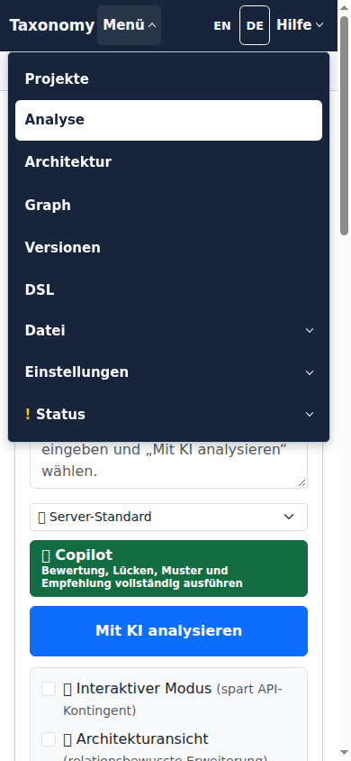

# Consistent application navigation

## Problem and design

The common header still combined Bootstrap tabs, a Bootstrap File dropdown,
separately styled native Settings/Status disclosures, and duplicate language and
help entries. Existing geometry tests proved that controls fitted, not that the
result was a consistent interface.

Use the existing common header and native disclosure menus throughout. Keep
all existing commands, permissions, contextual help targets and navigation pins.
Give primary links and menu launchers consistent typography and target sizes.
Provide one Help menu for contextual help, the manual and the existing About
dialog, and retain only the shared language controls. Header styling and menu
interaction belong to the common component; delete obsolete page overrides
and duplicate event handlers.

## Implementation and verification plan

- [x] Reproduce the actual header at desktop and phone sizes and retain captures.
- [x] Add native-browser regressions for inconsistent controls, File behavior,
      and duplicate language/help entries; observe the failures first.
- [x] Consolidate markup, styling and menu lifecycle; remove unused code.
- [x] Adapt existing interaction checks to the same user actions in the new menus.
- [x] Run related browser and JavaScript suites, Java compilation/checks, inspect
      new captures, and review the complete deletion and reference inventory.
- [x] Prepare one reviewable change with normal CI gates required before integration.

## Boundaries to check

Disabled File commands; delayed insertion of Status; Escape from nested mobile
menus; keyboard focus after closing; long German labels; custom colors; forced
colors; standalone pages without Bootstrap; context-path and language retention.

## Evidence

- Java 25 and the Maven Wrapper compile the full application reactor.
- 95 focused Java tests pass, including real Thymeleaf rendering and Selenium
  navigation across administration, document templates, workbench and editor.
- The complete Maven-owned JavaScript contract lane passes 1,936 tests.
- The focused Maven-owned native browser lane passes 124 tests. New failures
  were reproduced before correction: mixed controls, the separate File menu,
  duplicate language/help paths, standalone-link contrast/targets, Export style,
  About-dialog focus return, mobile Status alignment and compact-menu styling.
- Independent review found the standalone-link regression and a wrong test
  selector; both are corrected. Final visual inspection uses actual Thymeleaf
  pages with controlled HTTP responses, not a live authenticated deployment.

### Desktop navigation

Before:

After:

### Mobile navigation

The source-specific Export form retains its positioning and download behavior;
its header launcher uses the common menu style. In-page architecture source
adapters and Graph Explorer are outside this navigation change.
