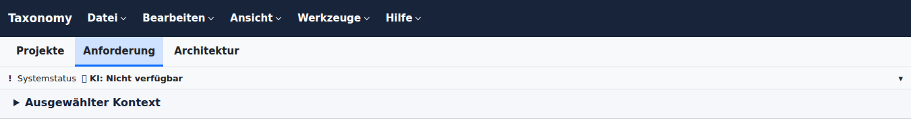
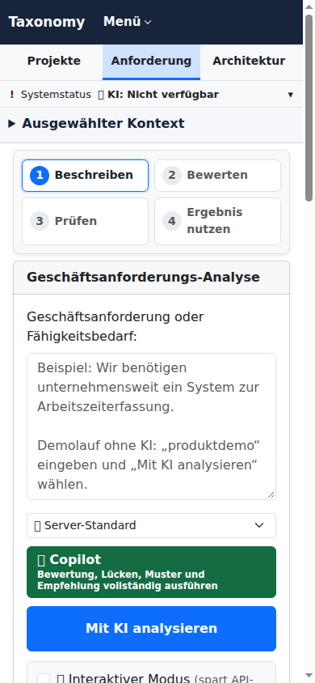
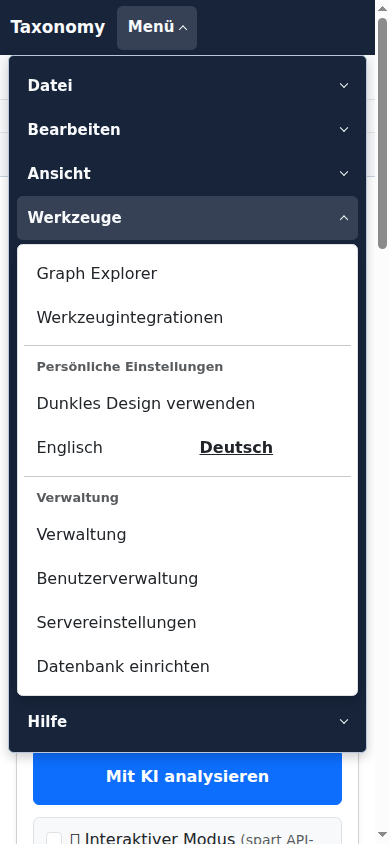
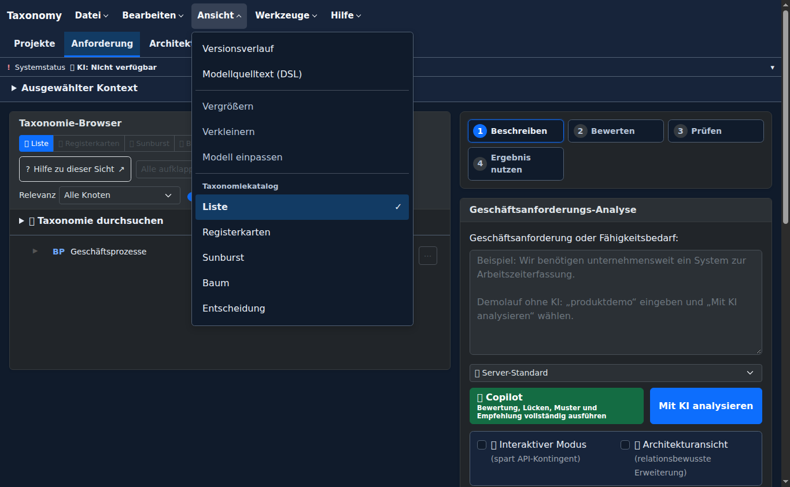

# Workbench command structure — 5 November 2026

## Result

The header now has a conventional command row and separate navigation between work objects.

| Surface | Purpose |
|---|---|
| File / Edit / View / Tools / Help | Commands and architecture views, using one native menu controller and shared styling |
| Projects / Requirement / Architecture | Existing work areas; directly visible on phones as well |
| Contextual toolbar and requirement actions | Operations on the displayed requirement or architecture |
| System status and inline analysis status | Visible readiness/warnings and recovery without opening a command menu |

Version history and model source are under View. Graph Explorer, integrations,
appearance, language and authorized administration are under Tools. The
requirement detail page highlights Requirement and keeps Matrices with its own
actions instead of allocating another toolbar/title row.

Menu adapters invoke the existing feature controls and observe their disabled,
hidden and pressed state. Business operations, permission checks, source scope
and draft decisions remain owned by those features. Switching work areas must
respect the architecture editor's leave decision; rejected New Analysis cannot
reset the requirement draft.

## Removed paths

- Retired `mainNavTabs`, its parallel ARIA/keyboard controller, old scroll-tab styles and duplicate page-click dispatch.
- Removed the page-specific theme handler; shared appearance now applies to standalone pages too.
- Moved the old Settings/Status paths to their single intended homes and removed duplicate API bootstrap tags from page templates.
- Deleted the obsolete source-text keyboard test and structural assertions that demanded the old tablist. Retained navigation, role, recovery, context and draft behavior checks in native/browser tests.

## Verification

- Java 25 and the Maven Wrapper compile the application reactor.
- The complete Maven-owned JavaScript contract lane passes 1,936 cases.
- The focused Maven-owned native browser lane passes 92 cases across navigation,
  standalone chrome and database setup. It covers both languages, 320–1366 px,
  command availability and pressed state, keyboard traversal, mobile dialog
  return focus and unavailable local-management routes with retained context.
- 187 targeted Java/Thymeleaf/Selenium cases pass across shared navigation, document/admin
  pages, the actual snapshot export control, architecture source transitions,
  draft protection, mounted portfolio routing and the database assistant with a
  real application server. The final per-owner reports are recorded below.
- Independent review found three reproducible defects: dark selected-work-area
  contrast on standalone pages, lost scope/language on the disabled local-user
  management explanation, and mobile About/database-dialog focus return. All
  were reproduced, corrected and independently rechecked (12 focused native
  cases passed).

Browser fixture responses are controlled test data. They establish UI behavior,
not live authentication, external provider reachability or architecture quality.
The snapshots below use production Thymeleaf, controllers, translations and CSS,
with one fixture taxonomy root and an explicitly unavailable AI provider. The
headless capture environment does not contain all decorative emoji fonts.

## Inspected captures

Desktop command row, work navigation and closed system/context detail:

Mobile work areas remain directly accessible while commands are collapsed:

The same command categories and authorized Tools entries on a phone:

View commands and the active catalogue view in dark appearance:

## Final Java test owners

| Test owner | Passing cases |
|---|---:|
| DatabaseSetupBrowserTest | 5 |
| TaxonomyResponsiveNavigationContractTest | 1 |
| TaskHierarchyStyleContractTest | 5 |
| SharedApplicationChromeBrowserIT | 53 |
| ArchitectureWorkspaceBrowserIT | 15 |
| PortfolioClientRoutingIT | 73 |
| DocumentTemplateNavigationBrowserIT | 18 |
| AnalysisSessionFrontendContractTest | 10 |
| SharedAdminNavigationBrowserIT | 7 |

The final application confirmation reruns the shared chrome, architecture workspace,
analysis commands and task-style owners after retiring the last old navigation
selectors. All 83 cases in that confirmation pass. The routing, document/admin,
readiness and server-backed database checks use their passing focused run.

## Review and CI follow-up

The shared navigation script now initializes **every** consumer, including portable
exports, browser sessions and all document-template pages. The API client's
existing dynamic bootstrap is the sole loader of account authority and UI
semantics; a second role-surface script tag was removed. The shared native view
matrix asserts that the role surface is loaded exactly once.

The standalone editor's page-specific link rule no longer overrides the header
brand's foreground. Active workspace regions have localized accessible names
linked to their existing navigation controls. Native browser regressions reproduced
both defects before the fixes; all 21 common-chrome native cases now pass.

The document-import button now translates its label without deleting its nested
progress indicator. Removed the JavaScript reconstruction workaround and the
source-text test that required it. The existing real-Thymeleaf view matrix covers
the rendered progress indicator in both languages: the new assertion failed in
both index cases before the markup fix and passed afterwards. The confirmation
run passes 18 native view cases and both remaining document-import CSP contracts.

The CI follow-up also passed 53 shared-chrome, 18 template-navigation and four
portable-export Selenium cases, plus the build-policy reactor. The complete
JavaScript contract lane remains green at 1,936 cases. The real application
passed all 74 primary ADMIN checks, including saving Preferences while a draft
save is pending and reloading Preferences during a pending draft restore.
The 720 × 500 Chromium task flow passed all 26 checks with 200% viewport sizing.
The same 26 checks also passed at 844 × 390 in Chromium; Firefox remains covered
by the integrated CI lane.

The ONNX Selenium helper now reads the shared navigation's `aria-current="page"`
state and uses its existing unobscured-click helper when navigation is necessary.
The full container-owned ONNX lane remains a CI responsibility in this environment.

## Search and navigation lifecycle

Search input now displays mode-specific, localized guidance and examples. Full
text accepts names, descriptions and identifier prefixes; semantic, hybrid and
graph-semantic modes accept natural-language descriptions without a special query
grammar. Guidance follows both mode changes and late translation/readiness updates.
Activating a result, including Previous/Next, selects its code in the existing
Graph Explorer. The architecture diagram keeps its selection, focus, filters and
viewport; search does not switch architecture source or mutate editor drafts.

Real-controller regressions cover overview, focused analysis and filtered context
members. The integrated native lane passes 118 cases across analysis/search UX,
architecture diagram, source lens and shared chrome. The search correction was
independently reviewed and all nine search cases were rerun successfully.

Portfolio job discovery now cancels timers and in-flight requests on selection
start and page departure, rejects late results from prior selections, and resumes
one bounded schedule after bfcache restoration. It forwards cancellation through
the existing portfolio API. No second transport or console-error exclusion was
added. The existing JUnit lifecycle owner passes 14 cases, including request and
JSON-body races, failed refresh and pending-refresh A→B→A. Adjacent continuation
and state-recovery checks pass all 76 cases. Full 1,936-case JavaScript verification
passed before the final selection-start event/listener addition; its focused
lifecycle and adjacent checks passed after that addition. Native WebKit cancellation
is checked by CI.
