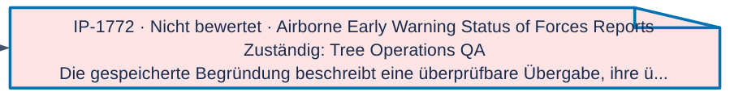
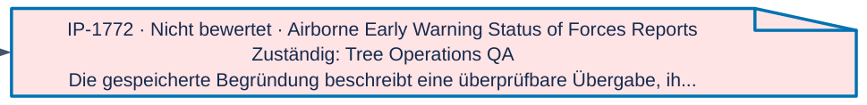

# QA der Ausgabeformate — 19./20. November 2026

## Ergebnis

Die geprüften Ausgabeformate waren nicht durchgängig vollständig und gut lesbar.
Die Prüfung fand sowohl fehlende fachliche Informationen als auch sichtbare
Darstellungsfehler. Dieser Änderungsstand behebt die unten genannten Verluste,
falschen Auswahlgrenzen und kleinen Layoutfehler. Er vereinheitlicht nicht den
fachlichen Umfang aller Formate: Ein Diagramm, ein Bewertungs-CSV und ein
vollständiger Entscheidungsnachweis erfüllen unterschiedliche Aufgaben.

Die Abnahme verbindet konkrete gespeicherte Eingaben mit den Produktionsrenderern,
nativen Lesern, tatsächlichen Browserdownloads und gerenderten Dokumentseiten.
Erfolgreiches Parsen allein gilt nicht als Sichtprüfung. Die verbliebenen Grenzen
stehen ausdrücklich am Ende dieses Berichts.

## Datenbasis und Vergleichbarkeit

- Ausgangscode: `5cf21c7ff8868a95e8864532c1c1ced2edafa665` auf `main`,
  Baum `4b69a32a9639d1ac8100fc92823f93b3e5758fea`.
- Das [Szenarioartefakt aus Lauf 44589312094](https://github.com/carstenartur/Taxonomy/actions/runs/44589312094)
  stammt von einem synthetischen PR-Merge mit demselben Quellbaum. Es enthält
  die gespeicherte Hochwasseranforderung, Entscheidungs- und Architekturdaten,
  Reformulierungsstände sowie ihre tatsächlichen Exportdateien.
- Der [Main-Lauf 44599542343](https://github.com/carstenartur/Taxonomy/actions/runs/44599542343)
  lieferte ergänzende Browser- und Druckbelege. Diese älteren Aufnahmen werden
  nicht als neu erzeugte Dateien dieses Änderungsstands ausgegeben.
- Das Szenario verwendet deterministische Wiedergabe aufgezeichneter
  Anbieterantworten. Die QA löst keine neue kostenpflichtige Analyse aus.
- Zusätzliche konstruierte Fälle prüfen Zuständigkeiten, lange Texte,
  Sonderzeichen, kollidierende IDs, fehlende Werte und ausdrücklich gespeicherte
  Nullwerte. Sie sind keine nachträglich dem historischen Szenario zugeschriebenen
  Daten. Insbesondere enthält dessen Architekturgraph keine zugewiesenen Owner.
- Verglichen werden nur Ausgaben derselben gespeicherten Eingabe. Das frühere
  aktuelle `report.html`/`report.json` und der eingefrorene Architektur-Word-Bericht
  beruhen auf unterschiedlichen Eingaben und eignen sich nicht als Paritätspaar.

Die erneute lokale Abnahme am 20. November verwendet frisch kompilierte Klassen
und die erneut geladenen Originaleingaben. Frühere Testergebnisse wurden nach der
Wiederherstellung des Arbeitsstands nicht als Nachweis für den neuen Baum übernommen.

## Behobene Befunde

| Bereich | Befund | Korrektur und Nachweis |
| --- | --- | --- |
| Portfolio-Auswahl | Ein Anforderungsbericht konnte Kennzahlen aus weiteren Anforderungen desselben Projekts übernehmen. | Die Auswahl wird vor der Aggregation angewendet. Im konstruierten Beispiel bleibt genau eine Analyse/Matrixzeile; der gemeinsame Knoten erhält `0.125` statt des projektweiten Werts `83`, ein fachfremder Knoten entfällt. Der Projektbericht behält beide Anforderungen. |
| Portfolio HTML/Word/CSV | HTML zeigte serialisierte Datensätze statt gut erfassbarer Tabellen; Konflikt- und Herkunftsinformationen fehlten teilweise; fehlende CSV-Werte wurden wie Null behandelt. | Zwei typisierte Tabellen, vollständige Konfliktnachweise und ein zusammenhängender Herkunftsabsatz pro Snapshot. CSV erhält leere Felder und explizite Null getrennt. Der Browserdruck hält normale Tabellenzeilen zusammen, damit ein Knotencode nicht über zwei Seiten zerlegt wird. |
| Architekturberichte | Begründungen, Lückendetails, Zuständigkeiten oder Herkunft waren zwischen Word, HTML und Markdown ungleich vollständig. HTML zeigte kein nutzbares Diagramm mit erreichbaren vollständigen Begründungen. | Gemeinsamer gespeicherter Inhalt, ausdrücklich bezeichnete direkte Bewertung, echte SVG-Abbildung, vollständiges Inventar und funktionierende Verweise auf Knoten- und Beziehungsbegründungen. Breite SVGs bleiben am Bildschirm in natürlicher Größe scrollbar und werden für den Druck eingepasst. |
| Gespeicherte Architektur als JSON | Der Antworttyp transportierte aufgezeichnete Knotenbegründungen und Analysesprache nicht vollständig. | Unveränderliche defensive Kopie der gespeicherten Begründungen und die tatsächlich aufgezeichnete Sprache. Fehlende historische Angaben werden nicht erfunden; der Controller verwendet die autorisierte eingefrorene Analyse. |
| Entscheidungsbericht HTML | Gespeicherte Begründungen waren nicht überall vollständig erreichbar; ausgeschaltete Zuständigkeiten konnten in einzelnen Darstellungen trotzdem erscheinen. | Vollständige Begründungsziele und Verweise; der Zuständigkeitsschalter gilt für Tabellen, Baum, Abbildung und Kapitel, ohne die Quelldaten zu verändern. |
| Entscheidungsbericht auf schmalen Bildschirmen | Zwei breite Tabellen dehnten den deutschen STANDARD-Bericht bei 390 px Bildschirmbreite auf 558 px aus. | Benannte, per Tastatur erreichbare Scrollbereiche erhalten lesbare Spalten und begrenzen die Seite auf 390 px. Desktopbild und alle zehn gerenderten Druckseiten des geprüften Falls bleiben identisch. |
| Entscheidungsbericht Herkunft | Quellgraph und ausgewählter Berichtsgraph konnten unter einer unklaren Hash-Beschriftung erscheinen. | Der Umfang nennt den vollständigen Quellgraph; die Herkunft bezeichnet den Fingerabdruck des tatsächlich dargestellten Architekturgraphs. Beide Werte bleiben erhalten. |
| Vollständigkeitsanzeige | Ein Prozentwert war ohne klare Bezugsmenge leicht als Aussage über den gesamten Katalog misszuverstehen. | Die Entscheidungsevidenz benennt ausdrücklich die erwarteten bewerteten Knoten des ausgewählten Entscheidungsbaums. Die Vollständigkeit von Architekturmustern behält eine davon unabhängige Beschriftung. Aufgezeichnete Werte und der Status `PARTIAL` bleiben unverändert. |
| Reformulierungsberichte | Ermittlungskontext, Quellstellen und Herkunft erschienen als schwer lesbares Roh-JSON oder gingen in der menschenlesbaren Darstellung verloren. | Lesbare Felder für Quelle, UUID, Klassifikation, Status, Konfidenz, Reviewflag, alternative Sprache, Beiträge und unbekannte verschachtelte Felder. Explizite Null und `false`, wörtlicher Alttext sowie Text/UTF-16-Positionen einer Quellstelle bleiben erhalten. Fehlender Kontext erhält eine lokalisierte Kennzeichnung. |
| Mermaid | Kollidierende oder reservierte IDs konnten Knoten und Kanten beschädigen; der Teilstatus war im Diagramm nicht zuverlässig sichtbar. | Eindeutige parserfeste Aliase einschließlich reservierter Linkziele, Layer und Suffixkollisionen; originale IDs bleiben in den Beschriftungen. Der Titel einschließlich `PARTIAL / TEILERGEBNIS` ist sichtbar. Die Titelgruppe übernimmt ausdrücklich die Diagrammrichtung. |
| Structurizr | Der Workspace-Titel konnte beim nativen Import abweichen oder mit Anführungszeichen/abschließendem Backslash ungültig werden. | Native Workspace-Namenssyntax und passende Literalbehandlung. Titel sowie 50 Knoten und 36 gerichtete typisierte Beziehungen werden tatsächlich wieder eingelesen. |
| Exporttransport | Gespeicherter Anbieter und Inhaltssprache konnten durch aktuelle Oberflächeneinstellungen ersetzt werden. | Score-JSON verwendet den aufgezeichneten Anbieter; Mermaid erhält die Inhaltssprache über den tatsächlichen Browser-/Controllerpfad. Importierte fehlende Herkunft bleibt fehlend. |
| Visio Screen | Eingeschaltete Zuständigkeiten waren in nativen Karten nicht durchgängig sichtbar. | Gemessener Textplatz und native Innenabstände. Alle 244 geprüften Titel und Zuständigkeiten sind sichtbar; die Variante ohne Zuständigkeiten bleibt unverändert. |
| Visio Wanddiagramm | Die umgeklappte Ecke von Informationsproduktkarten überlagerte lange Beschriftungen. | Begrenzte Kartenbreite und zur nativen Faltung passende Textreserve. Alle 56 geprüften IP-Beschriftungen passen ohne Faltüberdeckung. |
| Benutzerhandbücher | Hinweise vermischten Modell- und Ausschnittsexport, Exportvoraussetzungen und die Bedeutung von CSV-Feldern. | Beide Sprachen unterscheiden vollständiges ausgewähltes Modell, Ausschnitt und Druck. Gespeicherte Nullwerte ermöglichen die bewertungsabhängige Gruppe; installierte Fähigkeiten und die jeweils nötigen Daten bestimmen die einzelnen Formate. |

### Sichtbarer Visio-Vergleich

Beide Bilder zeigen dieselbe konstruierte Karte, dieselben Eingabedaten und
denselben nativen Renderer. Vorher schneidet die Faltkante das Wort „Reports“;
nachher endet die vollständige Überschrift vor der Faltung. Der kurze
Begründungsauszug bleibt als solcher gekürzt; vollständige Begründungen stehen
in den zugehörigen Nachweisen.

### Warum die zusätzliche Mermaid-Sichtprüfung nötig war

Der Parser bestätigte bereits die vollständigen 50 Knoten und 36 gerichteten
Beziehungen. Erst die tatsächliche Browserdarstellung zeigte, dass eine äußere
Titelgruppe ohne Richtungsangabe die Anordnung stark verändert: Bei derselben
Ansichtsbreite schrumpfte das Diagramm auf eine kaum lesbare flache Zeile.

| Szenario im selben Browser | SVG-ViewBox | Darstellung bei 1326 px Breite |
| --- | --- | --- |
| Ausgangsdatei ohne sichtbaren Gesamttitel | ca. 1586 × 5096 | 1326 × 4262 px |
| Zwischenstand mit impliziter Titelgruppenrichtung | ca. 10749 × 1072 | 1326 × 133 px |
| Titelgruppe mit ausdrücklicher `LR`-Richtung | ca. 1836 × 4945 | ca. 1326 × 3573 px |

Die Korrektur erhält die vorhandene `flowchart`-Syntax und die sichtbare
Teilstatuskennzeichnung. Sie verhindert die unbeabsichtigte Richtungsänderung;
sie ist keine allgemeine Optimierung der Kantenführung großer Graphen.

## Formatbezogene Abnahme und Grenzen

| Ausgabe | Geprüfter Inhalt und tatsächlicher Verbraucher | Aussagegrenze |
| --- | --- | --- |
| Entscheidungsbericht Word/HTML/JSON | Abgleich mit 298 gespeicherten Begründungseinträgen; alle 298 exakten Texte und HTML-Ziele in den frisch erzeugten Profilen erhalten. Kompaktes Word ebenfalls mit 298 Originalabsätzen und 298 eindeutigen Begründungsmarken. Tatsächliche Word-PDF-Seiten und Browsernavigation geprüft. | `COMPACT` und `FULL` haben unterschiedliche Kapitelumfänge. 43 kompakte gegenüber 176 vollständigen Word-Seiten betreffen zudem verschiedene Vorlagenpfade; daraus folgt keine vollständige Inhaltsgleichheit. Chromium druckt den kompakten HTML-Bericht auf 78 Seiten: verschiedene Medien erzeugen verschiedene Umbrüche. |
| Architektur Word/HTML/Markdown/JSON | Gespeicherte Gründe, Lücken, Zuständigkeiten und Herkunft; HTML-SVG mit vollständigem Inventar und Begründungslinks. Der ursprüngliche eingefrorene Word-Bericht hat 58 Seiten. | Ein Diagrammausschnitt ersetzt nicht den vollständigen textuellen Nachweis. Alte aktuelle Analysen und gespeicherte Snapshots dürfen nicht als identische Eingabe verglichen werden. |
| Reformulierung Word/HTML/Markdown | Archivierte Revision und Übernahme, lesbarer Entstehungskontext, Originalquellen und Quellenpositionen. Frisch gerenderte Word-Berichte haben jeweils 18 Seiten. Alle vier gespeicherten Knotenidentitäten samt Quelle, Status und Klassifikation sind in den drei Lesefassungen unabhängig vom Rohdatenarchiv erhalten. | Der Chromium-Druck umfasst 70 Seiten für die Revision und 111 für die Übernahme; das vollständige JSON-Archiv beginnt jeweils auf Seite 31. Vollständige Metadaten und Rohdaten machen den Bericht umfangreich. Gespeicherte Texte behalten ihre Originalsprache. |
| Portfolio Word/HTML/CSV | Projekt und einzelne Anforderung, jeweils zwei echte HTML-Tabellen; Word zwei bzw. eine Seite im konstruierten Beispiel. Auswahl vor Aggregation, vollständige Konflikt-/Snapshotangaben sowie leere CSV-Zelle gegenüber Null geprüft. | Einzelne Portfolioüberschriften sind weiterhin englisch. Ein kleiner Prüfdatensatz belegt keine uneingeschränkte Lesbarkeit beliebig großer Portfolios. |
| SVG und Vektor-PDF | Szenario-SVG mit 50 Knoten/Labels; ursprüngliches Gesamtmodell 10080 × 7154. Gesamtmodell-PDF mit großer erster Zeichnungsseite und Inventar, insgesamt 59 Seiten. Das separat gespeicherte aktuelle Architektur-HTML hat eine 3600 × 2610 SVG und druckt diese vollständig auf Seite 27 von 27; am Bildschirm ist sie intern scrollbar. | Auf A4 eingepasste große Graphen können vollständig und trotzdem zu klein sein. Die normale Berichtsschrift und das Detailinventar müssen die Detaillektüre ermöglichen; eine eingepasste Übersicht erfüllt diesen Zweck nicht. |
| PNG | Tatsächliche Downloads über den ausgelieferten Click-Handler und Rasterizer in Chromium: 912 × 560, 1824 × 1120, 3648 × 2240. Beide Markierungen und der vollständige Text des außerhalb des Bildausschnitts liegenden Knotens bleiben in 1×/2×/4× erhalten. | Konstruierter HTTP-Fall mit 912 × 560 SVG, keine Aussage über Speicherverbrauch oder Lesbarkeit eines riesigen Szenariographs bei 4×. Der Server liefert kontrollierte vollständige SVG-Daten; die native Browserrasterung ist echt. |
| Visio/VSDX und daraus gerendertes PDF | Sechs neu erzeugte Varianten, OPC-/Schema-/POI-Prüfung und native Seiten; tatsächliche Originalpakete mit 55 Snapshot- und 43 Arbeitsansichtsseiten geöffnet. Screen: 244/244 Titel und Zuständigkeiten, 889 Textzeilen mit mindestens 2,80 pt Randabstand. A1/A0: alle 56 IP-Titel ohne Faltüberdeckung. | Microsoft Visio Desktop mit Öffnen/Bearbeiten/Speichern wurde nicht geprüft. Dichte A1-IP-Texte erreichen nur 7,09 pt, A0 10,01 pt. |
| Mermaid Flowchart | Native Parser- und Renderprüfung des 50/36-Szenarios; 16 reservierte Token mit konkurrierendem Suffix, originale Beschriftungen, getrennte Knoten und richtige Pfeilrichtung; zusätzlich kollidierende Interpunktions-IDs. | Eine Zweckprojektion, kein vollständiger Entscheidungsnachweis. Große Diagramme bleiben dicht. Baumexporte haben einen eigenen Auswahlvertrag. |
| Structurizr DSL | Nativer Parser, exakter Workspace-Titel einschließlich Anführungszeichen, abschließendem Backslash und Teilstatus; 50 Knoten und 36 gerichtete Beziehungen. | Kein Ersatz für vollständige Bewertungs- und Entscheidungsdaten. |
| ArchiMate / Sparx | Abgleich von 50 Knoten und 36 gerichteten typisierten Beziehungen durch die vorhandenen Leser; Schema-/Paketprüfung der vorgesehenen Teilmenge. | Zuständigkeitszuweisungen werden in diesen Projektionen nicht vollständig erhalten und bislang nicht vollständig als Verlust ausgewiesen. Keine allgemeine Zertifizierung mit Archi oder Sparx Enterprise Architect. |
| ReqIF | Drei Artefakte, eine Relation und zwei Platzierungen des vorhandenen Szenarioaustauschs geprüft. | Kein Architektur- oder Entscheidungsbericht; die Aussage gilt für den implementierten Anforderungsumfang. |
| Score-CSV / gespeichertes Analyse-JSON | Aufgezeichnete Null und fehlende Werte getrennt, Umfang/Modus sowie gespeicherter Anbieter und Sprache geprüft. | CSV-`Score` bezeichnet effektive Relevanz. `Reason` ist eine Bewertungsdiagnose; vollständige aufgezeichnete Begründung und Verlauf gehören zum gespeicherten Analyse-JSON. Ein historischer Nullwert allein beweist keine erfolgreiche Bewertung. |
| Browserdruck / Diagrammdruck | Vorhandene native Druckbelege mit Tabellenkopf-Wiederholung und vollständigen langen Anforderungen; frische HTML-Berichte zusätzlich mit Chromium gedruckt. | Ganzer Seitendruck, gezielter Diagrammdruck und heruntergeladenes Gesamtmodell-PDF haben unterschiedliche Umfänge und Seitenlayouts. Ein allgemeines HTML-Tabellenfixture ist kein Beleg für den Portfolio-Exporter. |

## Ausgeführte Regressionen

Der normale Maven-Reaktor wurde mit JDK 25 und deaktiviertem Buildcache geprüft.
Die zusammenhängende ausgewählte Abnahme bestand aus 480 Testausführungen ohne
Fehler oder übersprungene Fälle: 70 JavaScript-Verträge, 165 Export-, fünf
Mermaid-Plugin-, 88 Reporting-, 18 Portfolio- und 134 Anwendungstests. Die
zusätzliche Titelgruppenrichtung wurde anschließend über zwei gezielt rote
Assertions und danach 64 grüne Mermaid-/Structurizr-Tests sowie die native
Browserdarstellung abgesichert.

Nach den abschließenden Darstellungsänderungen bestanden weitere 31 ausgewählte
Reporting-, Plugin-, Controller- und Dokumentationsprüfungen sowie elf
Portfolio-Berichts-/Prozenttests. Diese gezielten Nachläufe überschneiden sich
mit der ursprünglichen 480er-Auswahl; die Zahlen sind keine Anzahl zusätzlicher
unterschiedlicher Tests. Die mobilen Tabellen und der Portfolio-Seitenumbruch
wurden zusätzlich anhand der frisch erzeugten tatsächlichen Browserausgabe geprüft.

Der anschließende vollständige PR-Lauf fand eine gemeinsam verwendete Beschriftung:
Die präzisierte Entscheidungsknoten-Beschriftung war auch in der nativen
Architektur-Mustertabelle erschienen. Die beiden bestehenden Prozenttests wurden
lokal unverändert als fehlschlagend reproduziert. Nach Trennung der fachlichen
Beschriftungen bestanden alle 210 Tests des Reporting-Moduls einschließlich
nativer Visio-Prüfungen ohne Fehler oder Skips. Zusätzliche Deutsch-/Englisch-Fälle
prüfen tatsächliche HTML-/Word-Ausgaben; die gerenderten Mustertabellen zeigen
die passende Überschrift sowie korrekt begrenzte 100-%- und 0-%-Werte.

Die Regressionen liegen in den bestehenden Eigentümern, unter anderem
`MermaidExportServiceTest`, `StructurizrInteroperabilityTest`,
`CurrentDiagramMermaidControllerTest`, `SavedAnalysisReportControllerTest`,
`PortfolioReportReadingTest`, `ArchitectureReportSafetyAndParityTest`,
`DecisionReportReviewRegressionTest`, `ReformulationReportDocxReviewTest`,
`VisioDecisionDrawingContentTest` und `VisioDrawingPdfTest`.
Die bestehenden Modul-, Architektur-, Erweiterungs- und Dokumentationsverträge
bleiben aktiv. Es wurden keine Gates abgeschwächt und kein zusätzlicher
Sonderworkflow für diese QA eingeführt.

Native Dokumentprüfung verwendet LibreOffice/Poppler und die vorhandene
Dokumentrenderstrecke. Visio-Prüfungen nutzen einen isolierten konsistenten
DejaVu-Fontbestand. Browserbelege wurden mit Chromium 158.0.8127.18 erzeugt.
Die Java-Fixturen lesen die frisch von Maven erzeugten Klassenpfade; alte
kompilierte Überlagerungen dienen ausschließlich einem ausdrücklich bezeichneten
Vorhervergleich, nicht der Bestätigung des aktuellen Quellstands.

Diese fokussierte lokale Abnahme ersetzt nicht die vollständigen aktuellen
PR-Prüfungen für Datenbanken, Anwendungssuiten, Browser, Szenario, Coverage,
Transportverträge und Sicherheit. Deren verbindliches Ergebnis gehört zum
tatsächlich veröffentlichten PR-Head und anschließend zum Merge auf `main`.

## Verbleibende Befunde

| Priorität | Befund und Bedeutung |
| --- | --- |
| Mittel | Bestehende Architekturverbindungen schneiden fremde undurchsichtige Karten. Im nachgemessenen Überblick betrifft das 17 von 36 Routen; 52 Kartenüberschneidungen und 156 paarweise Kantenkreuzungen bleiben. Auch acht Detailrouten sind betroffen. Eine allgemeine Routingüberarbeitung liegt außerhalb dieser gezielten Korrekturen. |
| Mittel | Vollständige Wanddiagramme auf A1 sind nicht durchgängig bequem zu lesen. Die gemessenen 7,09 pt für dichte IP-Texte erfordern Vergrößerung, A0 oder Detailseiten. |
| Mittel | Ein PDF ohne Begründungsanhang enthält nicht den vollständigen aufgezeichneten Begründungs- und Quelltext. VSDX kann diese Angaben zusätzlich in Shape Data tragen; im PDF ist dieser interaktive Datenbestand nicht verfügbar. |
| Niedrig | Die A1-Variante mit Anhang zeigt zwei lange BP-1670-Detailtitel abgekürzt: 289 von 291 Titelvorkommen vollständig. Überblick und Shape Data erhalten den vollen Text; die anderen fünf geprüften Varianten enthalten alle vollständigen Titel. |
| Mittel | ArchiMate-/Sparx-Projektionen bilden Zuständigkeiten und deren Verlustmeldung noch nicht vollständig ab. Das Mapping muss vor einer entsprechenden Vollständigkeitszusage erweitert werden. |
| Niedrig | Lange Entscheidungs- und Reformulierungsberichte bleiben dicht; beim HTML-Druck vergrößern vollständige Rohdatenanhänge den Umfang erheblich. Die Korrekturen verbessern Bezeichnungen, Struktur und Nachvollziehbarkeit, schaffen aber keine fachlich verkürzte Managementfassung. |
| Grenze | DOT-/Mermaid-Baumexporte lassen bestimmte Nullbewertungen gemäß ihrem Hierarchievertrag weg. Vollständige aufgezeichnete Bewertungen sind im gespeicherten Analyse-JSON zu prüfen. |
| Ungeprüft | Öffnen, Bearbeiten, Speichern und erneutes Öffnen in Microsoft Word, Microsoft Visio und Sparx Enterprise Architect Desktop; beliebig große PNGs in allen Auflösungsstufen. Native LibreOffice-/Parserprüfung ersetzt diese Produktabnahmen nicht. |

## Ablage der Belege

Vollständige generierte Dokumente, native Browserbilder, JSON-Messungen und Logs
liegen während der Abnahme unter `target/output-format-qa/` bzw. in den verlinkten
CI-Artefakten. Im Repository bleiben die Regressionstests, dieser zusammengefasste
Bericht und die beiden tatsächlichen Visio-Vergleichsausschnitte. Die
[Umsetzungsplanung](../superpowers/plans/2026-11-19-output-format-qa.md) beschreibt
die Grenze der gezielten Reparaturen.
