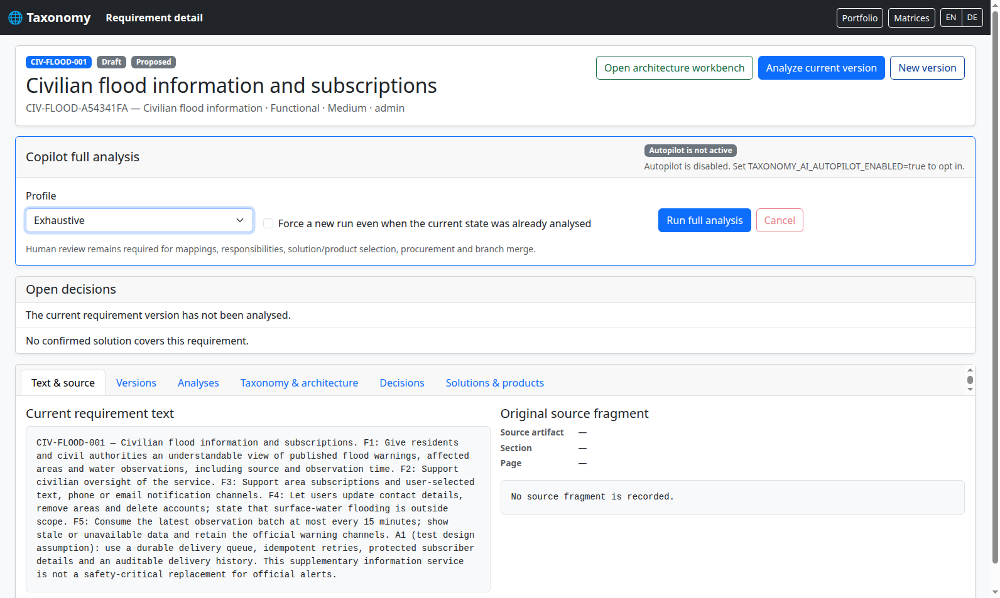
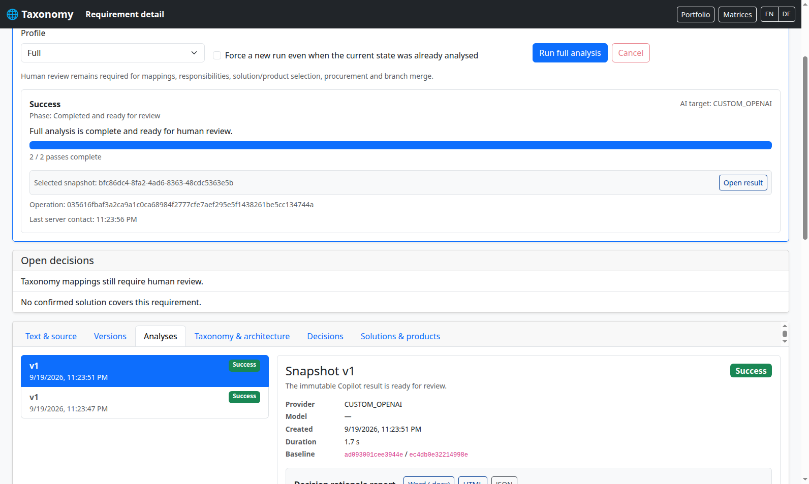
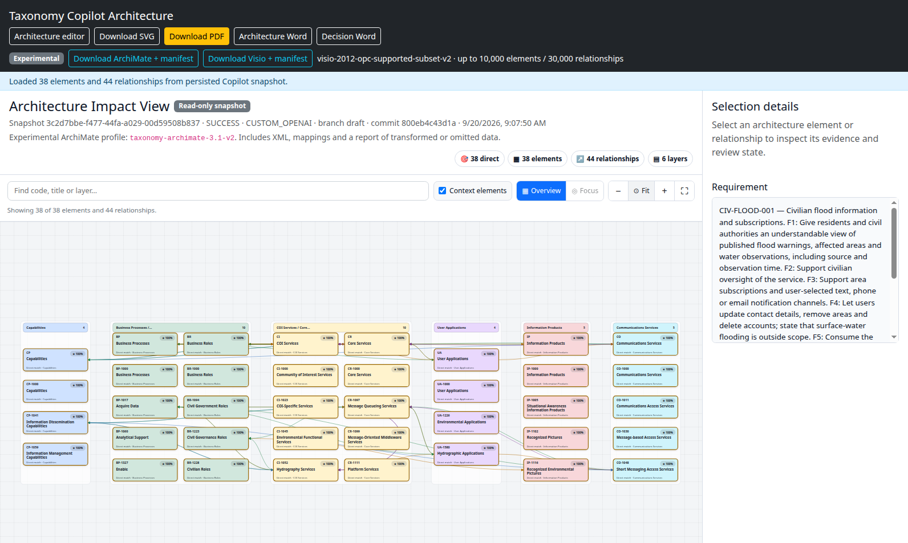
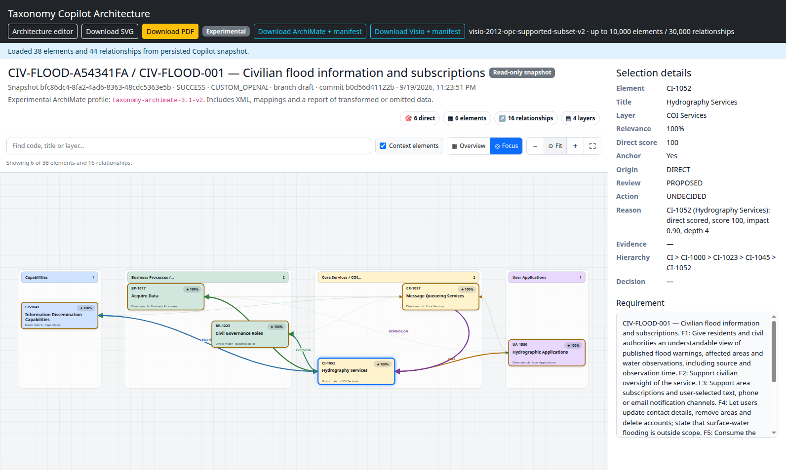
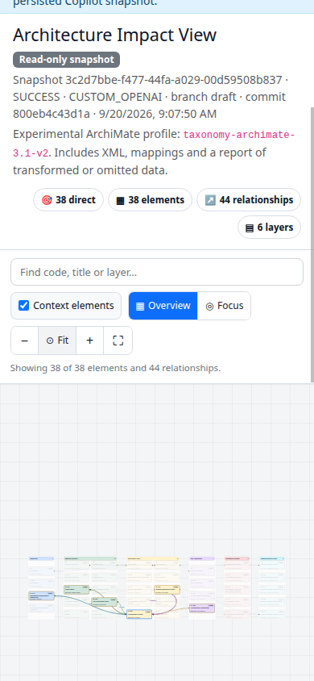

# Historische Bildschirmillustrationen

## Herkunft der früheren Szenariobilder

Die folgenden PNGs werden als ältere Illustrationen aufbewahrt. Ihre genaue
Zuordnung zu einem Quellstand oder Testlauf ist derzeit **nicht verifiziert**.
Beim Abgleich am 18. Oktober 2026 stimmen alle fünf Dateien nicht mit den
SHA-256-Werten des [früheren Laufmanifests](civilian-acceptance-evidence.json) überein.
Dieses Manifest beschreibt einen früheren CI-Artefaktbestand; es ist kein Nachweis
für die heute eingecheckten Bilddateien.

Auch die sichtbare Snapshot-Kennung widerspricht der früheren Zuordnung:
`75-civilian-architecture.png` zeigt `3c2d7bbe-f477-44fa-a029-00d59508b837`,
während das Manifest `bfc86dc4-8fa2-4ad6-8363-48cdc5363e5b` nennt. Deshalb werden
diese Bilder weder diesem Lauf noch einer gemeinsamen Browsersitzung zugeschrieben.
Das Manifest bleibt als historische Quelle unverändert; neue Bild-Hashes würden
seine fehlende Zuordnung nicht reparieren.

Die Bilder zeigen frühere Beispielzustände, keine aktuellen Bedienelemente,
aktuelle Abnahme oder gemessene Qualität einer heutigen Modellanalyse.
Der aktuelle Ablauf und seine Nachweise stehen in der
[Szenario-Abnahme](../testing/scenario-acceptance.md).

### Frühere Anforderungsansicht

### Frühere Ergebnisansicht

### Frühere Architekturansicht

### Frühere Fokusansicht

### Frühere mobile Ansicht

## Weitere veraltete Bedienungsabbildungen

Die aktuellen Benutzer- und Copilot-Leitfäden verwenden die folgenden Bilder nicht
mehr als aktuelle Navigations- oder Exportanleitung. Die Dateien bleiben erhalten,
damit historische Referenzen nicht stillschweigend auf andere Bildinhalte zeigen.

| Dateien | Sichtbare Abweichung zur heutigen Oberfläche |
|---|---|
| `01-full-page-layout.png`, `03-right-panel-default.png` | Frühere Navigation und dauerhaft sichtbare Status-/Kontextleisten statt der heutigen Menüs und Statusdetails auf Abruf. |
| `14-navbar-admin-lock.png` | Früherer Admin-Lock statt des heutigen Einstellungsmenüs. |
| `41-versions-tab-history.png`, `45-workspace-user-badge.png` | Frühere Einbettung der Versions-/Workspace-Bedienelemente. |
| `43-git-status-bar.png` | Früherer Seitenkopf mit injiziertem Beispiel-Commit; kein Nachweis eines echten Repositoryzustands. |
| `71-copilot-architecture-workbench.png` | Direkte SVG-/PDF-Buttons statt heutiger Druckansicht und gruppiertem Exportmenü. |
| `72-complete-copilot-run-result.png` | Getrennte Berichtsbuttons statt des gemeinsamen Entscheidungsbericht-Dialogs. |

Aktuelle Aufnahmen entstehen durch die jeweiligen vorhandenen Testbesitzer.
[Voraussetzungen, Befehle und Herkunftsregeln](../../.github/copilot-ref-screenshots.md)
trennen Vollanwendungsaufnahmen, lokale Szenarien und Komponentenillustrationen.
